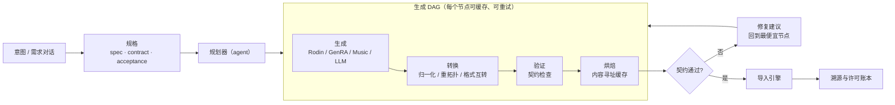

# 生成式资产管线：把生成器接成一台内容编译器

> 一份实现设计文档 · 基线日期 2026-11-18
> 工作区：`meter` · 状态：设计提案，无实现代码
> 前置阅读：[`docs/ai-native-game-engine.md`](ai-native-game-engine.md)（下称"主文档"）、[`docs/embedded-game-agent.md`](embedded-game-agent.md)（下称"agent 文档"）

---

## 0. 结论

你列的三个接入点，方向都对，但**三个名字的当前形态都和"接进来就能用"有距离**。先说校准结果，再说架构。

### 0.1 三句话校准（每条都有证据，见 §2）

1. **Rodin 已经能直接输出绑定好的资产了**（2026-10 的 Rigging API，人形/四足/鸟/龙/怪兽模板，可导出 UE5 / Unity / ActorCore 骨架）。所以 **Auto-Rig Pro 可能不是必需的一环**——但 Rodin 的绑定**不接受导入模型**，你自己的角色仍然要 ARP 或手工。两条路的选择，取决于"角色是生成的还是设计的"。
2. **GenRA 不是产品，是 MacPaw 的一个研究框架**（ECCV 2026 Workshop）。它要求输入是**已绑定的 USD（含且仅含一个 `UsdSkel.Skeleton`）**，输出**只有 USD**，**不做重定向**（直接在目标骨架上生成），**没有 loop 保证**，也**没有 FBX/BVH/glTF 导出器**。接入它，真正的成本不在模型，在**格式往返**。
3. **MiniMax Music 2.6 是音乐模型，不是音效模型。** 它出的是"最多 5 分钟、固定立体声、单条混音"的歌曲或器乐；**没有音效端点、没有 loop 参数、没有分轨、没有 BPM 结构化参数**；而且 2026-08-20 起，付费音乐 API **不再向新用户开放**。用它做游戏音效是范畴错误，做 BGM 则要自己补 loop 与响度。

### 0.2 主张

> **AI 时代的引擎，不是"内置生成器"，而是"内容编译器"。**
> 生成器（Rodin / ARP / GenRA / MiniMax / LLM）是可替换的后端；引擎的资产是**契约、验证、缓存、溯源**这四样东西。生成器明年就会换，契约不会。

由此推出本文的核心结构：**每个资产类 = 一份契约 + 一个生成 DAG + 一组验证器 + 一个缓存键 + 一条账本记录**。四个资产类（模型、动画、音频、代码）共用这套骨架，只是验证器完全不同。

### 0.3 三个判据

一条生成链路值不值得接，看三条：

1. **契约可校验**：产出能不能在**不打开 DCC** 的情况下被机器判定"能进引擎"。
2. **失败可回退**：失败时能不能回到**最便宜的那个节点**重试，而不是从头再来。
3. **产物可溯源**：每个文件能不能回答"哪个模型、哪个版本、什么参数、谁改过、许可是什么"。

三条里缺任何一条，这条链路就还停留在"演示"，不是"管线"。

---

## 1. 先纠正三个范畴问题

### 1.1 不是"一条管线"，是四类资产、四套契约

| 资产类 | 契约的核心 | 验证器查什么 | 失败最贵的地方 |
|---|---|---|---|
| **静态模型** | 面数、流形、UV、PBR 通道、单位、朝向、pivot | 网格拓扑、材质槽、尺度 | 绑定之后才发现拓扑不可绑 |
| **骨骼动画** | 骨架标准、rest pose、fps、loop、root motion、事件 | 骨骼匹配、循环闭合、脚滑、帧率 | 动画做完才发现骨架要改 |
| **音频** | 时长、响度、峰值、循环点、声道、采样率 | LUFS、真峰值、loop 接缝 | 上线后才发现循环有爆音 |
| **代码** | 协议、状态机、数据模型、验收标准 | 编译、单测、双端联调、回放 | 联调时才发现两端字段不一致 |

这四类的**生成器不能互换**，验证器不能复用，缓存键的含义也不同。把它们混成"AI 管线"这一个词，是后面所有工程混乱的来源。

### 1.2 生成器不是管线，缺的是"接缝"

Rodin 生成网格、ARP 绑定、GenRA 生成动画——这三件事单独看都成立。但**把它们按顺序连起来**，中间有三道接缝，每一道都有自己的格式、坐标系与前置条件：

```
Rodin（glb/fbx, 任意姿态, 20k–1M 面）
   │  接缝 1：姿态 / 面数 / 单位 / 原点 / 朝向
   ▼
归一化（重拓扑 / 减面 / T-pose / 标定）      ← 这一步没人愿意做，但它决定管线成不成立
   │  接缝 2：ARP 要 T/A-pose、≤8 万面、面向 -Y、单位 1.0
   ▼
ARP（Blender 插件，FBX/glTF 导出）
   │  接缝 3：GenRA 要 USD + UsdSkel，且不重定向
   ▼
GenRA（USD 进，USD 出，无 FBX/BVH/glTF 导出）
   │  接缝 4：引擎要 glTF/FBX，且要 root motion / loop / 事件
   ▼
引擎导入
```

**四道接缝，至少两道要写转换器（ARP→USD、USD→glTF），另外两道要做结构改造（姿态/面数/单位），每一步都需要人工兜底。** 这条链的真实工作量分布是：模型生成 10%、接缝与归一化 60%、验证 20%、导入 10%。任何"接三个 API 就完事"的预期都会在这里翻车。

### 1.3 "对话生成代码"的瓶颈不在生成

大模型能写出可玩骨架，这已被反复验证；它**不能**稳定做到的是：跨文件一致、运行时验证、跨变更保持功能（主文档 §2.4 已列证据：GameXpert-Bench、OpenGame 的失败模式）。

所以"通过对话理清需求"这件事的价值，不在于让模型更懂你，而在于**把对话的产物固化成机器可校验的规格**。对话本身不是产物，规格才是。§6 给出四件套。

---

## 2. 事实基线（2026-11-18）

这一节只放结论与出处。**所有"能力宣称"与"工程可用性"分开标注**——这是主文档附录 B 的纪律。

### 2.1 Rodin（Hyper3D / Deemos）

| 项 | 事实 | 等级 |
|---|---|---|
| 版本 | **Gen-2.5**，2026-05 发布（精确日期 5/19 见 CGWorld 引述，官方 changelog 只到"5 月"）；2026-09 另有 Agent-Ready 变体 | 二手（日期）/ 一手（版本） |
| 输入 | 文生 3D / 图生 3D（1–5 图，可选多视图） | 一手 |
| 耗时 | 标称 4 / 9 / 20 / 40 / 80 秒（按 Thinking Effort）；Agentic 档 3 / 5 / 10 分钟 | 二手（秒级档）/ 一手（Agentic） |
| 输出 | `glb` / `usdz` / `fbx` / `obj` / `stl`；PBR（base color / metallic / normal / roughness）；默认 Raw 三角，可选 **Quad**（约 4k–50k 面，上限 200k）；Raw 约 20k–1M 面，`quality_override` 最高 2M；官方称带 "ready-to-use UVs" | 一手（格式/面数）/ 二手（UV 质量） |
| API | REST，异步（提交 → `/status` → `/download`），Bearer，credits 计费，有并发上限 | 一手 |
| Blender 插件 | 有（RodinBridge），**依赖网页界面**，不是离线/无头工具 | 一手 |
| **绑定** | **2026-10 起有 Rigging API**：human / quadruped / bird / dragon / kaiju / custom 模板，可导出 **UE5 / Unity / ActorCore** 骨架；需付费档（Creator 起）；**不支持导入模型**，也不支持 Generate Texture 产物 | 一手 |
| 许可 | Free $0：10 个私有资产；$1.50/credit；Creator 起"无限导出与任意使用"；ToS 有 "will not limit your use" | 二手（页面 JS 渲染）+ 未核实（输出归属明条） |

**对你的方案的含义**：Rodin 的 Rigging API 是"捷径"——如果你能接受它的骨架模板与"只绑生成资产"的限制，**整条 ARP 环节可以删掉**。但对"设计出来的角色"（不是生成的），这条路走不通。

### 2.2 Auto-Rig Pro（Blender 插件）

| 项 | 事实 | 等级 |
|---|---|---|
| 版本/价格 | 作者 Artell（Lucas Veber EURL）；Full $50 / Lite $25；支持 Blender 2.93–5.2；当前 **3.79.20（2026-11-15）** | 一手 |
| 自动绑定 | 人形 **Smart**（需 T-pose 或 A-pose）；四足 **Multi-Ped** + Dog/Horse/Bird 预设；自定义用 Empty + Add Limbs；Mirror 默认开 | 一手 |
| 重定向/导出 | **Remap**（Mixamo/Rokoko/XSens 预设）；导出 FBX/GLTF，预设含 **Unity / Unreal / Godot** | 一手 |
| **无头** | **导出：官方支持**（文档给了 `bpy.ops.arp.arp_export_fbx_panel(filepath=...)`）。**重定向/批处理：仅社区**（"hacked the API to enable batch mode"）。**自动绑定：未找到任何官方或社区的无头成功案例** | 一手 / 未找到 |
| 限制 | 官方明说"不是一键"；Smart 仅双足；手指/面部可能失败；**约 8 万面以上**自动权重可能出错；非流形/坏拓扑/自定义法线会失败 | 一手 |
| 许可 | 混合：源自 BPY 的代码 GPLv3；二进制限制性许可（允许内部与商业使用，不可再分发）；用户产出的 rig 归用户 | 一手 |

**含义**：ARP 可以自动化的是**重定向与导出**，不是**自动绑定**。把它放进无人值守的 DAG，你会在"Smart 绑定"这一步卡住——而这一步恰恰是整条链的核心。

### 2.3 GenRA（MacPaw AI & Research）

| 项 | 事实 | 等级 |
|---|---|---|
| 形态 | 论文（ECCV 2026 OpenSUN3D Workshop，2026-09-03）+ 开源框架（Python，2026-08-12 建仓）+ HF 人工评测集；**无托管 API、无 SaaS** | 一手 |
| 输入 | **已绑定的 USD 资产**（必须且仅含一个 `UsdSkel.Skeleton`）+ 自然语言 + 可选 1–3 个同骨架示例动画 + 可选多视角骨骼渲染图 | 一手 |
| 输出 | **只有 USD**（把 `UsdSkel.Animation` 写回副本）；另出 metadata JSON、可选 Blender 预览 MP4。**无 FBX/BVH/glTF 导出器** | 一手 |
| 重定向 | **不做，也不需要**：直接在目标骨架上生成关节关键帧（论文原话 "without auto-rigging or retargeting"） | 一手 |
| 帧率 | 跟随源资产的 `timeCodesPerSecond`，无固定值 | 代码直证（B 级） |
| loop / root motion | **loop：未找到任何约束或参数**（疑不支持）；root motion：根关节作为普通关节参与，可产生位移，但文档从未以 root motion 命名，也无分离/导出选项 | 未核实 |
| 限制 | 仅单骨架；blendshapes 会被主动移除；输出的是"在给定骨架上的动作"，骨架一变全部作废 | 一手 |
| 成本 | 作者自报中位 **120 秒 / $0.09 一条**（用 OpenAI Responses API） | 一手（自报） |
| 许可 | **Apache-2.0 + Commons Clause v1.0**：禁止"把软件功能本身作为收费产品或服务出售"；生成动画的著作权归属**未约定** | 一手 / 未核实 |

**含义**：GenRA 是一个**研究级参考实现**，不是生产线组件。要接它，你必须先回答三个问题：USD 从哪来、动画怎么出、骨架改了怎么办。第三个问题的答案是"全部重来"——所以**骨架标准必须在第一次生成动画之前冻结**（§4.7）。

### 2.4 MiniMax Music 2.6

| 项 | 事实 | 等级 |
|---|---|---|
| 版本 | `music-2.6` **2026-04-10 发布**；现文档称其为"上一代"；最新为 **Music 3.0**（开放权重，发布日两处官方口径不一致：博客 2026-08-13 / 发布日志 2026-07-16） | 一手（2.6）/ 一手但矛盾（3.0 日期） |
| 内容 | 歌曲（含人声）或纯器乐（`is_instrumental`）；另有 Cover 模型（参考音频 6 s–6 min） | 一手 |
| 控制 | `prompt` ≤2000 字符；`lyrics` ≤3500 字符，支持 `[Verse]`/`[Chorus]` 等标签；BPM/调性只能写进 prompt，**无结构化参数** | 一手 |
| 时长 | **5 分钟/首**；**API 无 duration 参数** | 一手 |
| 规格 | 16k/24k/32k/**44.1k** Hz；mp3/wav/pcm；32k–256k bitrate；**固定立体声**（`music_channel: 2`） | 一手 |
| 计费 | **$0.15/首**；RPM 120 | 一手 |
| **可得性** | **2026-08-20 起，付费音乐/歌词 API 不再向新用户开放；免费 `music-2.6-free` 已停止服务** | 一手 |
| 缺失 | **无音效端点、无 loop 参数、无分轨、无 LUFS 目标、无单声道兼容、无变体批量** | 一手（否定） |
| 标识 | 有可选 `aigc_watermark`（默认 false，加在音频末尾）；中文 API 参考有、英文参考未见；用户协议要求显著标识且不得删除平台标识 | 一手（中文）/ 未核实（英文口径） |
| 商用 | 平台协议只规定输出权属归用户、AI 标识义务，**未见"允许/禁止商用"的直接条款** | 部分核实 |

**含义**：Music 2.6 适合做 **BGM / 主题曲 / 梗曲**，不适合做音效；而且它的**可得性正在关闭**，新项目应当直接评估 Music 3.0（开放权重，权重许可未核实）或其它供应商。

### 2.5 音效（SFX）的可核实替代

| 产品 | 时长 | 循环 | 商用 | API | 等级 |
|---|---|---|---|---|---|
| **ElevenLabs Sound Effects**（`eleven_text_to_sound_v3`） | 0.1–30 s | **支持无缝循环**（参数 `looping`） | 付费计划可商用，免费仅非商用 | 有 | 一手 |
| **Stability AI Stable Audio 3.0** | 1–380 s（默认 190 s），44.1 kHz 立体声 | 未找到 | 官方 FAQ："可商用" | 有（异步，8 credits/次） | 一手 |
| **Meta AudioGen**（`facebook/audiogen-medium`） | 文档示例 5 s，未找到硬上限 | 未找到 | **不可商用**（权重 CC-BY-NC 4.0） | 无（自托管） | 一手 |

**这三个才是"音效"该看的东西**：短、可循环、可按次生成、有商用条款。Music 2.6 不在这个类别里。

---

## 3. 参考架构：内容编译器

### 3.1 总览



要点只有三条：

1. **规格在最上游。** 没有规格就没有验收标准，后面的验证器无从判定。
2. **验证在每个节点之后，不在最后。** 生成一个 50 万面的网格再去绑定，等于把最贵的失败放在最后。
3. **失败回到最便宜的节点。** 绑定失败通常不是绑定的问题，是网格的问题；动画不对通常不是动画的问题，是骨架的问题。

### 3.2 五个子系统

| 子系统 | 职责 | 少了它会怎样 |
|---|---|---|
| **Asset Contract Registry** | 定义"什么叫合格资产"：每类资产的字段、阈值、必填项 | 每个生成器的输出都"看起来能用"，进引擎才发现不行 |
| **Generation DAG** | 节点编排、依赖、缓存、重试、预算 | 每次从头跑；成本失控；失败无法定位 |
| **Validators** | 客观检查：网格、骨骼、动画、音频、代码 | 人成为唯一质检，管线不可扩展 |
| **Bake Cache** | 内容寻址：`hash(工具, 版本, 参数, 输入, 种子)` | 无法复现、无法 diff、无法回滚；改一个参数重跑全链 |
| **Provenance & License Ledger** | 每个产物的模型、版本、参数、人工编辑、许可 | 合规风险；出问题无法定位；模型升级无法评估影响 |

### 3.3 缓存键与可复现

```
cache_key = H(
  tool_id,          // "rodin.gen2.5" / "arp.smart" / "genra" / "music.2.6"
  tool_version,     // 必须进 key：模型升级后旧缓存必须失效
  params,           // 规范化后的参数（排序键、统一单位）
  input_hashes[],   // 上游产物的内容哈希
  seed
)
```

三条纪律：

- **工具版本必须进 key。** 否则模型升级后你复用一个"看起来一样"的旧资产，然后在运行时发现风格全变。
- **输入用内容哈希，不用路径。** 路径会变，内容不会。
- **参数先规范化再哈希。** `{"a":1,"b":2}` 与 `{"b":2,"a":1}` 必须是同一个 key。

这与主文档 §5.4 的"种子化生成 = 可复现内容"是同一条原理，只是把"种子"扩展成了"整条 DAG 的指纹"。

### 3.4 重试策略：在最便宜的节点重试

| 失败位置 | 常见真实原因 | 应该回到 | 不应该做 |
|---|---|---|---|
| 绑定失败 | 网格非流形 / 面数过高 / 非 T-pose | 归一化 | 反复重试绑定 |
| 动画不匹配 | 骨架不是生成动画时的那一套 | 冻结骨架（重绑 + 重生成动画） | 重定向修补 |
| 导入报错 | 单位 / 轴向 / 材质槽名 | 导出配置 | 改引擎导入器 |
| 音频爆音 | loop 接缝 / 峰值过载 | 后期处理 | 重新生成整首 |
| 联调失败 | 两端字段不一致 | 协议 | 改一端"迁就"另一端 |

这张表是**成本控制的核心**：每一次"在错误的地方重试"，都在把一次 3 分钟的修复变成一次 30 分钟的重跑。

---

## 4. 美术链：Rodin → 归一化 → 绑定 → 动画 → 导入

### 4.1 八个契约关口

一条角色资产从生成到进引擎，要过八道关。**每一道关都有自己的失败方式，且越往后越贵**：

| # | 关口 | 检查项 | 失败代价 | 谁来定 |
|---|---|---|---|---|
| 1 | **生成** | 主体正确、风格一致、多视图一致 | 低（重生成即可） | 美术 |
| 2 | **网格** | 面数、流形、水密、对称、法线 | 中 | 引擎 |
| 3 | **UV / 材质** | UV 集、接缝、PBR 通道、材质槽命名 | 中 | 引擎 + 美术 |
| 4 | **变换** | 单位、朝向、pivot、缩放 = 1 | 低但**致命**（进引擎后全错） | 引擎 |
| 5 | **骨架** | 标准、层级、命名、rest pose | **高**（改了动画全废） | 引擎 |
| 6 | **蒙皮** | 权重归一、最大影响数、无未分配顶点 | 高 | 引擎 |
| 7 | **动画** | fps、时长、loop、root motion、事件 | 高 | 引擎 + 玩法 |
| 8 | **导入** | LOD、碰撞、材质映射、命名 | 中 | 引擎 |

**关键观察**：第 5 关（骨架）是整条链的**不可逆点**。GenRA 在目标骨架上直接生成动画、不做重定向，所以骨架一旦改动，已生成的全部动画作废。这就是为什么 §4.7 说"骨架必须在动画之前冻结"。

### 4.2 接缝 1：Rodin → 归一化

三处硬错配，都是两端官方文档可以直接对上的：

| 错配 | Rodin 侧 | ARP 侧 | 处理 |
|---|---|---|---|
| **姿态** | `TAPose` 默认 `false`，"pose is reconstructed as-is"（保留输入图姿态） | Smart 要求 T-pose 或 A-pose | 生成时置 `TAPose=true`，否则归一化里摆正 |
| **面数** | Raw 默认约 50 万面（20k–1M，可到 2M） | 官方 FAQ：**约 8 万面以上**自动权重可能出错，面数过多会冻结 | 减面 / 重拓扑到 6 万三角面以内 |
| **变换** | 未找到单位、原点、朝向的保证 | 要求模型在原点、面向 **-Y**、单位 **1.0** | 归一化脚本强制 |

第四处是文档没写、但一定会遇到的问题：**UV 与重拓扑的顺序**。重拓扑会破坏原 UV，所以要么用 Rodin 的 Quad 模式（4k–50k 面，接近可绑定量级）避免重拓扑，要么接受"重拓扑后重展 UV"的额外一步。**先重拓扑再展 UV，顺序反了就是白做。**

### 4.3 接缝 2：ARP → GenRA 的格式鸿沟

这是整条链最脆的一环：

- ARP 导出 **FBX / glTF**；GenRA 只吃 **USD（`UsdSkel.Skeleton`）**。
- ARP 没有 USD 导出文档（未找到）；Blender 有 USD 导出，但它**是否写出 `UsdSkel` 骨架、骨架命名能否原样往返，本文未核实**。
- GenRA **只支持单骨架**，且会**主动移除 blendshape**——面部形态键在这一步丢失。
- GenRA **不做重定向**，意味着"骨架必须原样送到它面前"，任何命名/层级变化都会让生成的动画对不上。

> **这是一个必须先跑尖峰实验的地方**（§10 的 S1）。如果 glTF → USD → GenRA → USD → glTF 的往返丢骨架或改命名，整条链就要重新设计——而这个问题只需一天就能验证，不要等做完再发现。

### 4.4 接缝 3：GenRA → 引擎

- 输出**只有 USD**，没有 FBX/BVH/glTF 导出器（一手）。所以必须自己转：Blender 导入 USD → 导出 glTF/FBX → 引擎。转换中骨架、蒙皮、动画曲线的保真度**未核实**。
- **帧率跟随源资产**，不是固定值。引擎侧要显式检查 `timeCodesPerSecond` 与目标帧率是否一致，否则会出现"动作变快/变慢"。
- **没有 loop 标记**：循环需要后期处理（首尾帧对齐、根关节位移归零、事件标记补齐）。
- **没有 root motion 语义**：根关节只是普通关节。要做 root motion，需要引擎侧从根关节曲线里**分离**位移，而不是指望文件里带标记。

### 4.5 一条捷径：Rodin 自己的 Rigging API

2026-10 起，Rodin 提供 Rigging API：human / quadruped / bird / dragon / kaiju / custom 六类模板，可直接导出 **UE5 / Unity / ActorCore** 骨架（一手）。

| 场景 | 建议 |
|---|---|
| 角色是**生成**的（NPC、杂兵、道具宠） | **优先用 Rodin Rigging**，跳过 ARP。少一道接缝、少一个 Blender 依赖、少一个售价 $50 的工具 |
| 角色是**设计**的（主角、有明确设定的角色） | Rodin 不支持导入模型 → 必须 ARP 或手工绑定 |
| 需要**自研骨架** | 两条路都要再做一次重定向；先在"标准骨架"上生成动画，再 Remap 到自研骨架（ARP Remap 支持预设与任意骨架） |

**这里有一个反直觉的建议**：不要用自研骨架作为"生成动画的源骨架"。用 UE5 或 Unity Humanoid 作为**中间骨架**，让所有生成器面向它，最后再 Remap 到引擎骨架。理由是：中间骨架有生态（Mixamo、GenRA 示例、ARP 预设都认它），而你的自研骨架只有你自己认。**多一次重定向，换整条工具链的兼容性，这笔交易划算。**

### 4.6 归一化：没人愿意做，但它决定管线成不成立

归一化是一组确定性的 Blender 脚本，跑在 `blender --background --python` 里（导入→处理→导出这条路官方支持，无头稳定性官方未承诺）：

| 步骤 | 做什么 | 为什么 |
|---|---|---|
| 清理 | 合并重复顶点、删除孤立面、重算法线 | 非流形是绑定失败的第一原因 |
| 减面 / 重拓扑 | 到 ≤6 万三角面；优先 Quad 输出 | ARP 的 8 万面阈值 |
| 对称化 | 沿 X 轴镜像检查 | 自动绑定依赖对称 |
| 标定 | 原点移到脚底、缩放 1.0、朝向 -Y | ARP 的硬要求 |
| 重展 UV | 仅当发生过重拓扑 | 重拓扑必然破坏原 UV |
| 材质槽 | 重命名为契约里的名字（`body` / `cloth` / `metal`） | 引擎侧按名字映射 |
| 输出检查 | 跑一遍 T0 验证（§7.3） | 不合格不进绑定 |

**这一步的定位要说清楚**：它不是"AI 的失败补丁"，而是**管线的稳定器**。把它自动化，生成器的输出才有资格进入下一步；不自动化，每个资产都要一个 TA 手工收拾，规模一上来就崩。

### 4.7 骨架必须冻结在动画之前

GenRA 不重定向 → 骨架是**不可逆点**。所以决策顺序必须是：

```
引擎动画系统的要求（fps / root motion / 事件 / LOD）
        ↓
选定"中间骨架标准"（建议 UE5 或 Unity Humanoid）
        ↓
绑定（Rodin Rigging / ARP / 手工）
        ↓
生成动画（GenRA / 动捕 / 手工）
        ↓
Remap 到引擎骨架（ARP Remap 或引擎自带重定向）
        ↓
（骨架变更 = 回到第 3 步，全部动画作废）
```

这条顺序看起来是常识，但它在实践里经常被反过来：先做绑定，动画做了一半发现引擎要 30fps、要 root motion、要脚部事件——于是改骨架，全部重来。

### 4.8 进引擎前必须对齐的七件事

| 项 | 事实 | 对策 |
|---|---|---|
| **单位** | glTF 线性距离是**米**；Unreal 默认**厘米**；Blender/ARP 1 米 = 1 网格单位 | 导入配置里显式写缩放，不靠"看起来对" |
| **轴向与手性** | glTF：右手、+Y up、+Z 前、+X 左；Unreal：左手、Z-up、+X 前；ARP 角色要求面向 **-Y** | 转换矩阵写进导入配置，不写在脚本注释里 |
| **rest pose** | Unity Humanoid **要求 T-pose**（否则 Avatar 无效或需 Enforce T-Pose）；Unreal 未找到强制条款；ARP 建议 UE 用 A-pose | 按目标引擎选 T 或 A，写进契约 |
| **骨骼命名** | Unity Humanoid 需映射到 Avatar 预定义结构；Unreal 未找到强制命名 | 用中间骨架的命名，Remap 时映射，不要手改名 |
| **root motion** | Unreal：root bone 上必须有动画并启用 Root Motion；glTF 规范**未定义** root motion | 引擎侧从根曲线分离，不指望文件标记 |
| **LOD** | 各引擎策略不同 | 生成时一次出 3 级，或导入后自动简化 |
| **碰撞** | 生成网格几乎不可能直接可用 | 用胶囊/凸包近似，碰撞体由规则生成，不由模型生成 |

这张表的价值在于：**它全部是"配置问题"，但全部是"错了就全错"的配置问题。** 把它们从脚本里搬到契约文件里，是让管线可维护的第一步。

### 4.9 验收判据

| 指标 | 定义 | 建议目标（说明性，非实测） |
|---|---|---|
| 生成→可导入通过率 | 一次生成即通过全部八关 | ≥ 30%（当前技术下不要期望更高） |
| 归一化自动化率 | 无需人工干预的资产比例 | ≥ 80% |
| 绑定一次成功率 | Smart/Rigging 一次成功 | ≥ 60%（生成角色）/ ≥ 90%（Rodin Rigging） |
| 单资产人工分钟数 | 从生成到可导入的人工投入 | ≤ 15 分钟（杂兵）/ ≤ 120 分钟（主角） |
| 动画一次通过率 | 无需修 loop/root motion | ≥ 50% |

**"生成→可导入通过率 30%"不是悲观，是这条链的真实起点。** 把它当成 KPI 去优化，比假装它是 90% 更有用。

---

## 5. 音频链：音乐不是音效

### 5.1 BGM 与 SFX 是两种资产

| 维度 | BGM（音乐） | SFX（音效） |
|---|---|---|
| 典型时长 | 30 s–5 min | 0.1–3 s |
| 循环 | **必须无缝** | 通常不循环，靠变体避免重复 |
| 声道 | 立体声 | **单声道优先**（3D 定位） |
| 响度 | −14 ~ −16 LUFS | −18 ~ −23 LUFS（相对对白） |
| 变体 | 少（版本切换） | **多**（pitch/volume/filter 随机） |
| 内存 | 流式 | 预加载 |
| 生成模型 | Music 类（MiniMax / Stable Audio / Lyria） | **SFX 类（ElevenLabs SFX / AudioGen）** |
| 主观性 | 高（风格、情绪） | 中（贴合、力度） |

把这两类混成一个"音频生成"需求，就会得到"用 5 分钟的立体声歌曲当开门音效"这种结果。

### 5.2 Music 2.6 能做与不能做

**能做**：

- 1–5 分钟的歌曲或器乐（`is_instrumental: true` 免歌词）。
- BPM、调性、段落结构写进 prompt 可以被"执行"（官方发布文口径，属 prompt 层面，非结构化参数）。
- 44.1 kHz 立体声，mp3/wav/pcm。
- $0.15/首，适合批量出 BGM 候选。

**不能做**：

- **无 loop 参数**：无缝循环要自己做（§5.3）。
- **无分轨**：不能拿到鼓/贝斯/旋律分开做动态混合。
- **无 duration 参数**：长度不可控，只能生成后裁剪。
- **无音效**：没有 SFX 端点（否定性事实）。
- **无 LUFS 目标、无单声道、无变体批量**。
- **新用户拿不到付费 API**（2026-08-20 起）。

### 5.3 把生成的音乐变成可循环的 BGM

这是"音乐模型 → 游戏 BGM"之间必须补的一段工艺，四步：

1. **生成器乐**（`is_instrumental`），prompt 里写清 BPM、调性、情绪、结构（`[Intro]` `[Main]` `[Outro]` 不一定被遵守，但值得写）。
2. **找小节边界**：用节拍检测（librosa / essentia）定位 beat 与 bar，选一个"首尾能量相近"的整小节作为循环段。
3. **切 + 交叉淡化**：在整小节处切，尾部 N ms 与头部 N ms 做等功率交叉淡化；目标是**首尾采样连续**，不是"听起来差不多"。
4. **验 + 标**：跑 §5.5 的客观检查；把 BPM、循环点、响度写进资产元数据。

对"动态音乐"的需求（探索/战斗切换），在没有分轨的前提下，只能**生成多个版本**（calm / intense），保证 BPM 与调性一致，运行时交叉切换。这比"分层音乐"便宜，也比"一首歌从头放到尾"好。

### 5.4 音效的正确路径

| 路径 | 适用 | 成本 | 质量 |
|---|---|---|---|
| **采样库**（商业/CC0） | 90% 的常规音效（脚步、UI、开门、命中） | 一次性采购 | 最高，且可预期 |
| **SFX 生成**（ElevenLabs 0.1–30 s 可循环 / Stable Audio 1–380 s） | 独特音、风格化音、大量变体 | 按次 | 中—高，需筛选 |
| **程序化**（合成器、物理建模） | 交互式音（引擎转速、风声） | 开发成本 | 高，但要做 |

**建议的比例是 90% 采样 + 10% 生成**。理由：游戏音效的核心需求是"可重复、可变化、不刺耳"，采样库在这三点上已经赢了；生成模型的优势是"独特"，而独特只对少数关键音有意义。

### 5.5 音频验证器（客观项）

| 检查 | 方法 | 阈值（建议） |
|---|---|---|
| 采样率 / 位深 / 声道 | ffprobe | 与契约一致 |
| 时长 | ffprobe | BGM 30 s–5 min；SFX 0.1–3 s |
| 集成响度 | EBU R128（ffmpeg `loudnorm` 分析） | BGM −14 ~ −16 LUFS；SFX 相对对白 −18 ~ −23 |
| 真峰值 | 同上 | ≤ −1 dBTP |
| 削波 / DC 偏移 | 波形统计 | 无削波；DC < 0.1% |
| **循环接缝** | 首尾 N 样本的能量差与相关性 | 相关性 > 0.9，能量差 < 1 dB |
| BPM / 调性 | 节拍检测 | 与元数据一致 |
| 静音比例 | 能量包络 | 无长静音（除设计内） |

**这张表只能证明"没有技术缺陷"，不能证明"好听"。** 所以音频资产必须进**试听队列**：盲听 A/B、按场景试配、人工签字。不要设计一个"自动通过"的音频管线——它会稳定地放过平庸的音乐。

### 5.6 版权与标识

- Music 2.6 有可选 `aigc_watermark`（默认 false，加在音频末尾）；用户协议要求对生成内容**显著标识**且**不得删除平台标识**（一手，中文口径）。
- 平台侧的 AI 披露要求（Steam 等）需要**逐条资产级**的溯源记录，不是一句"部分内容由 AI 生成"。
- **风格模仿**是高风险区：prompt 里写"像某位在世音乐人"会同时触发法律与舆论风险，应该写**结构性描述**（乐器、节奏、情绪、年代），不写人名。

> 这三条合起来意味着：**音频资产的账本必须比视觉资产更细**——它要能回答"这首曲子的哪一段是生成的、用的哪个模型、什么 prompt、有没有 watermark"。

---

## 6. 代码链：对话的产物是规格，不是代码

### 6.1 四件套

"通过对话理清需求"这句话，工程上必须落成四个文件。**没有这四个文件，对话就等于没发生**：

| 文件 | 内容 | 谁评审 | 作用 |
|---|---|---|---|
| `spec.md` | 需求、玩家可见行为、边界、**非目标** | 策划 + 主程 | 定义"做完是什么样" |
| `protocol.proto` | 消息、字段、类型、错误码、版本号 | 服务端 + 客户端 | **双端唯一真相** |
| `states.yaml` | 权威状态字段、状态机、同步频率、谁可写 | 服务端 | 定义"谁拥有真相" |
| `acceptance.md` | 可执行验收：场景、步骤、断言、回放种子 | QA + 主程 | 定义"怎么算过" |

一个最小的 `protocol.proto` 片段：

```protobuf
message AcceptQuestRequest {
  string player_id = 1;
  string quest_id  = 2;
  int32  npc_id    = 3;
}
message AcceptQuestResponse {
  enum Code { OK = 0; ALREADY_ACCEPTED = 1; PREREQ_MISSING = 2; INVENTORY_FULL = 3; }
  Code   code      = 1;
  string quest_state = 2;   // 服务端权威快照，客户端不得推导
}
```

一个最小的 `states.yaml` 片段：

```yaml
quest:
  authority: server
  fields: [state, progress, accepted_at]
  transitions:
    available: [accepted]
    accepted:  [completed, abandoned]
  sync: on_change          # 不是每帧
  writers: [quest_system]  # 只有它能写
```

### 6.2 生成顺序：契约先行

```
protocol.proto
   ├─→ 代码生成器（不是 LLM）→ 双端 stub / 序列化 / 校验
   ├─→ LLM 填服务端 handler（只允许用协议里的字段）
   ├─→ LLM 填客户端调用（只允许用生成的 stub）
   └─→ LLM 写集成测试 → 人审 → 跑通
```

三条硬规则：

1. **协议只能有一份。** 绝不允许"服务端一份、客户端一份，各自让模型写"。这是跨文件不一致的最大来源。
2. **模型不许发明字段。** 生成的代码必须过静态检查：引用的字段必须在 proto 里存在。这条检查用几十行脚本就能做，收益极大。
3. **序列化代码由生成器产出，不由模型写。** 模型写序列化 = 引入永不消失的兼容性 bug。

### 6.3 为什么"直接生成代码"会失败

主文档 §2.4 已经列了证据，这里只提炼三条与管线直接相关的：

- **跨文件不一致**：GameXpert-Bench 的结论是智能体在"发现缺陷、验证运行时行为、跨变更保持功能"上明显更弱。
- **场景接线断裂**：OpenGame 记录智能体在"跨文件不一致、场景接线断裂、逻辑不自洽"下崩溃。
- **对话越自由，生成越自由，失败越随机**：没有规格约束时，模型每次都会选一个"合理但不同"的实现，于是第二次修改就和第一次打架。

把这三条翻译成工程语言：**代码生成的上游必须是 schema，下游必须是集成测试。** 中间那段自然语言，只能用来解释意图与写测试，不能用来定义结构。

### 6.4 验证闭环

| 级别 | 检查 | 工具 |
|---|---|---|
| C0 | 编译、lint、字段存在性 | 编译器 + 自定义静态检查 |
| C1 | 单元测试（纯逻辑） | 测试框架 |
| C2 | **双端联调**：无头服务端 + 机器人客户端跑一遍完整流程 | 集成测试脚本 |
| C3 | **回放**：固定种子重放，断言状态哈希一致 | 主文档 §5.5 的黄金回放 |
| C4 | 协议兼容：旧客户端 × 新服务端、新客户端 × 旧服务端 | 契约测试 |

C2 是最容易被跳过、也最能救命的一级。**"编译通过"和"跑得通"之间的距离，正好是 LLM 生成代码的主要失败区间。**

### 6.5 人在哪

三个位置不能交给模型：

- **规格评审**：需求边界、非目标、验收标准。
- **数值与平衡**：经济公式、掉落率、成长曲线——这些是设计主张，不是代码。
- **安全边界**：鉴权、反作弊、支付、隐私字段。

其余部分（胶水代码、DTO、CRUD、UI 绑定）是生成的合理范围。

---

## 7. 五个子系统的具体形状

### 7.1 契约文件

```yaml
# contracts/character.contract.yaml
kind: character
target_engine: self        # self | ue5 | unity
mesh:
  max_tris: 60000
  manifold: true
  symmetry: x
  scale: meters
  forward: "-Z"
  up: "+Y"
  pivot: feet
uv:
  sets: ["UV0"]
  padding_px: 8
materials:
  slots: [body, cloth, metal]
  pbr: metallic-roughness
  max_texture: 2048
rig:
  standard: ue5-mannequin   # 中间骨架，见 §4.5
  tpose: true
  max_influences: 4
anim:
  fps: 30
  loop: required
  root_motion: in_place
  events: [footstep_l, footstep_r]
import:
  lods: [0, 1, 2]
  collision: capsule
```

这份文件的每一个字段都要有对应的验证器。**写不出来的字段，就不该出现在契约里**——因为没法验证的约束等于没有约束。

### 7.2 DAG 文件

```yaml
# pipelines/npc_guard.pipeline.yaml
id: npc_guard
inputs: [concept_image, height_cm]
nodes:
  - id: mesh
    tool: rodin.gen2.5
    params: { quality: high, quad: true, tapose: true }
  - id: normalize
    tool: blender.normalize
    deps: [mesh]
    params: { max_tris: 60000, forward: "-Z", pivot: feet }
  - id: rig
    tool: rodin.rigging        # 失败可切 arp.smart（人工）
    deps: [normalize]
    params: { template: human, skeleton: ue5 }
  - id: anim_idle
    tool: genra
    deps: [rig]
    params: { prompt: "idle guard, breathing, weight shift", seconds: 8 }
  - id: import
    tool: engine.import
    deps: [anim_idle]
```

`tool` 字段是可替换点：换生成器只改这一行，契约与验证器不动。**这就是"引擎是编译器、生成器是后端"的具体含义。**

### 7.3 验证器输出

```json
{
  "ok": false,
  "stage": "normalize",
  "code": "MESH_NON_MANIFOLD",
  "asset": "npc_guard/mesh.glb",
  "detail": "312 non-manifold edges; 4 boundary loops",
  "metrics": { "tris": 512000, "non_manifold_edges": 312 },
  "fix": ["run:blender.repair_non_manifold", "decimate to 60000"],
  "blocks": ["rig", "anim_idle"]
}
```

四个字段缺一不可：`code`（可统计）、`metrics`（可比较）、`fix`（可执行）、`blocks`（可调度）。没有 `blocks`，DAG 不知道哪些下游该跳过。

### 7.4 账本条目

```json
{
  "asset": "npc_guard",
  "node": "mesh",
  "tool": "rodin.gen2.5",
  "tool_version": "2.5",
  "params_hash": "sha256:…",
  "input_hashes": ["sha256:…"],
  "output_hash": "sha256:…",
  "license": "commercial-per-creator-plan",
  "human_edits": [],
  "created_at": "2026-11-18T10:02:11+08:00"
}
```

`human_edits` 是关键字段：它记录"这一个资产被人改过哪里"。没有它，你无法回答"为什么这个角色和那个角色不一样"，也无法评估"生成到底省了多少人工"。

### 7.5 评审队列

人看的不是文件，是**四样东西**：缩略图（或试听）、契约检查结果、语义 diff、账本摘要。评审队列的排序应当按"改动面 × 不可逆性"，而不是按时间。

---

## 8. 经济性

### 8.1 一个公式

```
单资产成本 = (生成成本 + 转换成本 + 验证成本 + 人工返工 × 时薪) / 一次通过率
```

其中**一次通过率**是分母，也是这条管线最敏感的参数：

| 一次通过率 | 成本倍数（相对 100% 通过） |
|---|---|
| 50% | 2.0× |
| 30% | 3.3× |
| 15% | 6.7× |

### 8.2 算例（说明性估算，非实测）

以一个杂兵角色为例，假设：

- Rodin 生成 1 次约 1–3 credits（$1.50/credit，**credits/资产数未核实**）；
- 归一化脚本 ≈ 0；
- ARP 绑定人工 ≈ 15 分钟（若失败重试，按 30 分钟算）；
- GenRA 一条动画 $0.09 + 120 秒；
- 人工时薪按 ¥300/h 计。

一次通过时，成本主要落在"15 分钟人工"（≈ ¥75）；三次才通过时，人工与生成成本同时翻三倍。**这条链的经济性完全由"第一次能不能过"决定，而不是由生成单价决定。**

### 8.3 什么时候不值得

| 场景 | 为什么 |
|---|---|
| 低产量（少于 ~50 个资产） | 契约与 DAG 的建设成本摊不薄 |
| 极高风格要求（美术总监级角色） | 一次通过率接近 0，返工成本超过手工 |
| 需要精确碰撞/物理的资产 | 生成网格的碰撞体仍需手工，省不下 |
| 法律敏感音频（品牌曲、名人风格） | 风险成本无法用单价衡量 |
| 需要强叙事的关卡 | 生成的是"素材"，不是"设计" |

---

## 9. 失败模式

| # | 失败模式 | 症状 | 根因 | 对策 |
|---|---|---|---|---|
| 1 | **风格漂移** | 同一批 NPC 材质、比例、明暗不一致 | 每次生成独立采样，无共享参考 | 固定风格参考图 + 固定种子族 + 风格契约字段 |
| 2 | **拓扑不可绑** | 绑定反复失败，人工说不清原因 | 生成网格非流形/面数过高/非 T-pose | 归一化前置 + 可绑定性验证（§4.2） |
| 3 | **骨架变更** | 绑定改了，全部动画作废 | 未冻结骨架就生成动画 | §4.7 的顺序 + 中间骨架 |
| 4 | **格式往返丢数据** | USD 转一圈后骨骼名错、蒙皮丢 | 转换器不支持 `UsdSkel` 或命名映射 | 尖峰实验 S1 + 往返断言 |
| 5 | **loop 爆音** | 音乐循环处有咔哒声 | 切点不在整小节，或首尾能量不连续 | §5.5 的接缝检测 |
| 6 | **版权/标识缺失** | 上架被要求补充披露，无法追溯 | 账本没记模型/prompt/watermark | 资产级溯源（§5.6、§7.4） |
| 7 | **代码能编译不能跑** | 双端各自"正确"，联调失败 | 协议无唯一真相、无联调 | §6.2 + §6.4 C2 |
| 8 | **生成物污染工程** | 无法复现、无法 diff、删不干净 | 无缓存键、无账本、直接写工作区 | 内容寻址缓存 + 只写 worktree |
| 9 | **重试风暴** | 一个资产跑几十次，账单失控 | 在错误节点重试 | §3.4 + 每节点预算上限 |

---

## 10. 尖峰实验（先跑再定架构）

这五个实验的定义方式沿用 [`docs/mmorpg-verification-plan.md`](mmorpg-verification-plan.md)：**有通过判据、有"结果如何改写架构"**。

| # | 实验 | 方法 | 通过判据 | 不通过则改架构 |
|---|---|---|---|---|
| **S1** | **骨架往返** | 取一个已绑定的 glTF → Blender → USD（检查是否写 `UsdSkel`）→ GenRA 生成 5 秒动画 → USD → Blender → glTF → 引擎 | 骨骼数、命名、层级、绑定姿势、动画曲线在容差内一致 | 放弃 GenRA，改用 BVH 路线（AnyTop 等）或纯手工动画 |
| **S2** | **Rodin → ARP 可绑定性** | 20 个生成角色，过归一化后跑 ARP Smart，记录成功率与人工分钟数 | 一次成功率 ≥ 50%，人工 ≤ 15 min/个 | 改用 **Rodin Rigging API**，删掉 ARP 环节 |
| **S3** | **Rodin Rigging → 自研引擎** | 生成角色 + Rodin 绑定（UE5 骨架）→ 导入引擎 → Remap 到自研骨架 | 蒙皮无破面，重定向后动作无脚滑 | 自研骨架改为直接兼容 UE5 命名 |
| **S4** | **音乐 loop 质量** | 10 首音乐生成（用当前可得的版本，2.6 已不对新用户开放）→ 自动 loop 制作 → 盲听 | 盲听通过率 ≥ 50%，接缝检测全过 | 只用采样库 BGM，或改用带 loop 能力的供应商 |
| **S5** | **双端代码生成** | 选一个功能（任务接取）：写 proto → 生成双端 → 联调 → 回放 | 联调一次通过，人工修改 < 50 行 | 缩小生成范围，只生成 DTO 与胶水 |

**S1 只需要 1–2 天，但它决定整条美术链的形态。** 先跑它。

---

## 11. 路线图

| 阶段 | 周期 | 交付 | 验收 |
|---|---|---|---|
| **P0 契约与验证** | 2–3 周 | 契约文件、验证器（网格/音频/协议）、账本骨架 | **手工资产 100% 能过契约检查**；不接任何生成器 |
| **P1 静态资产** | 3–4 周 | Rodin 接入、归一化脚本、内容寻址缓存 | 20 个资产：一次通过率 ≥ 30%，人工 ≤ 15 min/个 |
| **P2 绑定与动画** | 4–6 周 | S1–S3 结论落地、绑定/动画节点、loop 后期 | 5 个角色：动画可用、loop 通过、账本完整 |
| **P3 音频** | 2–3 周 | BGM 生成 + loop 工艺 + SFX 库接入 + 试听队列 | 10 首 BGM 盲听通过；SFX 变体系统可用 |
| **P4 代码** | 4 周 | 四件套模板、proto 生成、双端联调、回放 | 1 个功能端到端跑通，人工修改 < 50 行 |

**P0 不接生成器，是刻意的。** 先证明"你能判定一个资产合不合格"，再去引入"不确定的资产来源"——顺序反了，你会用生成器的随机性掩盖验证器的缺失。

---

## 12. 与既有文档的关系

| 文档 | 关系 |
|---|---|
| 主文档 §2.4 | 提供了本文的全部前提：生成资产的拓扑/UV/绑定仍需人工收尾；LLM 代码在跨文件一致性上薄弱 |
| 主文档 §5.4（烘焙优先） | 本文是它的**执行层**：DAG + 缓存键 + 内容寻址，就是"烘焙"的工程实现 |
| 主文档 §5.7（溯源账本） | 本文把它细化到**资产级**：`tool_version`、`params_hash`、`human_edits`、`license` |
| agent 文档 §5（写面）、§7（验证） | agent 是这条 DAG 的**驱动者**：它调用节点、读验证结果、在失败处重试。两者共用同一套"命令 + 验证 + 账本" |
| agent 文档 §12（P0/P1） | 时间上并行：agent 的 P0（只读）与本文的 P0（契约）可以同时做，最后在"导入引擎"处汇合 |

**一处需要说清的边界**：本文管**创作期**（资产与代码怎么被造出来），agent 文档管**编辑器里怎么安全地改**。两者共用验证与账本，但对象不同：一个是"DAG 的产物"，一个是"场景里的编辑"。

---

## 附录 A · 术语表

| 术语 | 含义 |
|---|---|
| **内容编译器** | 把规格编译成可验证、可缓存、可溯源资产的管线，生成器是可替换后端 |
| **契约（contract）** | 一类资产的合格条件，机器可校验；本文的核心产物 |
| **关口** | 资产必须通过的检查点，越往后失败越贵 |
| **接缝（seam）** | 两个工具之间的格式/约定不匹配处，是管线工作量的真正所在 |
| **归一化** | 把生成资产整理成符合契约的确定性步骤（清理/减面/标定/展 UV） |
| **中间骨架** | 生成器与工具链都认的标准骨架（UE5 / Unity Humanoid），最终再 Remap 到引擎骨架 |
| **缓存键** | `H(工具, 版本, 参数, 输入, 种子)`，决定一个节点能否复用 |
| **一次通过率** | 资产无需人工干预即通过全部关口的比例；经济性公式的分母 |
| **尖峰实验（spike）** | 用 1–2 天验证一个架构假设，失败则改架构 |
| **四件套** | `spec.md` / `protocol.proto` / `states.yaml` / `acceptance.md` |

---

## 附录 B · 参考来源

### B.1 3D 生成与绑定

| 事实 | 来源 | 等级 |
|---|---|---|
| Rodin Gen-2.5 输出格式、面数、Quad、PBR、`TAPose` | [Gen-2.5 API](https://docs.hyper3d.ai/en/api-specification/rodin-gen2-5) | 一手 |
| Rodin REST API、异步、credits | [Quick Start](https://docs.hyper3d.ai/en/get-started/quick-start) | 一手 |
| Rodin Rigging API（六类模板、UE5/Unity/ActorCore、不支持导入模型） | [Rigging API](https://docs.hyper3d.ai/en/api-specification/rigging) | 一手 |
| Rodin Blender 插件依赖网页界面 | [Blender add-on](https://docs.hyper3d.ai/en/addons/blender-addon) | 一手 |
| Rodin 定价（$1.50/credit、Free 10 个私有资产、Creator 起任意使用） | [Pricing](https://hyper3d.ai/pricing?lang=en) | 二手（JS 渲染） |
| ARP 版本/价格/Blender 版本 | [Superhive](https://superhivemarket.com/products/auto-rig-pro) | 一手 |
| ARP Smart 要求 T/A-pose、四足 Multi-Ped、自定义 | [Auto-Rig 文档](https://www.lucky3d.fr/auto-rig-pro/doc/auto_rig.html) | 一手 |
| ARP Remap 与 Unity/Unreal/**Godot** 导出预设 | [Remap](https://www.lucky3d.fr/auto-rig-pro/doc/remap_doc.html)、[导出](https://www.lucky3d.fr/auto-rig-pro/doc/ge_export_doc.html) | 一手 |
| ARP 导出可脚本化 `arp_export_fbx_panel` | [导出文档·脚本 API](https://www.lucky3d.fr/auto-rig-pro/doc/ge_export_doc.html#export-by-script-api) | 一手 |
| ARP 批处理仅社区（"hacked the API"） | [ARP-Batch-Retargeting](https://github.com/Shimingyi/ARP-Batch-Retargeting) | 一手（社区） |
| ARP 限制：非一键、~8 万面、非流形失败 | [FAQ](https://www.lucky3d.fr/auto-rig-pro/doc/faq.html) | 一手 |
| ARP 许可（混合 GPLv3 / 限制性二进制 / rig 归用户） | [License](https://www.lucky3d.fr/auto-rig-pro/doc/license.html) | 一手 |
| Blender `--background --python` 与 `--addons` | [CLI 文档](https://docs.blender.org/manual/en/latest/advanced/command_line/arguments.html) | 一手 |

### B.2 动画与音频

| 事实 | 来源 | 等级 |
|---|---|---|
| GenRA 论文（ECCV 2026 OpenSUN3D）与项目页 | [项目页](https://macpaw.github.io/GenRA/)、[研究页](https://research.macpaw.com/publications/genra) | 一手 |
| GenRA 输入 USD + `UsdSkel.Skeleton`、单骨架、移除 blendshape | [README](https://github.com/MacPaw/GenRA) | 一手 |
| GenRA 只输出 USD、无 FBX/BVH/glTF | [writing.py](https://github.com/MacPaw/GenRA/blob/main/src/anim_gen/generation/writing.py) | 一手（代码直证） |
| GenRA "without auto-rigging or retargeting" | 论文 PDF | 一手 |
| GenRA 中位 120 s / $0.09、Apache-2.0 + Commons Clause | README + [LICENSE](https://raw.githubusercontent.com/MacPaw/GenRA/main/LICENSE) | 一手 |
| Music 2.6 发布（2026-04-10） | [发布文](https://minimax.cn/news/music-26) | 一手 |
| Music 2.6 参数（5 min、44.1k、立体声、无 duration） | [API 参考](https://platform.minimax.io/docs/api-reference/music-generation) | 一手 |
| Music 2.6 定价 $0.15/首 | [定价](https://platform.minimax.io/docs/pricing/overview) | 一手 |
| 新用户停开（2026-08-20）、免费档停服 | 定价/发布日志 | 一手 |
| Music 3.0 与日期口径不一致 | [博客](https://www.minimax.cn/blog/minimax-music-3-0-cn)、[Release Notes](https://platform.minimax.io/docs/release-notes/models) | 一手但矛盾 |
| ElevenLabs SFX（0.1–30 s、`looping`、付费商用） | 官方文档（参考页需登录） | 一手 |
| Stable Audio 3.0（1–380 s、可商用、API） | 官方 FAQ / API 文档 | 一手 |
| AudioGen 权重 CC-BY-NC 4.0 | [HuggingFace](https://huggingface.co/facebook/audiogen-medium) | 一手 |

### B.3 引擎侧约定

| 事实 | 来源 | 等级 |
|---|---|---|
| glTF：米、右手、+Y up、+Z 前 | [glTF 2.0 规范](https://raw.githubusercontent.com/KhronosGroup/glTF/main/specification/2.0/Specification.adoc) | 一手 |
| Unreal：厘米、左手、Z-up、+X 前 | [Unreal Units](https://dev.epicgames.com/documentation/en-us/unreal-engine/units-of-measurement-in-unreal-engine)、[坐标系](https://dev.epicgames.com/documentation/en-us/unreal-engine/coordinate-system-and-spaces-in-unreal-engine) | 一手 |
| Unity Humanoid 要求 T-pose | [Unity 手册·Avatar](https://docs.unity.cn/cn/tuanjiemanual/Manual/ConfiguringtheAvatar.html) | 一手 |
| Unreal root motion 需 root bone 动画 + 启用 | [Root Motion](https://dev.epicgames.com/documentation/en-us/unreal-engine/root-motion-in-unreal-engine) | 一手 |

### B.4 未核实清单

1. Rodin 输出内容的**权利归属明条**（ToS 正文 JS 渲染，仅得第三方引述）。
2. Rodin **credits 与资产数量的换算**（无法据此算单价）。
3. Rodin **UV 质量**（官方只称 "ready-to-use"）。
4. **Blender USD 导出是否写 `UsdSkel`**、骨架命名能否往返——**这是 S1 要回答的核心问题**。
5. GenRA 的 **loop / root motion 官方表述**（只有代码层证据）。
6. GenRA 生成动画的**著作权归属**（LICENSE 只约束软件）。
7. Music 3.0 的**权重许可**（HF 不可达）。
8. MiniMax **商用授权明条**（协议正文未抓到）。
9. Music 2.6 `aigc_watermark` 的**英文口径**（中文有、英文无）。
10. ElevenLabs SFX 的**再许可细节**与确切端点路径（参考页需登录）。

---

## 附录 C · 走查：一个矿洞守卫的资产生命周期

**任务**：为矿洞入口做一个守卫 NPC，需要 idle / alert 两个动画，配一段矿洞 BGM 与开门音效。

**C.1 规格**（人 + agent 对话产出）

```yaml
# spec: npc_guard
风格: 低多边形、冷色调、与既有矿洞资产一致（参考 refs/mine_style_01.png）
体型: 180 cm，重甲，单手锤
动画: idle(8s, loop), alert(2s, one_shot)
音频: BGM "低沉、有回声、60 BPM、器乐"; SFX "铁门开启、沉重、0.8s"
验收: 进引擎后帧率不降；idle 无脚滑；BGM 循环无爆音
```

**C.2 生成与第一次失败**

Rodin 生成（quad, `TAPose=true`）→ 归一化验证：

```json
{"ok": false, "stage": "normalize", "code": "MESH_TOO_DENSE",
 "metrics": {"tris": 512000, "limit": 60000},
 "fix": ["decimate", "quad_remesh"], "blocks": ["rig", "anim"]}
```

减面 + 修非流形（312 条）→ 通过。**这一步如果不做验证，会直接进绑定，然后在 20 分钟后失败。**

**C.3 绑定：两次失败后的路线切换**

ARP Smart 第一次：手指权重错乱（官方 FAQ 已说明手指可能失败）。
第二次：改成"手部不绑手指"的简化骨架 → 通过，但人工花了 40 分钟。

> **决策点**：如果这个角色是"可替换的杂兵"，直接改用 **Rodin Rigging API**（10 分钟，UE5 骨架），放弃"精细手指"；如果是主角，才值得继续调 ARP。

**C.4 动画：loop 必须后期做**

GenRA 在 UE5 骨架上生成 idle（8 s）。输出 USD → Blender → glTF → 引擎。
验证发现：**没有 loop 标记**，首尾帧姿态差 3.2°。修复：首尾帧对齐 + 根关节位移归零 + 插入 `footstep` 事件。alert 动画一次性通过。

**C.5 音频：两件事都失败了一次**

- **BGM**：Music 生成 3 分 12 秒器乐，但**不是整小节结尾**。切在 59.8 s 的整小节处，尾部 200 ms 与头部交叉淡化，接缝相关性 0.94 → 通过。
- **SFX**：Music **没有音效端点**，换 ElevenLabs SFX，`looping=false`，0.8 s，−20 LUFS → 通过。

**C.6 账本**

```json
{"asset":"npc_guard","nodes":[
  {"tool":"rodin.gen2.5","version":"2.5","params_hash":"…","license":"creator"},
  {"tool":"blender.normalize","version":"1.0","human_edits":["repair_non_manifold"]},
  {"tool":"arp.smart","version":"3.79.20","human_edits":["disable_finger_bones"]},
  {"tool":"genra","version":"git-2026-08-12","cost_usd":0.09},
  {"tool":"music.2.6","version":"2.6","cost_usd":0.15,"watermark":false}
]}
```

**C.7 这个例子说明的五件事**

1. **失败发生在最便宜的节点**（减面），而不是最贵的地方——因为验证器前置了。
2. **绑定失败两次后的正确动作是"换路线"，不是"再试一次"**（杂兵用 Rodin Rigging）。
3. **loop 不是生成出来的，是制作出来的**——GenRA 不带 loop，音乐也不带。
4. **SFX 与 BGM 是两条供应链**，不能共用一个模型。
5. **账本让"这个资产是怎么来的"变成可回答的问题**——也是模型升级时评估影响的唯一依据。

---

## 附录 D · 一页速查

```text
四个资产类，四套契约
  模型：面数/流形/UV/PBR/单位/朝向/pivot
  动画：骨架/rest pose/fps/loop/root motion/事件
  音频：时长/响度/峰值/循环点/声道/采样率/水印
  代码：协议/状态机/验收/回放

五个子系统
  Asset Contract Registry · Generation DAG · Validators · Bake Cache · Ledger

四条接缝（工作量在这里，不在生成）
  Rodin→归一化（姿态/面数/单位）
  归一化→ARP（T-pose/8 万面/-Y）
  ARP→GenRA（FBX/glTF → USD+UsdSkel）
  GenRA→引擎（USD → glTF，无 loop/root motion 标记）

三条必须先跑的尖峰实验
  S1 骨架往返（1–2 天，决定美术链形态）
  S2 Rodin→ARP 可绑定性（决定要不要 ARP）
  S4 音乐 loop 盲听（决定 BGM 是否可用生成）

三个不要
  不要用音乐模型做音效
  不要在骨架冻结前生成动画
  不要让模型同时写协议的两端
```
