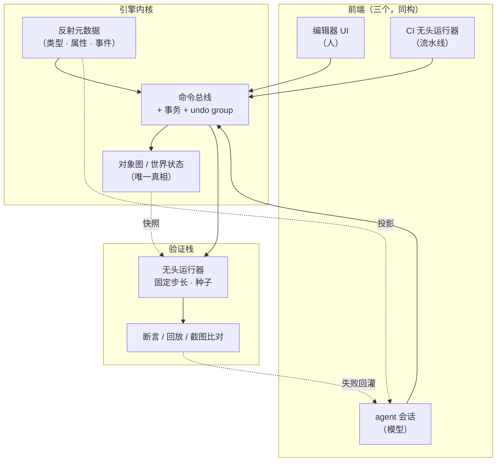

# 把 agent 嵌进自研引擎：一个 Godot 式的实现方案

> 一份实现设计文档 · 基线日期 2026-11-18
> 工作区：`meter` · 状态：设计提案（design proposal），无实现代码
> 前置阅读：[`docs/ai-native-game-engine.md`](ai-native-game-engine.md)（下称"主文档"）

---

## 0. 结论

**"像 Godot"里真正可以复制的不是编辑器，而是四条机械属性**：可内省的类型元数据、文本化的场景 / 资源、事务化的编辑历史、同一个二进制能无头跑。这四件东西恰好就是 agent 需要的**写面**（write surface）。

由此得到本文的主张：

> **不要把 agent 做成装在引擎旁边的程序，要把它做成引擎的第三个前端**——与编辑器、运行时同构，共享同一份反射元数据、同一条命令总线、同一条验证路径。
> 因此这件事的工程量**九成在引擎侧，一成在 prompt 侧**。

五条具体判断：

1. **外挂式工具面已经撞到天花板。** 工具数从 14 涨到 208，而明确把写入接进撤销栈、把验证接进无头运行的项目是极少数（§2.1）。再多加 50 个工具不会让 agent 变可靠，只会让它选错。
2. **自研引擎相对 Godot 的唯一真优势，不是"能改"，而是"能把用户定义的类型也纳入反射"。** Godot 官方文档明说 `class_name` 脚本类**不属于** ClassDB、不返回反射数据（【一手】，§4.4）。也就是说，外挂给 Godot 的 agent 天生看不见游戏特有的数据结构——它只能操作引擎原语。
3. **写面必须是命令，不是文件。** 直接改 `.tscn` 文本会覆盖未保存的编辑、丢 uid、破坏格式；场景文本是**序列化产物**，不是源。真正的源是运行中的对象图。（§5）
4. **验证的能力上限由确定性决定，而固定 tick ≠ 确定性。** Godot 官方明确写着"无论用哪个物理引擎，Godot 的物理都不是确定性的"（【一手】，§7.2）。可被严格验证的只有**逻辑状态**；视觉只能做容差比对。
5. **工具面必须按需装载。** 官方给出的数字是：58 个工具定义 ≈ 55K tokens，且工具数超过 10 就应当改为按需检索（【一手】，§9.1）。把 ClassDB 的几千个方法直接展开成工具，是最容易犯也最致命的错误。

一句话概括：

> **代码 agent 看的是源码，引擎 agent 看的是状态。**
> 前者只能猜"应该是什么"，后者能验证"实际上是什么"。
> 这就是"嵌入"的全部价值，也是它全部的成本。

---

## 1. 把"类似 Godot"拆成可实现的机械属性

### 1.1 四条属性

"Godot 式"是个模糊的说法。把它拆开，只有四条是与 agent 相关的：

| 属性 | Godot 的机制 | 对 agent 的意义 | 自研引擎要做的最小等价物 |
|---|---|---|---|
| **A. 可内省** | `ClassDB`：枚举全部引擎类；方法与属性各带类型、默认值、hint、usage；可实例化、可判父子类（【一手】） | 工具 schema 可以**生成**，而不是手写；手写的 schema 一定与代码漂移 | 一张类型注册表 + 导出器；**必须覆盖游戏代码定义的类型** |
| **B. 文本化** | `.tscn` / `.tres` 分段结构（文件头 / 外部资源 / 内部资源 / 节点 / 连接），节点与资源带 `uid`（【一手】） | 改动可 diff、可 review、可进 Git、可被人类直接读 | 稳定的序列化格式 + 稳定 id（uid/GUID），**且不把它当写面** |
| **C. 事务化** | `UndoRedo`（`create_action` / `add_do_property` / `add_undo_property` / `commit_action` / merge 模式）与 `EditorUndoRedoManager`（**每个场景独立历史**，归属由动作里第一个操作的对象决定）（【一手】） | 一次 agent 会话 = 一个可整体撤销的动作组；人类的修改与 agent 的修改在同一历史里 | 命令总线 + 事务 + undo group + 版本栅栏 |
| **D. 无头** | `--headless`（headless display + Dummy audio）、`--script`（脚本须继承 `SceneTree`/`MainLoop`）、`--quit-after`、`--export-release`、Movie Maker 强制固定帧率（【一手】） | CI 里能跑、能批量跑、能并行跑；验证不需要人开编辑器 | 无头运行器 + 可编程入口 + 固定步长 |

### 1.2 不可复制的部分（以及为什么不必复制）

- **编辑器 UI 本身。** agent 不点按钮；它调用按钮背后的命令。抄 UI 是纯成本。Godot 的可贵之处在于"按钮背后有一个命令对象"，而不在于按钮长什么样。
- **GDScript 生态与社区资产。** 与 agent 能力无关。
- **`@tool` 脚本（在编辑器内执行游戏代码）。** 这是 Godot 的一个真实优势：编辑器里也能跑同一份逻辑。自研引擎若要复制，代价是**编辑器进程必须能安全地加载游戏代码**——这会引入"编辑期执行任意用户代码"的风险面（§10）。建议**不复制**，改用"无头验证进程"替代。

一句话：**复制"命令对象与反射"，不要复制"界面与语言"。**

### 1.3 嵌入度分级（E0–E4）

"引擎里有个 agent"这句话没有信息量。用下面这张表定位你要做到哪一级——**每一级的成本差一个数量级，能力也差一个数量级**：

| 级别 | 形态 | agent 能做什么 | 事务 | 验证 | 典型成本 |
|---|---|---|---|---|---|
| **E0** | 进程外脚本 / CLI | 生成代码、批量改文本、跑构建 | 无（靠 Git） | 编译 + 测试 | 人日 |
| **E1** | 编辑器插件 + 外部模型 | 读写场景与资源，直接调编辑器 API | 无或部分 | 无 | 人周 |
| **E2** | **一等命令层**（本文起点） | 所有编辑经命令对象，落在同一 undo 栈 | 有 | 手工触发 | 人月 |
| **E3** | 反射生成 + 事务 + 无头验证 | schema 由反射导出；每次提交前自动验证 | 有 + 版本栅栏 | 自动、三级 | 人月 × 2 |
| **E4** | 与运行时共享本体 | 创作期动词 = 运行期动词；同一动作空间的两个前端 | 有 | 自动 + 回放 | 与主文档 §7 同期 |

**建议路径：先到 E2，再补 E3；E4 不是这一步的目标，但接口要留出来。**

E1 是今天绝大多数项目的实际位置（§2.1）。E1 与 E2 的差别不在模型，而在于**引擎是否承认"编辑"是一种可编程、可撤销、可验证的操作**。这个承认动作是引擎架构决策，一旦错过，后面所有工作都会以补丁形式重复实现它。

> **判据（可自测）**：让一个脚本（不是 LLM）执行一段"改场景"的程序，然后按一次 Ctrl+Z 能否完整撤销；再让 CI 在无头模式下重跑同一个脚本并断言结果。两件事都成立，你就在 E2 之上；有一件不成立，agent 的可靠性上限就已经被钉死了。

---

## 2. 为什么外挂方案有天花板

### 2.1 现状：工具数在涨，语义在退

对 Godot / Unity / Unreal / Blender 的 MCP 与插件做了一轮清点（2026-11，明细见附录 B）：

| 项目 | 工具数 | 是否写场景 | 是否有事务/撤销 | 是否无头 |
|---|---|---|---|---|
| `Coding-Solo/godot-mcp`（最早流行的一版） | 14 | **否**，只做启动编辑器 / 跑项目 / 抓输出 | 未找到 | 未找到 |
| `godot-mcp-pro`（付费插件） | 162 | 是 | **未找到** | 未找到 |
| `godot-editor-mcp` | 194→208（29 类，默认只开 inspection，其余按需） | 是 | **未找到** | 未找到 |
| `godot-mcp-bridge`（官方资产库条目） | 185（默认只加载 35） | 是，**编辑实时编辑器树**，结构变更进 undo 栈 | **有** | 有（无头导出 / 无头测试） |
| `CoplayDev/unity-mcp` | 50 | 是 | 未找到 | 未找到 |
| `IvanMurzak/Unity-MCP` 1.0 | **3**（RQL：`rql-query` / `rql-mutate` / `rql-schema`） | 是 | 未找到 | 未找到 |
| Unity 官方（编辑器内 MCP） | 若干（`Unity.CreateScript`、`Unity.ApplyTextEdits`、`CaptureGameView`…） | 是 | 未找到 | 未找到 |
| `Flux-Point/unreal-mcp` | 48 | 是 | 未找到 | 有（`UnrealEditor-Cmd` 构建/烘焙） |
| `mcp-for-blender` | 4 个直通 + 若干集成 | 是（`execute_blender_code`） | 无（代码直通） | 未找到 |

三个从这张表直接读出来的事实：

1. **工具数从 14 涨到 208，但没有一个项目公布"任务成功率"随工具数上升的数据。** 涨的是覆盖面，不是可靠性。
2. **只有 1 个项目（`godot-mcp-bridge`）明确把结构变更接进 undo 栈**，且它的卖点恰恰是这个——说明市场已经感知到痛点，但解决它的成本很高。
3. **工具数已经开始反向收缩**：`IvanMurzak/Unity-MCP` 1.0 用 3 个 RQL 工具取代"一动作一工具"；`godot-editor-mcp` 与 `godot-mcp-bridge` 都改成"默认只加载一小部分"。这是行业自己在纠正 E1 路线。

> **一处需要记录的差异**：主文档 §2.2 记 `godot-mcp` 为 162★，本次检索到的 `Coding-Solo/godot-mcp` 约 6.7k★。差异可能来自统计时间或同名仓库，**未核实**，不影响本节任何结论（结论只依赖"工具数与事务能力"这两列）。

### 2.2 三个天花板

外挂方案不是"还不够好"，而是**结构上够不到**三件事：

**(1) 状态盲区。** 外挂只能看见磁盘上的文件。它看不见：运行中的对象图、未保存的编辑器状态、资源实际被谁引用、某个信号到底有没有接收者、上一帧的物理结果。它只能读 `.tscn` 然后**猜**。猜错的代价是生成一个"看起来对、运行就崩"的补丁。

**(2) 无事务。** 没有事务就没有"要么全成、要么全不成"。没有事务，多步编辑中途失败会留下半成品工程——而 agent 恰恰最容易在中途失败。`godot-mcp-bridge` 解决这个问题的办法值得记住：**不写文件，编辑实时树，让变更进 undo 栈**。

**(3) 无验证。** 外挂能跑测试，但测试要人写。agent 需要的是"改完自动知道对不对"，而这要求引擎能以**固定步长、无头、可断言**的方式运行任意场景——这是引擎能力，不是工具能力。

### 2.3 自研引擎的唯一真优势

自研引擎相对 Godot / Unity 在**模型能力**上没有任何优势；在**写面**上有两个：

- **反射可以覆盖游戏自己的类型。** Godot 明确把 `class_name` 脚本类排除在 ClassDB 之外（【一手】）；自研引擎可以反过来做：组件、属性、枚举、事件全部进注册表。这决定了 agent 看得见"引擎原语"还是"这个游戏的概念"。
- **验证可以做到确定性。** 前提是你自己写内核（主文档 §4.2）。用第三方物理引擎，你会继承它的不确定性（§7.2）。

代价同样明确：**你引入了第二个写者。** 主文档的中心原则是"内核是唯一写者"，而 agent 天然想直接改内存、改文件、跑脚本。所以整个架构的目标可以概括成一句：

> **让 agent 成为一个"受约束的写者"——它的每一次写入都必须经过与人类编辑器相同的那条通道。**

这条通道就是下一节的命令总线。

---

## 3. 参考架构

### 3.1 三前端一内核



三条连线是这张图的全部要点：

1. **agent 与编辑器走同一条命令总线。** 不是"agent 有一条快速通道"。这条约束同时买到了事务、撤销、审计。
2. **agent 只读投影，不读对象图。** 投影是内核生成的、裁剪过的、只读的结构化视图（§8）。这样上下文成本可控，且不会把整个工程塞进模型。
3. **验证栈的输出回灌给 agent，而不是回灌给人。** 一次失败的验证应当产出一条**结构化负约束**，让 agent 直接修（§7.4）。

### 3.2 五层的职责边界

| 层 | 职责 | 出错时的表现 | 归属 |
|---|---|---|---|
| **L-Meta 反射** | 类型注册、schema 导出、文档强制 | schema 与代码漂移 → agent 调不存在的属性 | 引擎 |
| **L-Cmd 命令** | 原子编辑操作、前置条件、序列化 | 编辑"成功"但工程坏了 | 引擎 |
| **L-Txn 事务** | 事务边界、undo group、版本栅栏、语义 diff | 半成品工程；人类修改被覆盖 | 引擎 |
| **L-Verify 验证** | 静态 / 编译 / 行为三级检查 | agent 自信地交付一个跑不起来的场景 | 引擎 + 测试作者 |
| **L-Session 会话** | 模型调用、投影裁剪、计划、工具选择、预算 | 贵、慢、选错工具、跑偏 | agent 侧 |

**这张表的用途是分工**：L-Meta 到 L-Verify 是**引擎团队**的活，L-Session 才是"做 agent"的活。绝大多数团队的失败原因是把五层全塞进 L-Session（写一堆 prompt 让模型"小心一点"），而底下四层不存在。

### 3.3 进程模型：三种放法

| 方案 | 结构 | 优点 | 缺点 | 适用 |
|---|---|---|---|---|
| **A. 进程内** | agent loop 跑在引擎进程里 | 零序列化、能直接读对象图 | 模型调用阻塞主线程；崩溃拖垮编辑器；模型与引擎语言绑定 | 审批门、少量"决策在引擎内"的动作 |
| **B. 插件 + 外部 harness** | 引擎插件提供命令/投影端点，外部 agent 进程经 MCP 或 stdio 调用 | 模型生态成熟、可换 harness、可观测 | 序列化开销；并发写冲突要处理 | **交互式主路径** |
| **C. 无头 daemon + 外部 harness** | 引擎以 headless 服务运行，agent 与 CI 都连它 | 可并行多实例；CI 与交互同构 | 与人类编辑器并发写同一工程需隔离 | **CI 与批量任务** |

**推荐：B 为主，C 为 CI，A 只用于审批门这类极短路径。**

方向性证据：Unity 在 2026-11 弃用了编辑器内 MCP server，改由 `unity mcp`（CLI 自带 MCP server）承担（【一手】）。这不是小改动——它说明**把 agent 绑死在编辑器进程里，会同时牺牲可运维性与可迁移性**。反过来，这也解释了为什么"无头"在 §1.1 里被列为四条属性之一：**它是 B/C 两种放法共同的底座。**

### 3.4 关键接口（语言中立，C# 写法）

```csharp
// 1) 反射：schema 的唯一来源
interface ITypeRegistry {
    IEnumerable<TypeMeta> Types();                 // 覆盖引擎类型 + 游戏类型
    TypeMeta?             Get(string typeName);
    JsonSchema            ExportSchema(string typeName, SchemaOptions opts);
}
record TypeMeta(string Name, string? Base, TypeFlags Flags,
                IReadOnlyList<PropMeta> Props,
                IReadOnlyList<EventMeta> Events,
                string? Doc);

// 2) 命令：唯一的写面
interface ICommand {
    string Op { get; }                             // "set" | "create" | "delete" | "connect" | ...
    CommandResult Apply(IEditContext ctx);         // 同步、主线程
    CommandRecord Record();                        // 可重放、可 diff
}

// 3) 事务：要么全成，要么全不成
interface ITransaction : IDisposable {
    TxnId    Id { get; }
    long     BaseVersion { get; }                  // 读快照时的世界版本
    void     Stage(ICommand cmd);
    CommitResult Commit(CommitOptions opts);       // 版本栅栏 + 验证 + undo group
    void     Abort();
}

// 4) 验证：结构化失败
interface IVerifier {
    Task<VerifyReport> Run(VerifyRequest req);     // 静态 / 编译 / 行为
}
record VerifyReport(bool Ok, IReadOnlyList<Diagnostic> Diags, string? ArtifactDir);

// 5) 投影：只读视图
interface IProjection {
    ProjectionView Build(ProjectionRequest req);   // 焦点 + 预算 → 文本/结构
}
```

> 这五个接口加起来不到 40 行，但它们的位置决定了整个系统的性质：**如果 `ICommand` 是唯一的写面，agent 就永远无法绕过事务与验证。** 反过来，只要引擎里还留着"agent 可以直接改文件/改内存"的路径，前面所有约束都是建议而非约束。

---

## 4. L-Meta：反射层

### 4.1 为什么反射是起点

如果不是从反射出发，就只有两条路，两条都错：

- **手写工具定义**：20 个工具时可行，200 个时一定与代码漂移。漂移的表现是"agent 调了一个上季度被重命名的属性"，而错误信息在模型看来和"模型笨"无法区分。
- **把引擎 API 直接暴露成工具**：ClassDB 级别的类和方法数量是四位数，展开后既有 §9.1 的 token 灾难，也有"99% 的调用是错的"这种可用性问题。

反射的价值不是"自动生成"，而是**让 schema 与代码只有一份真相**：类型改了，schema 跟着改；schema 没改，CI 就红。这一点与主文档 §5.6 的"语义差分"是同一种思路——**让变更无法悄悄发生**。

### 4.2 类型 → schema 的映射规则

这张表是 L-Meta 的核心交付物。它必须被写成**可执行的导出器**，而不是文档：

| 引擎侧 | JSON Schema | 备注 |
|---|---|---|
| `bool` / `int` / `float` / `string` | `boolean` / `integer` / `number` / `string` | `float` 建议加 `multipleOf` 或精度说明，避免模型写 `0.30000000000000004` |
| 枚举 | `enum` + 每个值的文档 | 字符串值，不用整数——整数枚举是模型第二大错误源 |
| 位标志 | `array` of `enum` | 一位一个字符串，禁止让模型自己算位掩码 |
| 资源引用 | `{"type":"object","properties":{"uid":...,"path":...}}` | **uid 优先**，路径作 fallback；两者都要校验 |
| 节点 / 组件引用 | `{"type":"string"}`，值为稳定 id | 见 §8.2 的 id 方案；禁止裸路径字符串 |
| 数值范围（`@export_range`） | `minimum` / `maximum` | 有 hint 就必须映射，否则模型会写 `light_energy=1e9` |
| 文件路径（`@export_file`） | `pattern` + 存在性校验 | 校验放在命令层，不放 schema |
| 数组 / 字典 | `array` / `object`，带 `maxItems` | 上限由引擎给，不由模型猜 |
| 只读属性 | **不导出为可写工具** | 反射里的 `usage` 标志必须被尊重 |

三条硬规则：

1. **默认值必须出现在 schema 里。** 模型填属性时应省略默认值，只写差异；否则一个 30 个属性的组件会变成 30 行必须全填的 JSON。
2. **单位必须写进描述。** `2.0` 是米还是厘米，决定生成的地图尺寸差 100 倍。这类错误在验证阶段才发现，成本是 10 倍。
3. **不可逆 / 破坏性操作不映射为普通属性。** 删节点、改父级、移除组件是独立命令，不是 `set`。

### 4.3 schema 的可信度需要一把锁

Godot 有一个值得抄的细节，反过来也是一个警告：**release 构建里反射只剩方法名**（【一手】，官方文档原话是"will contain only method names"）。也就是说，**反射数据的丰富程度取决于构建配置**。

推论：agent 的工具 schema 不能来自"运行时问引擎"，而应当来自**构建期导出的清单（schema lockfile）**：

```
schemas/
  engine.schema.json      # 引擎类型（构建期导出，进 Git）
  game.schema.json        # 游戏类型（同上）
  lock.json               # 两个文件的 hash + 引擎版本 + 导出器版本
```

CI 里做三件事：导出 → 与上一版比对 → 有语义变更就要求人工 approve。这样"agent 能做什么"这件事本身进入了代码评审流程——**这是把 agent 当成基础设施而不是当成功能的分水岭**。

### 4.4 用户类型必须进反射（自研引擎的关键差异点）

Godot 官方文档写得很清楚：

> `class_name` 定义的脚本类**不属于** ClassDB，因此不返回方法 / 属性列表等反射数据；而 GDExtension 定义的类**属于** ClassDB，会返回反射数据。（【一手】）

这意味着**外挂给 Godot 的 agent 有一个能力上限**：它看得见 `Node3D`、`CharacterBody3D`、`OmniLight3D`，看不见你自己的 `QuestState`、`FactionRelation`、`LootTable`。而游戏之所以是游戏，恰恰在后者。这在实践中的表现是：agent 很会摆家具，不会做玩法。

自研引擎应当反过来做，并把它作为**设计约束**写进编码规范：

| 必须可反射的东西 | 做法 | 为什么 |
|---|---|---|
| 组件 / 节点类型 | 注册宏或 attribute，编译期登记 | 决定 agent 能不能"看见"这个游戏的概念 |
| 可编辑字段 | 与编辑器检视器**同一份**元数据 | 否则编辑器和 agent 看到的世界不一致 |
| 枚举 | 名字 + 值 + 文档 | 模型对整数枚举的错误率显著更高 |
| 资源引用 | 声明目标类型，而非 `object` | 让校验能在提交前发生 |
| 事件 / 信号 | 签名 + 文档 | 才能校验"连了一个不存在的回调" |
| 系统 / 规则 | 只读描述 + 参数 | 让 agent 知道"这个世界怎么运转"，而不只是"有哪些对象" |
| 权限范围 | 每个类型 / 命令的 scope 标签 | 见 §10 |

> **一句话**：编辑器检视器能改的东西，反射必须能描述；反射不能描述的东西，agent 也不该能改。**这条对齐关系是整个方案的地基**——它保证了"agent 的能力"与"人类编辑器的能力"是同一张表，而不是两套逐渐分叉的接口。

### 4.5 文档即工具描述

工具描述不是写 prompt，是写**这个类型是什么、什么时候用、常见错误是什么**。所以：

- **没有文档的字段不导出。** 导出器直接跳过 `Doc == null` 的属性，并在 CI 里报"缺失文档"清单。这把"写注释"从美德变成了编译条件。
- 文档里要有**反例**：`light_energy` 的描述应包含"室内 1–3，室外日光 8–16；超过 20 会过曝"。模型缺的往往不是格式知识，是量级直觉。
- 描述长度受预算约束（§9.1）：一个字段 1–2 句，一个类型 3–5 句。写成长篇小说的文档等于没写。

### 4.6 反射的边界

反射能描述**结构与类型**，描述不了**时序与行为**：

- "这个门在 Boss 死前锁着"——是规则，不是属性。
- "先设 visible 再设 energy，否则会闪一帧"——是顺序约束。
- "这个属性只在服务器上可写"——是权限，需要额外标注。

这三类必须由**运行时装配的约束**（invariant / precondition）补上，而不是指望 schema。这也是为什么 §7 的验证层不可省略：**静态定义永远盖不住动态行为。**

---

## 5. L-Cmd：写面

### 5.1 两种写面，两种纪律

| 写面 | 内容 | 通道 | 纪律 |
|---|---|---|---|
| **结构化** | 节点/组件的增删改、父子关系、信号连接、资源属性、场景实例化 | 命令总线 → 事务 | 必须可撤销、可校验、可语义 diff |
| **文本** | 脚本、shader、配置、本地化表 | 文件写入 → 解析/编译校验 | 必须走"写入 → 解析 → 编译"三步，失败自动回滚文件 |

**关键的不对称**：结构化写面**永远不要**退化成文本编辑。原因有三，每一条都是实际踩过的坑：

1. **覆盖未保存的改动。** 人类在编辑器里改了场景没保存，agent 从磁盘读、改、写回，人类的改动就没了。`godot-mcp-bridge` 的官方资产库描述里把这一点列为它的核心卖点——编辑**实时编辑器树**而不是写文件。
2. **丢 uid。** Godot 的场景格式用 `uid` 做稳定引用；文本重写极易丢掉或重排 uid，导致所有引用这个资源的场景静默断链。
3. **格式即实现细节。** 场景文件的段结构、`load_steps` 的弃用、节点 `unique_id` 的加入，都是版本相关的（【一手】）。把 agent 绑在文本格式上，等于让它承担引擎序列化格式的兼容责任。

### 5.2 通用动词集

**不要一方法一工具。** 用少量通用动词覆盖结构操作，把语义留给参数：

| 动词 | 参数 | 说明 |
|---|---|---|
| `find` | 查询表达式 / 类型 / 名字 / 引用关系 | 只读；返回稳定 id 列表。所有编辑的第一步 |
| `inspect` | id + 深度 | 返回投影片段（§8.2） |
| `create` | 类型 + 父 id + 初始属性 | 返回新 id；属性走 schema 校验 |
| `set` | id + 属性字典 | 批量；`skip_if_equal` 避免噪音 |
| `delete` | id + `cascade` 标志 | `cascade` 默认 false；有子节点时拒绝，除非显式要求 |
| `reparent` | id + 新父 + 顺序 | 独立动词，因为它会改变变换语义 |
| `connect` / `disconnect` | 发送者 id + 事件 + 接收者 id + 方法 | 提交时校验回调存在（见 §7.1 T1） |
| `attach` | id + 脚本/组件类型 | 组件挂载单独成动词，便于权限控制 |
| `save` | 作用域（场景 / 资源） | **显式**保存；不自动落盘，便于事务回滚 |
| `run` | 验证/构建/截图任务 | 唯一允许"执行代码"的动词，走 §10 的权限 |

**领域动词**（`spawn_encounter`、`set_faction`、`open_shop`）不在这张表里。它们属于主文档 §4.3 的**本体**，应当在 E4 阶段接入；在 E2/E3 阶段，它们由"通用动词 + 项目约定"组合而成。这个区分很重要：**通用动词是引擎能力，领域动词是游戏设计**，混在一起会让引擎背上每个项目的语义负担。

### 5.3 写面的两种内核形态

如果你的自研引擎不是节点树，而是 ECS / 数据表，写面要相应变形——但**约束不变**：

| 内核形态 | "对象"是什么 | 写面命令 | 稳定 id | 风险点 |
|---|---|---|---|---|
| **对象树**（Godot / Unity 式） | 节点 / 组件实例 | `create` / `set` / `reparent` / `delete` | 节点 GUID | 父子关系与变换耦合 |
| **ECS / 数据表** | 实体 + 组件行 | `spawn` / `set_components` / `despawn` | 实体 ID（需**跨会话稳定**） | 实体 ID 复用导致 diff 错乱 |
| **混合**（编辑器树 + 运行时 ECS） | 两套 | 需要**映射层**：树节点 ↔ 实体 | 两边各一个 id + 映射表 | 映射不同步是最常见的"编辑器对了、运行时错了" |

ECS 的一个额外硬要求：**实体 ID 不能复用**，或者必须带"代际"（generation）。否则 agent 读到的 `#42` 在提交时已经是另一个实体了，而事务的版本栅栏只检查"世界版本变了没有"，检查不出"同一个 id 指的东西变了"。

### 5.4 命令协议

命令必须是**数据**，不是代码。理由是 §5.1 的三条加上一条：数据可以被记录、被重放、被审计、被人类读懂。

```json
{
  "txn": "t-7f3a",
  "intent": "矿洞入口的灯只在夜里亮",
  "base_version": 8812,
  "ops": [
    {"op": "find", "query": "type:OmniLight3D under:#1"},
    {"op": "set", "id": "#12", "props": {"light_energy": 0.0}, "skip_if_equal": true},
    {"op": "connect", "from": "#12", "event": "visibility_changed",
     "to": "#1", "method": "_on_lamp_visibility"}
  ]
}
```

协议的四条规则：

1. **只读动词与写动词在同一事务里也不行。** 读必须在事务开始前完成（拿到 `base_version`），事务内只允许写。否则你会得到"读了半新半旧的状态"这类无法复现的 bug。
2. **每个 op 返回结构化结果，不是字符串。** `{"ok": false, "code": "UNKNOWN_PROP", "id": "#12", "prop": "light_engery", "suggest": ["light_energy"]}`。拼写建议直接降低了模型的重试成本。
3. **幂等。** 同一个事务重放两次，结果必须一致。这是回放验证与断点续跑的前提。
4. **事务有 `intent` 字段，且必须来自模型的自然语言。** 它会成为 undo 的名字和 diff 的标题——**人类审查 agent 的改动时，第一眼看的就是这行字**。

### 5.5 拒绝的写面

有些操作不该有命令，而该有**流程**：

| 操作 | 为什么不能是命令 | 应该是什么 |
|---|---|---|
| 删除资源文件 | 会断掉所有引用，且不可撤销 | 独立流程：引用计数 → 影响面报告 → 人工确认 |
| 改 `project.godot` / 工程设置 | 影响全局，一次错误污染所有场景 | 结构化表单 + 白名单键 + 审批 |
| 安装插件 / 引入外部依赖 | 供应链风险 | 人工操作，agent 只能"建议" |
| 修改 `.gitignore` / CI 配置 | 会隐藏证据 | 只读 |
| 执行任意脚本 | 等价于给模型一个 shell | 只允许**注册过的**验证/构建任务（§10.3） |

这张表看似限制了 agent，实际上是在保护它：**agent 最需要的不是权限，是可回滚。** 一个不能回滚的动作，无论模型多聪明，都不该交给它。

---

## 6. L-Txn：事务

### 6.1 一次事务的四个字段

```
Transaction = (base_version, ops[], intent, verification_plan)
Commit      = 版本栅栏 → 执行 → 验证 → undo group + 语义 diff + 账本条目
```

**粒度是需要反复调的经验参数**，但有两条可用的先验：

- **一个事务 = 一个可被人类读懂的意思。** "把灯改成夜里亮"是一个事务；"调整矿洞所有灯光"是另一个（更大、更需要审批的）事务。
- **一个事务 = 一次可整体撤销。** 如果撤销后会留下"半亮不亮"的状态，事务就切错了。

### 6.2 版本栅栏

这是并发下唯一能救命的东西。场景：agent 读了世界（v=8812），开始推理 30 秒，这 30 秒里人类在编辑器里删了一个节点，agent 提交。

三种处理策略，按风险选：

| 策略 | 做法 | 适用 |
|---|---|---|
| **Abort** | `base_version != current` → 拒绝，让 agent 重新投影 | 默认；最安全，代价是一次重试 |
| **Rebase** | 若写集无交集 → 允许；有交集 → 逐 op 检查 | 人类与 agent 编辑不同区域时 |
| **3-way merge** | 属性级三方合并 | 仅限无结构变化的属性写入；实现成本最高 |

**关键点：写集（write set）必须由命令层自己算出来，不能让模型声明。** 模型说"我只改了灯"，实际顺手删了一个节点——这种"声明与行为不一致"是 agent 的典型失败模式，靠信任解决不了。

Godot 的 `UndoRedo` 提供了 `version` 与 `version_changed`（【一手】），但文档中没有线程安全或并发冲突检测的语义。自研引擎不要指望"照抄一个 UndoRedo 就有了事务"——undo 是历史，事务是并发控制，两者不是一回事。

### 6.3 undo group

- **一个 agent turn = 一个 undo group**，名字 = `intent`。
- 人类按一次 Ctrl+Z 撤销整个 turn，而不是撤销 47 次属性写入。
- **agent 的 undo group 里可以包含人类之前的部分改动吗？不能。** 历史必须线性、可解释：谁改的、改了什么、什么顺序。
- 反向也要支持：**agent 必须能看见人类的 undo**。否则它会在一个"人类已经撤回"的世界版本上继续推理。

### 6.4 语义 diff

事务提交产出两份 diff：**文件 diff**（给 Git）与**语义 diff**（给人）。后者才是审查对象：

```
txn t-7f3a   "矿洞入口的灯只在夜里亮"   author=agent  model=…  base=8812
~ scene res://levels/mine.tscn
  ~ #12 OmniLight3D.light_energy   2.0 → 0.0
  + connect #12.visibility_changed → #1._on_lamp_visibility
验证: T0 pass · T1 pass · T2 pass（tests/light-at-night.scn.yaml，600 ticks）
截图: 夜间差分 0.8%（阈值 5%）；白天差分 0.0%
未覆盖: 该连接在白天分支（hour<18）未被任何测试触达
```

最后一行**必须存在**。没有"未覆盖"的 diff 会让人误以为验证是全的——这是把"验证通过"变成"验证幻觉"的最快方式（§11 第 4 条）。

### 6.5 与 Git 的关系

双轨，不要合并：

- **文件轨**：事务提交后照常落盘，`git diff` 可用。这是给工具链的。
- **语义轨**：事务日志（JSONL）进仓库或进账本。这是给人与审计的。

两条轨的对应关系由 `base_version` + `intent` + `ops` 维持。**不要试图让 Git 成为事务系统**：Git 的原子单位是文件，事务的原子单位是意图，两者粒度不同，硬合会导致"一个 commit 里塞了 12 个不相关改动"。

---

## 7. L-Verify：验证

### 7.1 三级验证

| 级别 | 检查什么 | 耗时 | 什么时候跑 | 失败示例 |
|---|---|---|---|---|
| **T0 静态** | schema 合法、引用完整、类型匹配、循环依赖、资源存在 | 毫秒 | 每个 op 执行前 | `UNKNOWN_PROP`、`MISSING_UID`、`CYCLE_IN_PARENT` |
| **T1 加载/编译** | 脚本编译、资源导入、场景可实例化、事件回调存在、组件依赖满足 | 秒 | 事务提交前 | `METHOD_NOT_FOUND`（连接了一个不存在的方法）、`MISSING_COMPONENT` |
| **T2 行为** | 无头运行场景 N 个 tick，断言状态 / 截图 / 回放 | 秒—分钟 | 提交前（小）或 CI（大） | 灯没亮、玩家卡住、帧时间超标 |

**T1 里最值得单独说的是"回调存在性"。** 在很多引擎里，连接的目标方法要到事件真正触发时才解析（Godot 是否在 `connect()` 时就校验，本文未核实）。后果是：连了一个不存在的方法，可能几小时后才炸。自研引擎应当在**连接提交时**就解析方法签名——成本是几毫秒，收益是消灭一整类"运行到一半才崩"的 bug。

### 7.2 确定性分层：可验证的到底是什么

这是本文最需要说清楚的一点，因为它决定了验证的可信度上限。

**固定步长不等于确定性。** Godot 官方文档明确警告：

> 无论使用哪个物理引擎，Godot 中的物理都**不是确定性的**；物理**不保证**以相同方式运行。（【一手】）

固定 tick 只保证**步长一致**，不保证**结果一致**。浮点运算顺序、多线程调度、对象 id 分配顺序、容器遍历顺序、时间源，任何一处都可能让两次运行分叉。

所以验证必须**分层**，不同层用不同手段：

| 层 | 包含 | 能否严格验证 | 手段 |
|---|---|---|---|
| **逻辑状态** | 实体、位置（定点数）、属性、任务状态、背包、经济数值 | ✅ 能 | 每 tick 算 state hash；两次运行 hash 序列必须完全相同 |
| **离散事件** | 触发器、对话推进、战斗判定 | ✅ 能（若内核确定） | 事件日志逐条比对 |
| **物理结果** | 刚体位置、碰撞流形、布料 | ❌ 跨机器不能 | 锁版本 + 固定输入 + 容差；或把物理结果**排除**在 hash 之外 |
| **渲染输出** | 像素、光照、后处理 | ❌ 严格不能 | 截图 + 感知哈希 + 容差阈值；只用于"没坏"而不是"对" |

三条工程结论：

1. **state hash 只覆盖逻辑状态。** 把渲染或物理塞进 hash，你会得到 100% 的假失败，然后团队就会关掉这个检查——这是所有验证系统死亡的标准路径。
2. **逻辑用定点数。** 主文档 §4.2 已经要求；这里补一条：定点数的转换边界要显式（`float → fixed` 只在输入解析处发生一次）。
3. **物理可以用第三方，但必须承认它不可验证。** 那就把"物理是否正确"交给截图与人工，不要假装它能被 hash 证明。

> 一个反直觉的推论：**验证能力不是由模型决定的，是由内核的确定性预算决定的。** 你愿意为确定性付出多少（定点数、单线程系统、禁用某些物理特性），直接决定了 agent 能自动修多远。

### 7.3 scenario：给验证一个可读的格式

验证脚本不能是代码（否则 agent 就得写代码来验证自己写的代码）。用声明式 DSL：

```yaml
# tests/light-at-night.scn.yaml
scene: res://levels/mine.tscn
seed: 8812
ticks: 600
setup:
  - set: { path: "/Mine/DayNight", prop: hour, value: 23.0 }
assert:
  - at: 1
    state: { path: "/Mine/Entry/Lamp", prop: light_energy, value: 0.0 }
  - at: 1
    state: { path: "/Mine/Entry/Lamp", prop: visible, value: false }
artifacts:
  - hash: { ticks: "0..600" }
  - screenshot: { at: 1, tag: night }
```

设计要点：

- `path` 用**人类可读的路径**（不是 id）。测试是给人读的，id 每次投影都会变。
- `setup` 只允许"设置初始状态"，不允许"执行逻辑"。测试的副作用必须来自被测场景本身。
- `hash` 是一个区间，不是单点——单点 hash 会被"第一帧恰好相同"骗过。
- 一个 scenario 文件 = 一个可回归的意图。**agent 每次修 bug 都应当新增/修改一个 scenario**，这条纪律比任何 prompt 都有效：它把"这次修好了"变成"以后不会坏"。

### 7.4 失败如何回灌

验证失败的输出不是给人看的报告，而是**给模型的负约束**：

```json
{
  "ok": false,
  "failed": [
    {"stage": "T1", "code": "METHOD_NOT_FOUND",
     "at": "#1._on_lamp_visibility",
     "detail": "Mine.gd has no method _on_lamp_visibility",
     "candidates": ["_on_lamp_toggled"]},
    {"stage": "T2", "scenario": "tests/light-at-night.scn.yaml",
     "at_tick": 1, "expect": {"light_energy": 0.0}, "actual": {"light_energy": 2.0}}
  ],
  "next": ["rename the connection target to _on_lamp_toggled, or add the method"]
}
```

三个要求：

1. **`candidates` 字段。** 拼写与重命名的错误占 agent 失败的一大半，给出候选直接省掉一轮往返。
2. **`at_tick` 必须精确到帧。** "灯没亮"是无用的反馈；"第 1 tick 时 light_energy 还是 2.0"是可以直接修的反馈。
3. **`next` 是建议，不是命令。** 让模型自己决定修法；把修法写死会让它在新情况下不会变通。

### 7.5 验证的边界（诚实清单）

| 能验证 | 不能验证 |
|---|---|
| 引用不丢、类型正确、脚本能编译 | 这个场景**好玩**吗 |
| 灯在夜里灭、门在 Boss 死后开 | 这个光照**好看**吗 |
| 玩家能走到出口（可达性） | 走过去的**手感**对吗 |
| 帧时间不超预算 | 这个节奏**对**吗 |

这张表不是免责声明，是**分工依据**：能验证的部分交给 agent 自动迭代；不能验证的部分必须由人审，并且**必须保护人不被 agent 的改动淹没**——所以才有 §6.4 的"未覆盖"提示和 §9.4 的变更预算。

---

## 8. 上下文：投影，而不是"把工程塞进去"

### 8.1 非对称接口

一条贯穿全文的设计原则：

> **读用投影，写用命令。两者格式不同，这是特性不是缺陷。**

- 读要**省 token**、要**可读**、要**带结构**。所以用紧凑的行式投影（§8.2）。
- 写要**可校验**、要**可撤销**、要**精确**。所以用 JSON 命令（§5.4）。

让模型"读 DSL、写 JSON"看起来不一致，但它避免了最糟的组合：让模型**重写整棵场景树**来改一个属性。那种做法既贵又危险，而且会产生无法审查的巨型 diff。

### 8.2 投影语言

```text
@scene res://levels/mine.tscn            uid://c8m4k2
@ver 8812   @budget 4096   @omitted defaults,hidden,engine-derived
#1  Mine                      Node3D        t=(12,0,-4)  script=Mine.gd
#2  Mine/Entry                Area3D        t=(0,1.2,0)  sig body_entered→#1._on_entry
#3  Mine/Entry/Lamp           OmniLight3D   energy=2  shadow=true  tex=$res://art/lamp.png
#4  Mine/Entry/Trigger        Area3D        t=(0,0,0)   size=(3,2,3)  [collapsed: 4 children]
#5  Mine/DayNight             DayNight      hour=23  speed=0.02
~   #3  referenced-by: 0 nodes, 1 resource
```

规则（每一条都在省 token 或防错）：

| 规则 | 理由 |
|---|---|
| 一行一个对象，`#id` 打头 | 模型引用对象时只需 2–3 个 token，而不是完整路径 |
| **默认值一律省略** | 一个 30 属性的组件通常只有 2–3 个非默认值；全量输出是 10 倍 token |
| 向量写成元组 `(x,y,z)` | 比 `{"x":..,"y":..,"z":..}` 省 5–8 倍 |
| 引用写成 `$uid://…` / `$res://…` | 明确"这是引用"，避免模型把路径当普通字符串改掉 |
| 信号写成 `sig event→#id.method` | 一行说完一条连接；也便于 T1 校验 |
| 子树可折叠成 `[collapsed: N children]` | 让模型知道"这里还有东西"，但不必看见 |
| 结尾附 `@omitted` 说明 | 模型必须知道投影是不完整的，否则会以为"没列出 = 不存在" |

投影与命令的 id 空间**只在一次投影内有效**。这是刻意的：稳定 id 会让模型跨会话缓存 id，然后在世界变了以后继续用（§6.2 的版本栅栏也拦不住"id 指的东西变了"）。

### 8.3 裁剪算法

投影不是"导出场景"，是**在预算内最大化信息密度**。一个够用的算法：

```
1. 种子集合 = 任务中提到的对象 ∪ 当前选中 ∪ 最近改动 ∪ 验证失败点
2. 一跳扩展：父、子（最多 k 个）、被引用 / 引用（按引用次数降序）
3. 打分：s = 与种子的距离 + 非默认属性数 + 是否含脚本 + 是否被测试覆盖
4. 按分数装填，直到预算用尽；装不下的子树折叠成一行摘要
5. 始终保留：场景根、修改目标、验证失败点（这三类永不裁剪）
```

第 5 条是硬约束。裁掉"失败点"会让 agent 在一个它看不见的对象上反复猜——这类循环在长会话里非常常见，而且从日志上看起来像模型变笨了。

**投影缓存**：以 `(ver, focus, budget)` 为 key 缓存，命中时直接复用。注意 `ver` 必须参与 key，否则你会把一个过期的视图喂给模型，而它没有理由怀疑。

### 8.4 预算

| 项 | 建议值 | 依据 |
|---|---|---|
| 单次投影 | 2–6K tokens | 与工具定义预算同量级，留出推理空间 |
| 单次工具响应硬上限 | 25K tokens | Claude Code 的默认截断值（【一手】）；超过这个量，模型对中段的利用率显著下降 |
| 投影里对象数上限 | 200–400 行 | 超过后模型开始"跳读"，且引用错误率上升（经验值，**未量化核实**） |
| 每轮重投影 | 必须 | 会话里不保留旧投影；旧投影是过期真相 |

最后一条值得展开：**agent 的上下文里不应该有"上一轮的世界"**。每轮重新投影、重新拿 `ver`，是保证它不基于幻觉状态行动的唯一办法。代价是 token，收益是正确性——而这个 trade 在 §9.1 的数字下是划算的。

### 8.5 规范上下文

除了"世界是什么"，agent 还需要"这个项目怎么做事情"：命名约定、目录结构、错误处理风格、既有实现样本。这些**不要写进系统提示**，而应当：

- 从项目里**检索**（找同类对象、找已有实现），因为检索到的样本天然是最新的；
- 把稳定约定写成**仓库里的文件**（`AGENTS.md` / `conventions.md`），随代码一起评审；
- 让引擎的 lint 规则承担一部分（命名不合规 → T0 直接拒），比提示词可靠。

> 判据：**任何"agent 老是不按我们的规范来"的问题，都应该能用一条 lint 规则解决。** 如果只能靠 prompt 解决，说明规范本身没有被机器化。

---

## 9. 工具装载与模型分工

### 9.1 工具数量的经济学

这一节的所有数字都来自 Anthropic 的工程博客（【一手】），它们把"工具太多会变笨"从经验变成了账本：

| 事实 | 数字 |
|---|---|
| 工具定义的 token 成本 | GitHub 35 个工具 ≈ 26K tokens；Slack 11 个 ≈ 21K；Jira 那个 server 的全部工具 ≈ 17K |
| 多 server 叠加 | 5 个 server 共 58 个工具 ≈ **55K tokens** |
| 见过的极端值 | 单次会话 **134K tokens** 的工具定义 |
| 常见失败模式 | "选错工具、参数错"，尤其**工具名相似**时 |
| 按需检索的收益 | Opus 4：**49% → 74%**；Opus 4.5：**79.5% → 88.1%**；token 降 85%（191,300 → 约 8.7K 起始占用） |
| 何时该做按需检索 | 工具定义 **>10K tokens**、或 **10+ 工具**、或接多个 server |

把这四个数字套到引擎上，结论很直接：

- 一个中等规模的游戏，组件类型 300–800 个，每个类型 5–20 个属性。全量展开是**几十万 token**，比上下文窗口还大。
- 就算只展开"当前场景里出现的类型"，一个关卡也可能有 40+ 种。
- 所以：**工具必须是"通用动词 + 按需类型视图"，不能是"类型 × 属性"的笛卡尔积。**

### 9.2 装载策略

三层，从固定到动态：

| 层 | 内容 | 数量 | 何时在上下文里 |
|---|---|---|---|
| **核心动词** | `find` / `inspect` / `set` / `create` / `delete` / `reparent` / `connect` / `attach` / `save` / `run` | 10 | 永远 |
| **焦点类型视图** | 当前投影里出现的类型的属性 schema（只读、紧凑） | 5–15 | 按投影动态注入，一次性 |
| **检索式工具** | 其余类型 / 领域动词 | 数百 | 通过 `find` / 检索工具**按需查询**，不预载 |

这与行业的收敛方向一致：`IvanMurzak/Unity-MCP` 1.0 用 3 个 RQL 工具取代"一动作一工具"；`godot-editor-mcp` 默认只开 inspection、其余 28 组按需开启；`godot-mcp-bridge` 185 个工具默认只加载 35 个（【一手】）。**大家都在从"多"往"少 + 检索"走**，这是过去两年这一领域最明确的一次经验总结。

### 9.3 模型分工

不要用一个模型干所有事。按主文档 §4.4 的分级思路：

| 角色 | 典型模型 | 负责 | 为什么 |
|---|---|---|---|
| **规划者** | 云端前沿模型（C 级） | 读投影、定计划、决定改哪些对象、写 intent | 需要世界知识与长上下文理解 |
| **执行者** | 本地中模型 / 便宜模型（B 级） | 填属性 JSON、改命名、总结 diff、生成 scenario | 高频、格式固定、可校验；错了 T0 会拦 |
| **审阅者** | 同一云端模型，独立会话 | 看语义 diff 判断"这是不是想要的" | 与生成分离，避免自我确认 |

审阅者这一步经常被省掉，但它的性价比很高：**让模型看自己的 diff，比让它重读需求更能发现"改错对象"这类错误。** 代价是双倍 token，所以只对"改动面超过阈值"的事务启用（§9.4）。

### 9.4 变更预算

每个事务有改动面上限（节点数、属性数、文件数、新增行数）。超过阈值时：

1. 强制拆分事务（一个 intent 拆成多个可独立审查的步骤）；
2. 强制人审（§10.3）；
3. 强制生成 scenario（否则"大改"无法回归）。

这条规则的目的不是限制能力，而是**保护审查带宽**。人类审查 agent 的瓶颈从来不是"agent 改得不够多"，而是"人看不懂它改了什么"（主文档 §9 问题 12 是同一件事）。

---

## 10. 安全与权限

### 10.1 威胁模型

| 威胁 | 具体形态 | 后果 | 主要防线 |
|---|---|---|---|
| **破坏** | 误删资源、覆盖场景、批量改属性、破坏 uid | 不可恢复的工程损坏 | 能力 scope + 事务 + 版本栅栏 + worktree |
| **执行** | 通过脚本 / 构建任务执行任意代码 | 供应链攻击、环境被改 | `run` 只允许注册过的任务；禁用 shell |
| **外泄** | 把整个工程、密钥、未发布内容发给云端模型 | 商业与法律风险 | 投影脱敏 + 出口白名单 + 二进制资产不出引擎 |
| **成本** | 长会话、大投影、无限重试 | 账单失控 | 每 turn / 每任务预算 + 硬上限 + 熔断 |

四类里最容易被低估的是**外泄**：投影默认包含资源路径、命名、注释、任务文本——这些本身就是未发布信息。一个"帮我优化这个场景"的请求，可能已经把整个关卡设计发出去了。

### 10.2 能力模型

```
asset.read     资产元数据与文本预览
asset.write    创建/修改资产文件
scene.write    场景/预制体的结构编辑
script.write   脚本与 shader 写入
config.write   工程设置（默认不授予）
process.run    执行注册过的任务（验证/构建/导出）
net.egress     网络出口（默认不授予）
vcs.commit     提交（默认不授予，留给人类）
```

三条默认值：**`process.run` 白名单、`net.egress` 关闭、`vcs.commit` 不授予**。第三条尤其重要——让 agent 自己 commit 会把"审查"这个动作从流程里删掉。

### 10.3 审批门

必须人批的动作（不设"聪明的自动判断"）：

| 触发条件 | 为什么 |
|---|---|
| 删除任何资源文件 | 不可逆，且影响面跨场景 |
| 单事务 op 数 > 20，或涉及节点数 > 50 | 审查带宽 |
| 修改工程设置 / 依赖 / 插件 | 全局污染 |
| 新增 `process.run` 任务 | 等价于新增执行入口 |
| 任何网络出口 | 数据边界 |
| 改动保护目录（`anchors/`、`tests/`） | 主文档 §4.6：锚点是设计主张，测试是回归基线 |

**审批门要少而硬。** 门太多会导致"审批疲劳"，人开始无脑点通过——那比没有门更危险。

### 10.4 隔离

- **一个会话一个 git worktree**（或在引擎克隆的副本上工作）。人类主干永远不被 agent 直接写。
- **合入由人做**，且合入前看语义 diff 而不是文件 diff。
- **网络默认关闭**；需要联网时走显式开关，并记录到账本。
- **二进制资产不进投影**：只给元数据（尺寸、格式、引用关系）与按需的低分辨率缩略图，不给原始文件。

### 10.5 审计

每个事务记一条账本（复用主文档 §5.7 的结构）：

```json
{"txn":"t-7f3a","intent":"矿洞入口的灯只在夜里亮","author":"agent",
 "model":"…","prompt_hash":"…","base_version":8812,"final_version":8819,
 "ops":3,"files":1,"scopes":["scene.write"],"verify":{"T0":"pass","T1":"pass","T2":"pass"},
 "approved_by":null,"at":"2026-11-18T09:12:03+08:00"}
```

这张表同时服务于四件事：合规披露、故障复现、回滚定位、以及**评估**（§13）。

---

## 11. 失败模式

按"出现频率 × 破坏力"排序。前三条是必现的，不是可能性。

| # | 失败模式 | 症状 | 根因 | 对策 |
|---|---|---|---|---|
| 1 | **工具面爆炸** | 选错工具、参数填错、反复重试同一动作 | 工具定义吃掉上下文，模型在相似名字间迷失 | §9：10 个通用动词 + 按需类型视图 + 检索 |
| 2 | **schema 漂移** | 调用不存在的属性/方法；"看起来成功"但没生效 | 手写工具定义与代码不同步 | §4.3：构建期导出 + lockfile + CI 比对 |
| 3 | **事务过大** | diff 上千行，人类放弃审查 | 一个 intent 里塞了重构 + 改数值 + 加节点 | §9.4：变更预算 + 强制拆分 |
| 4 | **验证幻觉** | 全绿，但功能是错的 | 测试只覆盖了"没崩"，没覆盖"意图" | §6.4 的"未覆盖"提示 + scenario 随 bug 增长 |
| 5 | **局部补丁偏置** | 只会在已有节点上贴属性，从不重构结构 | 训练分布偏向"小改动"；结构操作风险高 | 提供结构动词（`reparent`/`delete`）+ 定期的"重构任务" |
| 6 | **上下文腐化** | 越改越乱，最后自相矛盾 | 会话里积累了过期投影与旧决定 | §8.4 每轮重投影 + 会话长度上限 + 决定落盘到仓库 |
| 7 | **假成功** | agent 说"已修改"，实际 no-op | 命令的 `skip_if_equal` 或属性被系统接管 | 每个 op 回传**实际变化**；空变化必须显式返回 `no_change` |
| 8 | **并发覆盖** | 人类的改动消失 | 无版本栅栏，或栅栏粒度太粗 | §6.2：`base_version` + 写集比对 |
| 9 | **成本失控** | 一个任务几十美元 | 重试无上限、投影过大、审阅者滥用 | §9.4 预算 + 熔断 + 分级模型 |

第 5 条值得单独说：它是最难用工程手段解决的。agent 的结构性改动能力弱，不是因为它不会，而是因为**结构性改动的失败代价高、验证难**。缓解办法是给"结构操作"配更强的验证（T2 必跑）和更强的审批（人看语义 diff），让"敢做结构改动"成为可能——而不是靠 prompt 鼓励它"大胆一点"。

---

## 12. 路线图

三个前提：**一个引擎工程师 + 一个 agent 工程师**；**先有确定性内核与无头模式**（主文档 §7 的 M1）；**评测集先于功能**。

| 阶段 | 周期 | 交付 | 验收（可通过/不通过） |
|---|---|---|---|
| **P0 只读** | 3–4 周 | 反射注册表、投影器、`find`/`inspect`、无头运行器、10 条 scenario | agent 能在 60 秒内回答"哪些节点引用了不存在的资源 / 哪些信号没有接收者"，**零写入** |
| **P1 写面** | 5–6 周 | 命令总线、事务、undo group、`save`、T0/T1 验证、版本栅栏 | 50 个人工设计的编辑任务：成功率 ≥ 85%；**零不可恢复破坏**；每次改动都能一键撤销 |
| **P2 反射与预算** | 5–6 周 | schema lockfile、动态工具装载、权限 scope、审批门、T2 自动生成、变更预算 | 连续 100 个 turn 不破坏主干；30 条 scenario 全绿；单任务成本可预测（±30%） |
| **P3 本体** | 与主文档 M2 同期 | 领域动词接入、创作期与运行期共享动作空间 | 同一个动词在编辑器和运行时都能触发，且走同一闸门 |

**每个阶段不做的事，同样是交付物：**

- P0 不做写入（写了就无法验证"只读是否够用"）。
- P1 不接模型（先用脚本机器人跑通 50 个任务，模型只是最后一个变量）。
- P2 不做多 agent 并行（并发问题会掩盖单 agent 的问题）。
- P3 之前不做"一键生成一个关卡"（那是烘焙管线的事，不是 agent 的事）。

---

## 13. 度量

| 指标 | 定义 | P2 目标（建议值，非实测） |
|---|---|---|
| 任务成功率 | 人工判定"意图达成且验证通过" | ≥ 85% |
| 首次通过率 | 无人工干预、一次提交通过 | ≥ 50% |
| 平均事务数 / 任务 | 迭代效率 | ≤ 3 |
| 人工返工率 | 合入后被人改回的比例 | ≤ 15% |
| token / 任务 | 成本 | 可预测（方差 ≤ 30%） |
| 回归破坏率 | 事务导致既有 scenario 失败的比例 | ≤ 2% |
| 撤销率 | 人类撤销 agent 事务的比例 | 观测项，不作目标 |
| diff 可审性 | 语义 diff 行数 / 事务 | ≤ 30 行 |

两条反指标，用来防止"指标好看但产品变差"：

1. **自主度上升时，返工率若同步上升**，说明 agent 在做超出验证能力的事——应当收紧变更预算，而不是继续提自主度。
2. **首次通过率上升但任务成功率不变**，可能只是任务变简单了——评测集要定期加难度。

---

## 14. 与主文档的关系

**定位：本文是主文档 §4.6（L4 意图编译器）的下半身，不是新架构。**

| 主文档 | 本文 | 关系 |
|---|---|---|
| 形态①"AI 辅助引擎"（工具链内） | 全文 | 本文做的是形态①里最硬的一块：**写面与验证** |
| 形态②"AI 增强引擎" | §3–§7 的基础设施 | 同一套命令 / 事务 / 账本 / 验证，只是对象从"运行时世界"换成"资产与场景"。**这是形态②的施工电梯** |
| §4.2 L0 确定性内核 | §7.2 验证地基 | 没有确定性内核，T2 只能靠容差，验证就退化为"没崩" |
| §4.6 L4 意图编译 | §5.4 `intent` 字段、§6.4 语义 diff | L4 说"创作变成写意图"，本文说"意图必须落到可验证的写面" |
| §5.7 溯源账本 | §10.5 | 直接复用结构 |
| §5.3 降级阶梯 | §11 失败模式 | agent 不可用时，人类编辑器必须能独立工作——这就是"拔电源测试"的创作期版本 |
| §7 M1/M2"不含任何 AI" | §12 P0/P1 | 同一纪律：先有可验证的内核，再接模型 |

**一处需要正面回应的潜在冲突**：主文档 §10 说"它的编辑器是导演台加测试台，不是场景编辑器"。本文却在强化场景编辑器。这不矛盾，因为两者的**对象不同**：

- **导演台**管**生成**——意图、本体、种子、烘焙、语义 diff。
- **场景树**管**锚点**——那 5% 必须精确、有品味、不可生成的东西。

生成式内容趋向均值（主文档 §8(3)），而锚点是分布尾部。尾部必须被**手工精确编辑**，因此 agent 必须能在场景树上做外科手术——不是因为它要"搭场景"，而是因为**它是唯一能陪人类一起精修尾部的工具**。两者是同一套架构的两端，不是替代关系。

---

## 15. 开放问题

1. **投影 DSL 的效率没有实测。** 本文声称"约为等价 JSON 的 1/3–1/5"（说明性估算），但没有在真实场景上测过 token 与错误率。这需要一个 A/B：同一批任务，JSON 投影 vs DSL 投影。
2. **事务粒度的经验值未知。** "一个 intent = 一个事务"是好原则，但真实任务里 intent 会自然分裂（"把灯改成夜里亮，顺便把亮度调合适"）。分裂点在哪里，需要数据。
3. **scenario 自动生成能到什么程度？** 让 agent 为自己的改动写测试，存在"测试与实现同错"的风险。是否需要独立的测试生成 agent？
4. **反射覆盖度的成本曲线。** 把游戏类型全部纳入反射，是"写代码时多写一行标注"还是一套完整的元数据框架？前者可行，后者可能是几个月。
5. **是否需要比场景树更抽象的一层？** 本方案让 agent 直接操作场景树，但人类的意图往往是"这块区域应该更压迫"。中间是否需要"关卡语法"层？主文档 §4.3 的本体是运行时版本，创作期版本还没有。
6. **会话生命周期。** 一个 4 小时的重构会话，应该持续重投影还是定期"存档重开"？重开丢上下文，不重开丢准确性。
7. **如何评估美术/关卡类改动？** 逻辑有断言，画面只有截图比对。感知质量评估（VLM 打分）是否可靠到可以进 CI？
8. **多 agent 并行写同一工程。** 锁的粒度是对象、场景还是文件？粒度过粗则并行无意义，过细则死锁概率高。

---

## 附录 A · 术语表

| 术语 | 含义 |
|---|---|
| **写面（write surface）** | agent 能改变世界的全部合法通道；本方案中唯一写面是命令总线 |
| **命令总线（command bus）** | 编辑器与 agent 共用的、串行化的编辑入口；每个命令可校验、可记录、可重放 |
| **事务（transaction）** | 一组命令 + 基线版本 + 意图 + 验证计划；要么全成，要么全不成 |
| **版本栅栏（version fence）** | 提交时比对 `base_version` 与当前版本，防止覆盖并发修改 |
| **undo group** | 一个事务在撤销历史里的原子单位；一个 agent turn 一个 group |
| **语义 diff（semantic diff）** | 以对象/属性/连接为单位的变化报告，区别于文件 diff |
| **投影（projection）** | 内核生成的、裁剪过、只读、预算受限的世界视图 |
| **稳定 id** | 跨序列化与跨会话持久的对象标识（uid / GUID / 带代际的实体 id） |
| **state hash** | 每 tick 对**逻辑状态**计算的哈希，用于检测两次运行是否分叉 |
| **scenario** | 声明式的验证脚本：加载场景 → 设初始状态 → 跑 N tick → 断言 |
| **嵌入度（E0–E4）** | 见 §1.3：从"进程外脚本"到"与运行时共享本体"的五级 |
| **反射（reflection）** | 引擎在运行时/构建期暴露的类型元数据 |
| **锚点（anchors）** | 手工精修、不可被生成覆盖的内容（沿用主文档） |
| **变更预算（change budget）** | 单事务允许的改动面上限，用于保护审查带宽 |

---

## 附录 B · 参考来源与可信度声明

沿用主文档附录 B 的纪律：**【一手】= 官方文档 / 官方仓库 / 论文原文；【二手】= 媒体或第三方整理；【未核实】= 明确留空，不凭记忆填充。**

### B.1 Godot 机制

| 事实 | 来源 | 等级 |
|---|---|---|
| ClassDB 提供类/方法/属性/信号清单，`default_args`、`return` 字典含类型与 hint | [class_classdb](https://docs.godotengine.org/en/stable/classes/class_classdb.html) | 一手 |
| 属性字典含 `hint`/`hint_string`/`usage` | [class_object](https://docs.godotengine.org/en/stable/classes/class_object.html) | 一手 |
| `class_name` 脚本类不属于 ClassDB、不返回反射数据；GDExtension 类属于 ClassDB | [class_classdb](https://docs.godotengine.org/en/stable/classes/class_classdb.html) | 一手 |
| release 构建中反射只剩方法名（"will contain only method names"） | 同上 | 一手 |
| `UndoRedo`：`create_action(name, merge_mode, backward_undo_ops)`、`add_do_property`、`add_undo_property`、`commit_action(execute)`、`version`/`version_changed` | [class_undoredo](https://docs.godotengine.org/en/stable/classes/class_undoredo.html) | 一手 |
| `EditorUndoRedoManager` 每个场景独立历史，归属由动作第一个操作的对象决定 | [class_editorundoredomanager](https://docs.godotengine.org/en/stable/classes/class_editorundoredomanager.html) | 一手 |
| `.tscn` 五段结构、`ext_resource`/`sub_resource`/`uid`、4.6 起 `load_steps` 弃用 | [tscn 格式](https://docs.godotengine.org/en/stable/contributing/development/file_formats/tscn.html) | 一手 |
| `--headless`（headless display + Dummy audio）、`--script`（须继承 `SceneTree`/`MainLoop`）、`--quit-after`、`--export-release` | [命令行教程](https://docs.godotengine.org/en/stable/tutorials/editor/command_line_tutorial.html) | 一手 |
| Movie Maker 强制固定帧率、`--quit-after` 指定帧数 | [creating_movies](https://docs.godotengine.org/en/stable/tutorials/animation/creating_movies.html) | 一手 |
| **物理不确定**："regardless of physics engine, is not deterministic" / "not guaranteed to run the same way" | [physics_introduction](https://docs.godotengine.org/en/stable/tutorials/physics/physics_introduction.html) | 一手 |
| 编辑器跑在引擎上、静态编译进同一二进制；`-e` 进编辑器、不带 `-e` 跑游戏 | [design philosophy](https://docs.godotengine.org/en/stable/getting_started/introduction/godot_design_philosophy.html) | 一手（"单一可执行文件兼编辑器与运行时"的**原句未找到**） |

### B.2 工具与 agent 工程

| 事实 | 来源 | 等级 |
|---|---|---|
| 58 个工具 ≈ 55K tokens；35 个 GitHub 工具 ≈ 26K；极端 134K | [Anthropic: advanced tool use](https://www.anthropic.com/engineering/advanced-tool-use) | 一手 |
| 按需检索使 Opus 4 从 49%→74%、4.5 从 79.5%→88.1%，token 降 85% | 同上 | 一手 |
| 阈值建议：工具定义 >10K tokens、或 10+ 工具 | 同上 | 一手 |
| Claude Code 默认把工具响应截断到 25K tokens | [Anthropic: writing effective tools](https://www.anthropic.com/research/writing-tools-for-agents) | 一手 |
| MCP 规范当前版本 2026-07-28，改为无状态、去掉 initialize 握手 | [MCP spec](https://modelcontextprotocol.io/specification/2026-07-28) | 一手 |
| aider 每次请求附整仓 repo map，默认 1k token 预算 | [aider blog](https://aider.chat/2023/10/22/repomap.html) | 一手 |

### B.3 引擎侧实践（工具数 / 事务 / 无头）

| 项目 | 事实 | 来源 | 等级 |
|---|---|---|---|
| `Coding-Solo/godot-mcp` | 仅进程控制（启动/运行/抓输出），不读写场景树 | [repo](https://github.com/Coding-Solo/godot-mcp) | 一手；工具数 14 为二手 |
| `godot-mcp-pro` | 162 个工具，覆盖场景/动画/3D/物理/着色器，付费 | [repo](https://github.com/youichi-uda/godot-mcp-pro) | 一手（自述） |
| `godot-editor-mcp` | 194→208 个工具，29 类，默认只开 inspection | [PyPI](https://pypi.org/project/godot-editor-mcp/2026.11.4b2/) | 一手（自述） |
| `godot-mcp-bridge` | 185 工具默认加载 35；编辑**实时编辑器树**，结构变更进 undo 栈；支持无头导出/测试 | [资产库](https://godotengine.org/asset-library/asset/5369) | 一手（作者撰写） |
| `CoplayDev/unity-mcp` | 约 50 个工具入口 | [repo](https://github.com/CoplayDev/unity-mcp) | 一手 |
| `IvanMurzak/Unity-MCP` 1.0 | 用 3 个 RQL 工具取代"一动作一工具" | [repo](https://github.com/IvanMurzak/Unity-MCP) | 一手 |
| Unity 官方 | 弃用编辑器内 MCP server，改由 `unity mcp`（CLI）承担（2026-11） | [Unity 文档](https://docs.unity.com/en-us/unity-cli/replace-mcp-server-unity-cli) | 一手 |
| Unity Muse | 2025-10-01 退役，由 Unity AI 取代 | [包文档](https://docs.unity3d.com/Packages/com.unity.muse.chat@1.1/manual/) | 一手 |
| `Flux-Point/unreal-mcp` | 48 工具；`UnrealEditor-Cmd` 无头构建/烘焙 + Remote Control + 插件 | [repo](https://github.com/Flux-Point-Studios/unreal-mcp) | 一手（自述） |
| `mcp-for-blender` | 4 个直通工具 + `execute_blender_code` | [repo](https://github.com/ahujasid/mcp-for-blender) | 一手 |
| UE Learning Agents | 官方插件，RL/模仿学习，**不是 LLM agent** | [Epic 课程页](https://dev.epicgames.com/community/learning/courses/GAR/unreal-engine-learning-agents-5-5/bZnJ/unreal-engine-learning-agents-5-5) | 一手 |

### B.4 学术与对照

| 工作 | 与本文的关系 | 来源 | 等级 |
|---|---|---|---|
| Voyager | 代码即动作 + 技能库，验证靠环境反馈 | [arXiv:2305.16291](https://arxiv.org/abs/2305.16291) | 一手 |
| SIMA 2 | 动作空间 = 96 键 + 鼠标 + 离散位移；像素输入，无特权状态 | [arXiv:2512.04797](https://arxiv.org/abs/2512.04797) | 一手 |
| SceneCraft | 文本 → Blender Python；用视觉反馈闭环迭代 | [PMLR v235](https://proceedings.mlr.press/v235/hu24g) | 一手 |
| GameGen-Verifier | 把规格拆成断言、注入运行时状态构造局面，与人类判断一致率 92.2%（preprint） | [arXiv:2605.07442](https://arxiv.org/abs/2605.07442) | 一手（预印本） |
| NVIDIA ACE Game Agent SDK | 端侧 agent 框架（Beta），UE5 插件 | [NVIDIA 博客](https://developer.nvidia.com/blog/build-on-device-ai-companions-with-the-nvidia-ace-game-agent-sdk-and-unreal-engine-plugins) | 一手 |

### B.5 未核实清单（明确留空，不填充）

1. 上表各仓库的 **star 数**——检索到的数字与主文档记录不一致，且星数随时间变化，不作为任何论断依据。
2. "工具数超过 ~60 出现选择准确率相变"——只见于一份 Zenodo 预印本及其转引，**未采用**。
3. `.tscn` 可被**外部工具写入**的官方授权——官方只说"human-readable / 便于版本控制 / 可用外部编辑器查看"，未承诺写入兼容。本文据此主张"不要用文本做写面"，但这条主张是**推论**，不是文档结论。
4. Movie Maker 模式"可复现"的官方措辞——只有 `perfect frame pacing` 与 `visual output remains identical`，未使用 reproducible/deterministic。
5. Godot 的 `connect()` 是否在连接时就校验目标方法存在——**未核实**，因此 §7.1 的对应段落改为一般性表述。
6. 投影 DSL 相对 JSON 的 token 比例、以及它对错误率的影响——**无实测**，正文已标注为说明性估算。
7. 各 MCP 项目的"任务成功率"——没有任何项目公布，本文因此只比较"工具数/事务/无头"三项可见属性。

### B.6 与主文档的差异记录

| 项 | 主文档 | 本次 | 处理 |
|---|---|---|---|
| `godot-mcp` 星数 | 162★ | 约 6.7k★（`Coding-Solo/godot-mcp`） | 可能统计时间或同名仓库不同，**未核实**；本文不使用星数 |
| Godot 官方 AI | "官方零 AI" | 复核仍成立：4.7 发布页与 Asset Library 均无官方 AI 功能，第三方插件需区分 | 一致，补注"Asset Library 里的 'Godot AI' 是第三方" |

---

## 附录 C · 数据级走查

一次真实形态的编辑过程，含被拒绝的提议。**所有 JSON / DSL 均为示意，非任何引擎的真实输出。**

### C.1 任务

> 人类：矿洞入口的灯只在夜里亮。白天关掉，18 点以后开。别把别的灯改了。

### C.2 投影（模型看到的全部世界）

```text
@scene res://levels/mine.tscn            uid://c8m4k2
@ver 8812   @budget 4096   @omitted defaults,hidden
#1  Mine                      Node3D        t=(12,0,-4)  script=Mine.gd
#2  Mine/Entry                Area3D        t=(0,1.2,0)  sig body_entered→#1._on_entry
#3  Mine/Entry/Lamp           OmniLight3D   energy=2  shadow=true  sys=DayNight/subtree
#4  Mine/Entry/Trigger        Area3D        t=(0,0,0)  size=(3,2,3)  refs:#3
#5  Mine/DayNight             DayNight      hour=23  speed=0.02  lamps=[]
#6  Mine/Exit/Lamp            OmniLight3D   energy=1.5
```

模型能看到的：两盏灯、一个昼夜系统（`lamps=[]`）、一个触发器引用了入口灯、以及入口灯处于 `DayNight` 的系统作用域内。它看不到：`Mine.gd` 的具体内容（只给了路径）、被折叠的子树、被默认值省略的属性。

### C.3 第一次提议（校验给出两处失败）

模型的计划（自然语言，不执行）：

> 把 `#3` 的 `light_energy` 设为 0，再连一个信号，由 `DayNight` 控制。

```json
{"txn":"t-7f3a","intent":"矿洞入口的灯只在夜里亮","base_version":8812,
 "ops":[
   {"op":"set","id":"#3","props":{"light_energy":0.0}},
   {"op":"connect","from":"#5","event":"hour_changed","to":"#1","method":"_on_lamp_hour"}
 ]}
```

### C.4 闸门校验：两处失败

```json
{"ok":false,"failed":[
  {"stage":"T0","code":"PROPERTY_OWNED_BY_SYSTEM","id":"#3","prop":"light_energy",
   "detail":"该灯位于 DayNight 的 subtree 作用域，light_energy 由系统每 tick 写入；直接写会被下一帧覆盖",
   "next":["把灯加入 DayNight.lamps，由调度器按 hour 控制"]},
  {"stage":"T1","code":"METHOD_NOT_FOUND","id":"#1","method":"_on_lamp_hour",
   "candidates":["_on_daynight_hour"],"next":["改用已有方法"]}
]}
```

两条都不是"模型笨"：第一条是**所有权**问题（系统写的属性不归编辑器），第二条是**命名**问题（候选直接给出）。这正是 §7.4 说的"结构化负约束"的价值。

被拒绝的第二个提议（用户没看到，但发生了）：

```json
{"op":"delete","id":"#3","cascade":false}
```

→ `REFERENCED_BY`：`#4` 在 T0 阶段检查到 `#3` 被引用，拒绝删除（§5.2 的 `cascade` 默认 false 在这里生效）。**如果没有这条检查，agent 会先删灯再建一盏新的——看起来达成了目的，实际断掉了触发器。**

### C.5 修复：把灯交给系统

```json
{"txn":"t-7f3b","intent":"矿洞入口的灯只在夜里亮","base_version":8812,
 "ops":[
   {"op":"set","id":"#5","props":{"lamps":["#3"]}},
   {"op":"connect","from":"#5","event":"hour_changed","to":"#1","method":"_on_daynight_hour"}
 ]}
```

T0 通过（`#3` 被系统接管，符合所有权规则）；T1 通过（`_on_daynight_hour` 存在）。

### C.6 T2 失败：时序

```json
{"ok":false,"failed":[
  {"stage":"T2","scenario":"tests/light-at-night.scn.yaml","at_tick":1,
   "expect":{"#3.light_energy":0.0},"actual":{"#3.light_energy":2.0},
   "detail":"DayNight 只在 hour_changed 时重算；加载时 hour=23 但事件未触发",
   "next":["让 DayNight 在加载后主动 apply 一次（已注册任务 run:daynight.apply）"]}
]}
```

这是最有价值的一类失败：**逻辑全对、结构全对，错在初始化顺序**。只有 T2 能抓。

### C.7 修复 → 通过 → 提交

```json
{"txn":"t-7f3c","intent":"矿洞入口的灯只在夜里亮","base_version":8812,
 "ops":[
   {"op":"set","id":"#5","props":{"lamps":["#3"]}},
   {"op":"connect","from":"#5","event":"hour_changed","to":"#1","method":"_on_daynight_hour"},
   {"op":"run","task":"daynight.apply"}
 ]}
```

```text
txn t-7f3c   "矿洞入口的灯只在夜里亮"   author=agent  base=8812 → final=8819
~ scene res://levels/mine.tscn
  ~ #5 DayNight.lamps                 [] → ["#3"]
  + connect #5.hour_changed → #1._on_daynight_hour
验证: T0 pass · T1 pass · T2 pass（tests/light-at-night.scn.yaml, 600 ticks）
截图: 夜间差分 0.4%（阈值 5%）；白天差分 0.0%
未覆盖: hour 在 18–23 之间的连续变化未被任何 scenario 覆盖
undo group: "矿洞入口的灯只在夜里亮"（3 ops，可整体撤销）
```

### C.8 这个例子示范了五件事

1. **所有权**：系统写属性、编辑器写配置，两者不能混。这条规则让"设置属性"这个最简单的动作也需要理解架构。
2. **引用完整性先于意图**：删灯能达成视觉目的，但会断掉触发器——闸门拦的是"后果"，不是"意图"。
3. **结构化失败**：`candidates` 与 `next` 把一次失败变成一次低成本重试。
4. **T2 抓的是时序**：这是静态检查永远抓不到的一类错误，也是"必须能无头跑"的最强理由。
5. **"未覆盖"必须出现**：它承认了验证的边界，也给出了下一条测试的方向——**agent 的每一次失败都应当沉淀成一条 scenario**。

---

## 附录 D · 一页速查

```text
引擎侧（九成工作量）
  反射：类型/属性/事件/文档 → schema → 构建期导出 + lockfile
  命令：10 个通用动词，唯一写面，结构化结果 + 幂等
  事务：base_version + 写集 + undo group + 语义 diff
  验证：T0 静态 / T1 编译 / T2 无头断言；state hash 只覆盖逻辑
  投影：预算内裁剪，默认值省略，每轮重建

agent 侧（一成工作量）
  工具：核心 10 个 + 焦点类型视图 + 检索
  模型：规划（云端）+ 执行（本地）+ 审阅（独立会话）
  预算：投影 2–6K、响应 25K 上限、变更面阈值
  会话：不保留旧投影；决定落盘到仓库

判据
  脚本改场景 → 一次 Ctrl+Z 能撤销 → 无头重跑断言通过
  两件事都成立，才算"嵌进去了"
```
