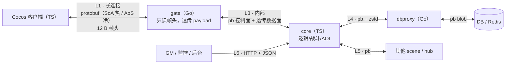

# 协议分工：默认 protobuf，什么时候才值得换

> 上级文档：[`server-engine-stack.md`](server-engine-stack.md)（§8.2 未压缩实测、§8.3 库选型）
> 配套证据：[`../spikes/ser-compare/`](../spikes/ser-compare/) —— `bench-ts.mjs`（读写）、`compress-bench.mjs`（压缩）、`fb-evolution.mjs`（FlatBuffers 的 struct 冻结）
> 状态：**规划文档（v2，已由 FlatBuffers-first 改为 protobuf-first）**。§4 的帧头与 msgId 是唯一不可逆的部分。

## 0. 结论先给

**四条规则：**

- **R1 · 默认全部走 protobuf。** 按数据形状选布局：**每 tick 的批量数值用 SoA（packed 数组）**，一次性的对象用 AoS（普通 message）。
- **R2 · 每帧广播的路径以"布局"换速度，不以"换格式"换速度。** 我们自己的实测：同一份 protobuf，AoS → SoA 让**读提速 3.3×、字节降 33%**，比换到 FlatBuffers 便宜得多。
- **R3 · 只是转发**（gate → logic、logic → client）→ **原样透传字节，不解码、不转码**。
- **R4 · 帧头保留 1 字节 `fmt`，值 1 固定为 protobuf。** 这是唯一的后路，成本 1 字节。

**为什么不给 FlatBuffers 留位置（这是我们自己的实测推翻了初稿）：**

| 项 | 数字 | 说明 |
|---|---|---|
| 客户端每帧解码（60 可见实体 × 20Hz） | pb AoS 35 µs → pb SoA **10.6 µs** → FB 6.2 µs | **FB 相对 pb SoA 只省 4 µs/帧 = 一帧预算的 0.03%** |
| 服务端每 tick（400 实体） | pb AoS 66 µs → pb SoA **20 µs** → FB 2 µs | 省 18 µs / 100 ms 预算 = 0.02% |
| 未压缩字节（每实体） | pb SoA 31.0 / pb AoS 47.4 / FB 64.1 | FB 最大 |
| **zstd-19 压缩后字节**（每实体，N=60） | pb SoA 25.4 / pb AoS 34.9 / FB 26.7 | **FB 只比 pb SoA 差 5.1%**，压缩把差距吃掉了 |

关键在第二行和第三行：**一旦把 protobuf 的布局从 AoS 换成 SoA，"读慢"这个理由就从 5.6× 缩到 1.7×**，绝对值是每帧 4 µs。为 0.03% 的帧预算去背一套额外的 schema 语言、一套 codegen、`struct` 冻结纪律（见 §6.3）和未压缩时 27% 的流量，不划算。

**FlatBuffers 仍然有价值，但不在我们的负载上**：它的收益随"同屏实体数 × 解码成本"线性增长。§9 给了量化触发条件——触发之前，别引入。

---

## 1. 判据：三档，不是两档

**默认第一档，只有明确理由才往下走。**

| 档 | 用什么 | 什么时候 |
|---|---|---|
| **A · pb SoA**（packed 数组，每字段一条） | `repeated <scalar> [packed=true]` | **每 tick 的批量数值**：位置、朝向、血量、状态位、AOI 进出列表。这是我们唯一的高频档 |
| **B · pb AoS**（普通 message） | `message` + `repeated` 或单条 | 其余一切：登录、背包、任务、邮件、商店、社交、聊天、错误、GM、内部 RPC、落库 |
| **C · raw** | 定长裸帧（8 字节） | 心跳 |

**什么时候允许跳出 A/B/C（目前没有）**：只有当 §9 的触发条件成立时，才允许为**单条**消息引入 FlatBuffers 或手写 codec。**不要因为"某条消息看起来热"就单独换格式**——上一版规划就是这么滑进去的。

**选 A 还是 B 的判断很具体**：

- 一次发**同一种结构的很多条**（实体列表）→ **A**（SoA）
- 一次发**一条结构里有很多字段**（一件装备、一封邮件）→ **B**（AoS）
- 一条消息里**既有列表又有字符串**（聊天、公会成员）→ **B**，并且按 §3.4 拆包

---

## 2. 链路清单



| 链路 | 格式 | 理由 |
|---|---|---|
| **L1** client ⇄ gate ⇄ logic | **protobuf**（热路径 SoA、冷路径 AoS） | 一种格式 = 一套 schema、一套 codegen、一套调试工具 |
| **L2** logic → gate → client 推送 | 同一通道，**字节透传** | gate 不解码，转发成本 = memcpy |
| **L3** gate ⇄ logic | 控制面 pb；数据面**透传** | gate 若解码状态包，零分配设计就废了 |
| **L4** logic ⇄ dbproxy ⇄ DB | **pb**，大对象再 zstd | 低频、要可读、要能与运维工具共用 |
| **L5** logic ↔ logic | **pb** | 低频、要能 debug；读方不是渲染层，不需要零拷贝 |
| **L6** 运维面 | **HTTP + JSON**（pb 的 `toJson`） | 不引入第三套协议 |
| **L7** 落库 / 日志 / 回放 | pb blob / JSON / **pb + 帧头** | 回放按帧重发原字节，零转码 |

---

## 3. 消息级清单

### 3.1 热路径（档 A · pb SoA）

| 消息族 | 频率 | 布局要点 |
|---|---|---|
| `SceneSnapshot`（进场景全量快照） | 每次进场景 | SoA packed 数组，一次性 400 实体 ≈ 12 KB；配 zstd-19 |
| `EntityDeltaBatch`（每 tick 增删改） | 10–20 Hz | SoA；**只发变化字段**（每个字段一条数组 + 一条 `dirtyMask`） |
| `MoveBatch`（位置/朝向） | 10–20 Hz | SoA，量化到 1/4 单位（int16）；这是最热的一条 |
| `CombatFrame`（技能/命中/伤害） | 20 Hz | SoA；事件条数不固定就再加一条 `repeated` 事件表 |
| `AOIEnterLeave`（视野进出） | 事件驱动 | SoA；只发 id 列表 |

**为什么不拆成"每条实体一个 message"**：同一个数据量下 AoS 读 585 ns/实体、SoA 读 176 ns/实体（§8.2 实测），字节也少 33%。**布局就是我们省下的那 3.3×**，不需要换格式。

### 3.2 冷路径（档 B · pb AoS）

| 消息族 | 频率 | 备注 |
|---|---|---|
| `Login / Auth / SelectServer / SelectRole` | 会话级 | 要抓包能看懂、要错误码 |
| `PlayerInfo / 属性面板 / 装备详情` | 人触发 | 可变长嵌套 |
| `Inventory*`（列表/使用/移动/出售） | 人触发 | 请求-响应 + 事务式错误码 |
| `Quest*`（列表/接取/提交/追踪） | 人触发 | 任务链是典型嵌套 |
| `Mail*` / `Shop*` / `Purchase` / `VerifyReceipt` | 人触发 | **涉及金额与订单，必须可读可审计** |
| `Social*`（好友/公会/审批） | 人触发 | 长列表 + 多状态机 |
| `ChatSend / ChatPush` | 1–2 Hz | 文本可变长，pb 更省；见 §3.4 |
| `RankList` | 开面板时 | 列表用 packed 数组，但仍是普通 message |
| `ErrorNotify / Toast / 重连` | 事件 | 极小消息，开销可忽略 |
| `GMCommand` | 人触发 | 必须可读可审计 |

### 3.3 落库与回放

| 数据 | 格式 | 备注 |
|---|---|---|
| 玩家存档 | **pb blob** + `schema_version` | 字段号演进安全；能 `toJson` 给 GM 看 |
| 日志（行为/支付/异常） | **JSON** | 可读性 > 体积 |
| 战斗回放 | **pb 帧 + 帧头**，按帧追加 | 重放 = 逐帧重发原字节；回放器需同版本 schema |

### 3.4 三个特殊形状

**① 心跳：raw 8 字节**（`u64` 客户端时间）。没有语义，不值得进 schema。

**② 聊天：pb AoS**。它同时满足"广播"（想上热路径）和"可变长文本"（该走 AoS）——而文本带宽由文本本身主导，布局换不到东西。

**③ 混合形状要拆，按"变与不变"拆，不按"业务对象"拆**：
- `EntityDeltaBatch`（SoA，纯数值）每 tick 发
- `EntityNameBatch`（AoS，只在名字变时发）按需补

理由：SoA 只能装标量；把 string 塞进去会把整条消息退化回 AoS，读成本立刻从 176 ns 回到 585 ns/实体。

---

## 4. 帧头与 msgId：唯一不可逆的部分

**12 字节定长帧头，4 字节对齐：**

```
off  size  field
0    1     fmt     1 = protobuf（当前只有这个值）, 0 = raw（心跳）, 2 = 保留
1    1     flags   bit0: zstd  bit1: 分片  bit2–7 保留
2    2     class   0 = 普通，1 = 战斗帧（给 gate 做优先级队列）
4    4     len     payload 字节数（LE）
8    4     msgId   见下表（LE）
12   ...   payload
```

**三条规矩：**

1. **`fmt` 由发送方写死，接收方不猜。** 同一个 `msgId` 永远只对应一种格式；换格式 = 换 `msgId`。
2. **gate 只读前 12 字节**，不解 payload、不看 schema，路由靠会话表（连接 → uid → logic 节点）。
3. **`msgId` 按域分段**，段内顺序数字，不复用已废弃的号：

| 段 | 域 | 布局 |
|---|---|---|
| `0x00xx` | 心跳 / 底层控制 | raw |
| `0x01xx` | 登录 / 鉴权 / 连接 | AoS |
| `0x02xx` | 场景 / AOI / 移动 | **SoA** |
| `0x03xx` | 战斗 | **SoA** |
| `0x04xx` | 背包 / 道具 | AoS |
| `0x05xx` | 任务 | AoS |
| `0x06xx` | 邮件 / 商店 / 支付 | AoS |
| `0x07xx` | 社交 / 公会 / 聊天 | AoS |
| `0x08xx` | 排行 / 成就 / 活动 | AoS |
| `0x09xx` | 错误 / 提示 / 重连 | AoS |
| `0x0Axx` | 内部 gate ⇄ logic | AoS |
| `0x0Bxx` | 内部 logic ⇄ dbproxy | AoS |
| `0xF0xx` | GM / 运维 | AoS |

**为什么先定帧头**：它改了就要三端同时发版、老客户端掉线。schema 可以加字段，帧头不能。

---

## 5. 压缩：实测之后，"省流量"不再是选格式的理由

【实测-本机】`spikes/ser-compare/compress-bench.mjs`（同一份数据、zstd 经 `@mongodb-js/zstd`）：

**N = 1000 实体（快照尺度，约 30–63 KB）**

| 编码 | 原始 | zstd-3 | zstd-19 | brotli-11 |
|---|---:|---:|---:|---:|
| **protobuf SoA** | 30,993 B | 19.81 KB (65%) | **19.60 KB (65%)** | 13.04 KB (43%) |
| protobuf AoS | 47,420 B | 33.51 KB (72%) | 29.90 KB (65%) | 22.85 KB (49%) |
| FlatBuffers AoS | 64,096 B | 29.41 KB (47%) | 24.41 KB (39%) | 27.94 KB (45%) |

**N = 60 实体（每 tick 增量尺度，约 1.9–3.9 KB）**

| 编码 | 原始 | zstd-3 | zstd-19 |
|---|---:|---:|---:|
| **protobuf SoA** | 1,898 B | 1.49 KB (80%) | **1.49 KB (80%)** |
| protobuf AoS | 2,835 B | 2.15 KB (78%) | 2.04 KB (74%) |
| FlatBuffers AoS | 3,936 B | 2.00 KB (52%) | 1.56 KB (41%) |

**三条结论：**

1. **压缩把"FB 字节劣势"基本吃掉**：未压缩时 FB 比 pb SoA 大 107%，压缩后（N=60）只大 **5%**。所以"FB 费流量"这个反对理由，在压缩之后不成立；同样，"pb 省流量"也不再是支持它的主要理由。
2. **布局的影响被压缩放大**：pb SoA 比 pb AoS 小 **34%**（zstd-19，N=1000）。所以**选 SoA 比选格式重要**——这一条在压缩前看不出来。
3. **brotli-11 的压缩率用不起**：它把 30 KB 压到 13 KB（zstd-19 是 19.6 KB），但**压缩一个 30 KB 包要 43,647 µs**（zstd-19 只要 17 µs）。除非是"离线出包/静态资源"，否则排除。

**压缩的时间预算**（zstd-3，压缩 + 解压，同一进程内测）：

| N | protobuf SoA | protobuf AoS | FlatBuffers AoS |
|---|---:|---:|---:|
| 1000 | 143 µs | 604 µs | 513 µs |
| 60 | 55 µs | 66 µs | 66 µs |

**什么时候压、用哪一档：**

- **每 tick 增量**：只在包 > 512 B 时压，用 **zstd-3**（55 µs/包 ≈ 0.3% 帧预算）。小于它，压缩头（~9 B）与 CPU 都不划算。
- **快照 / 落库 / 回放**：**zstd-19**（一次性，慢点无所谓）。
- **服务端压缩是"每次广播压一次，发给 N 个人"**，所以它的成本被 fan-out 摊薄；**客户端解压是每人每 tick 都付**，这是唯一要盯的数。

---

## 6. 布局纪律（取代初稿的"struct 冻结"章节）

### 6.1 SoA 的三条规矩

1. **热路径字段只允许标量**（int32 / int64 / bool / 量化后的定点数）。字符串、数组一律走配套的 AoS 消息（§3.4）。
2. **每条 SoA 消息带 `count` 与可选 `dirtyMask`**，避免"数组长度不一致"这类错误在运行时才发现。
3. **量化在发送端做**：坐标 1/4 单位（int16）、朝向 1/256 圈（uint16）、HP 用实际值。**量化范围写进 schema 注释**，因为它一旦上线就不能改（改了老客户端解析出错误坐标，而**不会有任何报错**）。

### 6.2 为什么"静默错误"是这里的主要风险

proto3 没有必填字段：**解码端拿到的是默认值，而不是错误**。所以布局/量化的任何变更都会表现为"客户端显示错"，而不是异常。防线只有一条：**同一份 fixture 在服务端与客户端解码后逐字段比对**（§7.2 的第 2 条 CI 规矩）。

### 6.3 附：如果哪天真的引入 FlatBuffers

FlatBuffers 的 `struct`（定长内联）**一旦上线就冻结**——这一点值得留档，因为它是最坏的失败模式。`spikes/ser-compare/fb-evolution.mjs` 实测（1000 实体，15 字段 struct）：

| 实验 | 结果 |
|---|---|
| 给 `EntityState` 末尾**加一个字段**，用新代码解老字节 | **不报错**。第 0 个实体 `id` 读成 1000999（真值 1000000）、`x` 读成 11081（真值 −100000），前 50 个实体 **50/50 全错** |
| 用 `table` 版本解老 struct 字节 | 也不报错（错误用法没有任何提示） |
| table 数组 vs struct 数组：读 1000 实体 | **36–42 vs 18 ns/实体（2.0–2.3×）** |
| table 数组 vs struct 数组：字节 | **74,336 vs 64,096 B（1.16×）** |

所以**如果**引入 FB：每帧消息的 struct 必须一次预留 4 个 `int` 槽位、上线后只允许占坑、需要新语义就开新 `msgId` 双发过渡、并在 CI 里对 `*.fbs` 的 struct 段做 hash 快照。

---

## 7. 代码组织与 CI

### 7.1 目录

```
schema/
  pb/         *.proto        ← 全部消息（热路径 SoA 也在里面）
  ids.yaml    msgId 注册表（唯一源） → 生成 TS / Go 常量
protocol/
  frame.ts    12 字节帧头编解码（客户端一份、gate 一份，字节必须一致）
```

**一份 `ids.yaml` 生成三处常量**：客户端 TS、gate Go、logic TS。名字对齐靠 codegen，不靠人。

### 7.2 三条 CI 规矩

1. **`regenerate && git diff --exit-code`** —— 生成物与 schema 不同步就 fail（防"提交旧产物"，这是 §8.3 里那个真会咬人的风险）。
2. **三端解码一致性** —— 同一份 fixture，`protoc-gen-go` / protobuf-es 解码后逐字段相等；且编码字节相同（S2 里已经这么做过：50,433 / 34,006 两侧一致）。
3. **量化范围快照** —— 热路径消息的量化注释（Q 格式）变更必须在 PR 里显式标注，CI 比对 schema 注释 hash。

### 7.3 PR review checklist

- [ ] 高频消息（≥5 Hz/连接）是 **SoA**；一次性对象是 AoS
- [ ] 热路径消息里没有字符串/数组（有就拆包）
- [ ] 新 `msgId` 从注册表申请，没有复用已废弃号
- [ ] 转发路径（gate）没有解 payload
- [ ] 涉及金额/订单的消息入了审计日志
- [ ] 量化参数与上一版一致（或 PR 显式标注变更）

---

## 8. 分阶段落地

| 阶段 | 内容 | 完成判据 |
|---|---|---|
| **P0** | 定帧头（§4）+ `ids.yaml` + 两份帧头实现（TS/Go）+ 一致性测试 | 同一帧在 TS 与 Go 解析出的字段完全相同；截断/超长/未知 `fmt` 都有明确错误 |
| **P1** | 第一条热路径消息用 **SoA** 实现（`MoveBatch`）；其余全 AoS | 端到端跑通；客户端每帧解码 < 1 ms |
| **P2** | `SceneSnapshot` + `EntityDeltaBatch` 迁 SoA；引入 zstd-19（快照）/ zstd-3（>512 B 增量） | 带宽与 P1 对比有量化下降；解压不超 0.5% 帧预算 |
| **P3** | gate 变"只读帧头"的透传器 | gate 单进程连接密度达标（对应 §8 的 S4） |
| **P4** | 回放落 pb 帧 + 帧头；跨服/迁移走 pb | 回放能逐帧重发；迁移不改变客户端可见行为 |

**顺序理由**：P0 不可逆，必须先做对；P1 用一条消息验证"SoA 够用"这个判断（如果不成立，§9 的触发条件会被提前触发）；P2 才谈压缩；P3 依赖 P0 的 `fmt` 才能不解析就转发。

---

## 9. 什么时候重新考虑 FlatBuffers

**量化触发（满足任一，且必须在压测数据里成立）：**

1. 客户端**每帧解码耗时 > 2 ms**（占 16.7 ms 预算的 12%），并且确认瓶颈在解码而不是业务逻辑；或
2. **同屏可见实体 > 200 且 tick ≥ 10 Hz**（此时 pb SoA 的 176 ns/实体 × 200 × 10 = 0.35 ms/s... 仍不算大，但低端安卓 5× 后就接近 2 ms）；或
3. 出现"同一份字节要**零转码**转发给几万个连接"的形态（当前不成立，回放不要求）。

**触发后的第一选择仍然不是 FlatBuffers**，而是：

1. 先把该路径的布局再压一层（更小的量化、位压缩、只发 delta）；
2. 再考虑**手写裸 codec**（我们已经在 S1 里证明 12 B/实体、0.17 ms/tick 是可行的）；
3. 最后才是 FlatBuffers——因为它的 struct 冻结纪律是永久的，而位压缩是局部的。

---

## 10. 未核实 / 待拍板

| # | 项 | 状态 |
|---|---|---|
| ① | **"pb 直接解进 SoA 数组"的实现成本** | **【未核实】**：本次测的 176 ns/实体是"解成对象数组"的 protobuf-es 路径。若手写"解进 TypedArray"的解析器，可能再降到接近 FB 的水平——那会让 §9 的触发条件更难被触发 |
| ② | zstd 解压在**低端安卓**上的实际耗时 | **【未核实】**：本文是 i5-14400F 的数。移动端按 3–5× 估，需要实测 |
| ③ | 小游戏 runtime 是否允许 wasm 解码器（zstd 的 JS 实现会慢一个数量级） | **【未核实】**：决定"压缩"在小游戏渠道上是否可用 |
| ④ | `dirtyMask` 的粒度（按字段还是按实体） | **待拍板**：按字段省字节，但实现复杂；建议先按实体 |
| ⑤ | 是否兼容 abelkhan 的 `proto/` | **【未核实】**：若复用它的服务端，msgId 段要重新对 |
| ⑥ | 帧头 `class` 字段（战斗帧优先级）是否真需要 | **未验证**：等 S4 压测才知道 |
