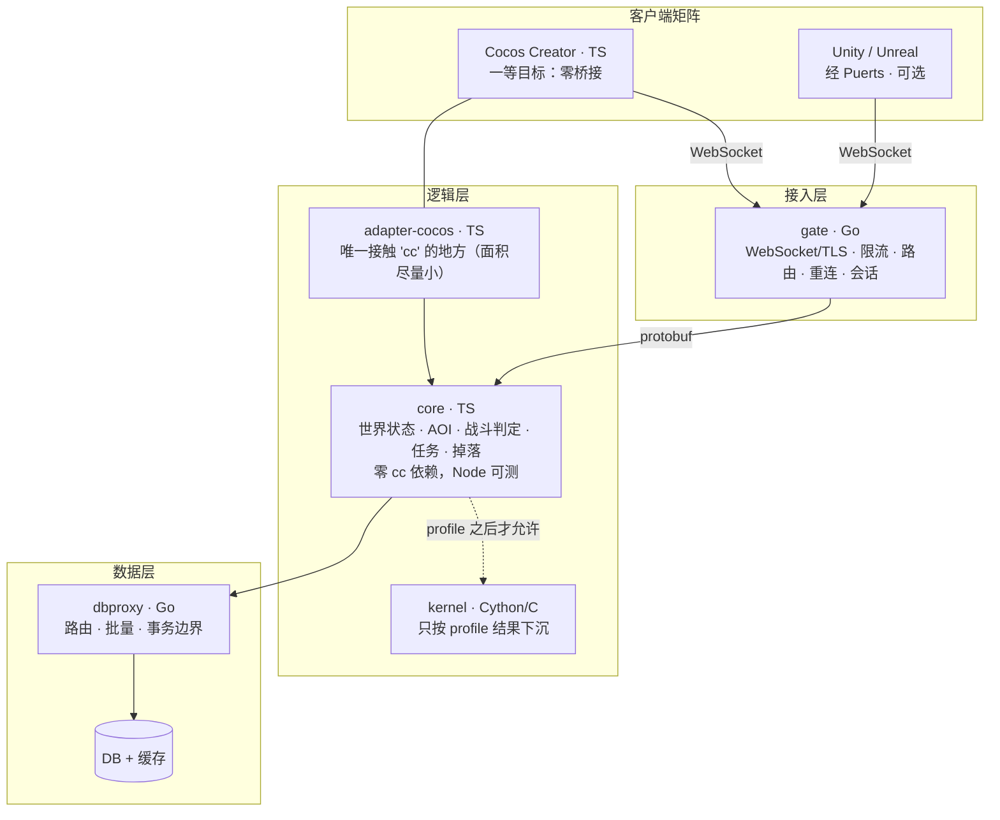

# 服务器引擎技术栈：Go 接入层 + TS 逻辑层 + Cython 内核

> 配套文档：[`../spikes/`](../spikes/) —— 本仓库**唯一的代码**，本文 §3、§4、§5 的每个数字与每条断言都出自那里，可复现。
> 上级文档：[`ai-native-game-engine.md`](ai-native-game-engine.md) —— "L0 内核独立于引擎""内核是唯一写者"是本文分层的来源。
> 相关文档：[`mmorpg-engine-choice.md`](mmorpg-engine-choice.md) —— 它的 §7/§8 建立在一个**本文已改写的前提**上，见 §6。
> 状态：**决策文档 + 实测**。§3–§5、§8.1、§8.2 是本机实测；§0–§2 是提案；§7 仍是未核实的东西。

## 证据等级

沿用主文档附录 B 的纪律，并新增一档：

| 标记 | 含义 |
|---|---|
| **【一手】** | 本轮实际抓到的官方文档 / 官方 API / 编译器与运行时的实际行为 |
| **【实测-本机】** | 本轮在本机跑出的数字。脚本在 [`../spikes/`](../spikes/)，机型与版本见附录 A |
| **【否定性】** | 逐条看过，确认**没有**该能力/该条目。只能证明"没有文档"，不等于绝对不存在 |
| **【前序会话】** | 上一个会话得出的结论，**本轮没有重新核对** |
| **【未核实】** | 没取得原文或没跑过。故意留空，不凭记忆填 |

⚠️ **本文最重要的坦诚**：§3 之外的性能判断**全部没有实测**。尤其"2w DAU 需要几台机器"这一句，本文给不出可以当预算用的数字，只在 §8 给出把它变成数字的实验。

---

## 0. 结论先给

| 层 | 定稿 | 一句话理由 | 证据 |
|---|---|---|---|
| **接入层 gate** | **Go** | 瓶颈是 syscall / 拷贝 / 加解密 / 连接状态，与语言无关；goroutine-per-conn + 复用缓冲可做到每连接零分配 | 【前序会话】 |
| **数据层 dbproxy** | **Go** | 瓶颈在 DB 与路由，不在语言；与 gate 共用一套运维与发布 | 【前序会话】 |
| **逻辑层 core** | **TS**（Node 可跑、Cocos 可跑、零 `cc` 依赖） | 与 Cocos 同语言 ⇒ 客户端共享代码；且 TS 的性能是"白送"的（§3） | 【实测-本机】§3 |
| **热路径内核** | **Cython / C**，按 profile 结果**逐段**下沉 | 同一段循环，Python 地板比 V8 慢约 80×，但天花板与之重合（§3） | 【实测-本机】§3 |
| **视图层** | Cocos Creator 为**一等目标**；Unity/Unreal 经 Puerts 为**可选** | 一等目标只允许一个，否则要付四端对等的代价（§1） | 【前序会话】 |
| **协议** | **全部 protobuf**：热路径用 SoA（packed 数组），冷路径用 AoS；帧头留 1 字节 `fmt` 做后路 | §8.2 的 FB 优势在换成 SoA 布局后缩到 4 µs/帧（0.03% 预算），且压缩后字节差仅 5%——不值得背第二套 schema | 【实测-本机】§8.2 + `protocol-map.md` |
| **RPC 类型** | 方法名**字面量**同时决定请求与响应类型，调用处零泛型参数 | 已在 TS 5.9 `--strict` 下验证：正例通过、4 条反例全部被拒 | 【实测-本机】§5 |
| **TS 执行方式** | 开发 `tsx`；`core` 开 `erasableSyntaxOnly`；路径用 `package.json#imports` | 擦除 ≠ 转换；别名由运行时解析的写法才不需要给每一处转译器配一遍 | 【一手】§4 |

**但真正需要读的是"为什么"，不是这张表。** 因为这套栈不是被"哪门语言快"决定的：

1. **在 2w DAU 这个量级上，CPU 不是瓶颈。** 峰值 CCU 数千、场景 tick 10Hz（战斗 20Hz）、实体 2–3 万——这些是**前提给定的人数，不是测出来的负载**。§8.1 的实测把它们变成了数字：逻辑层骨架在 50 场景下只吃 **11.1% 单核**（含 3× 未建模折算 33.2%）⇒ **约 0.2–0.7 核**。用性能选语言，是拿错的尺子量。
2. **真正的三个约束是结构性约束**：**连续可调性**（能不能先写最直白的实现、profile 之后再局部下沉，而不用重写架构）、**热更**（能不能不停服改逻辑）、**客户端共享**（能不能和 Cocos 用同一份代码）。
3. 这三个约束**没有任何一门语言能同时给满分**——所以结论必然是混合栈。混合栈的代价是"三种运行时 + 两套工具链 + 两次跨语言边界"，§4、§5、§2 的 CI 规矩全部是为了压这个代价。

---

## 1. 需求是怎么收敛的：三次改写，每次都在改答案

这一段是为了不让读者以为"选 TS"是一开始就想清楚的。**它是一路被推翻出来的**。

| 版本 | 新增的前提 | 它推翻了什么 | 逻辑层答案 |
|---|---|---|---|
| **V1** | 通用服务器引擎、性能优先、底层 flatbuffer + 逻辑层 protobuf、gate/dbproxy ∈ {Go, Rust, C++}、逻辑层 ∈ {C#, Scala, Python}、目标客户端 = 微小 / 抖小 / TapTap / Google Play / iOS | —— | **C#**（.NET 8：`struct`/`Span`/`ArrayPool` 让热路径接近原生，且能与 Unity 客户端共享代码） |
| **V2** | 实时战斗 + **总 DAU 2w 全区全服** + **客户端 Cocos** | **C# 的决定性理由消失**：Cocos 的脚本层是 TS/JS，C# 逻辑无法在 Cocos 客户端复用 | 改为"TS 战斗内核 + Go 帧同步服"（**后来整段作废**） |
| **V3** | **做 MMO，不是开房间**；Python 用 Cython 优化；TS 的 C++ 扩展"一个版本一组 API，老要跟着变"；目标是 Cocos 为主、Unity/Unreal 为辅 | **帧同步方案整段作废**：MMO 是持久世界 + 服务器权威 + AOI，判定在服务端算，客户端只做预测与插值。且"引擎不能绑定任何一门客户端脚本语言" | 仍在对等四端 → 需要 C ABI / wasm / 多语言绑定 |
| **V4** | **以 Cocos 为主要目标** | 四端对等的复杂度**可以砍掉一大半**：Cocos 原生 TS ⇒ 零桥接，wasm 退化成"profile 之后才加的优化项" | **TS `core`**，零 `cc` 依赖 |
| **V5** | 小游戏里 `new WebSocket` 直接可用【一手·口述】 | 传输入口**不做平台分叉**（此前把"平台 API 必须显式调用"当成了硬约束，是错的） | 不变 |
| **V6** | TS 与 Python 的性能上限之争；TS 的直接执行方式 | 把"选 TS"从口味之争变成可测量的判断 | 不变，§3/§4 给出数字与工具链 |

### 1.1 三个被淘汰/降级的选项，理由分别是

- **C#：不是被性能淘汰的。** .NET 8 的稳态吞吐与尾延迟足以做这件事，Orleans 也是这类系统的合理答案。它被淘汰的唯一理由是**换不到东西**：客户端是 Cocos(TS)，"与客户端共享代码"这条唯一的净收益归零，而代价是引入第二个运行时、第二套 GC/构建/发布、以及又一次跨语言边界。
- **Scala：被"平台 vs 工具包"和运维重量淘汰。** 差异不在性能，在编排模型——Orleans 是**平台**（启动 silo，成员管理/放置/激活回收/定时器/存储全由运行时负责，对外只有"接口 + await"），Pekko 是**一组库**（`ActorSystem` 只是容器，Sharding / Persistence / Streams 要自己拼）。【前序会话：这一条是当轮的对照结论，本轮未重新核对】对一个还需要自己写 gate 与 dbproxy 的项目，"多一层要自己拼的库"是净负担。
- **Python：没有被淘汰，是被降级。** 它从"逻辑层候选"变成"热路径内核的工具"。原先反对它的理由（高密度实时战斗、每 tick 遍历几万实体）在 V2 的规模下面不成立；支持它的理由（Cython 逐段下沉、`importlib.reload` 真热更）保留下来，但都不足以撑起整个逻辑层。

### 1.2 为什么不是"C# 服务端 + C# 逻辑"（也就是本仓库另一份文档的路径）

那是 [`mmorpg-engine-choice.md`](mmorpg-engine-choice.md) §8 在"客户端用 .NET 引擎（Stride / Godot）"前提下的默认答案。当客户端换成 Cocos，那条链的**第一环断了**：abelkhan 的客户端绑定只有 C#（`client/csharp/`），而前端是 TS。详见 §6。

---

## 2. 分层与边界：每一层"不许做什么"比"做什么"更重要



| 层 | 语言 | 职责 | **禁止** |
|---|---|---|---|
| gate | Go | 长连接、TLS/WS、限流、加解密、路由、重连、会话映射 | 任何游戏规则；任何"顺手算一下"的判定 |
| dbproxy | Go | 存储路由、批量合并、事务边界、缓存一致性 | 业务语义（"这个道具该不该给"不属于它） |
| **core** | TS | 世界状态与**唯一写权**、AOI、战斗判定、任务、掉落 | **`import 'cc'`**；直接碰 socket；持有渲染态 |
| adapter-cocos | TS | 输入采集、表现插值、把 core 的差分画出来 | 持有权威状态；写规则 |
| kernel | Cython/C | AOI 网格、位压缩、批处理等被 profile 证明的热点 | 成为**第二套**业务逻辑（一旦规则出现在这里，core 就不再有唯一写权） |

### 2.1 三条必须由 CI 强制执行的规矩

这是整套结构能不能活过三个月的基础，比任何模块设计都重要：

1. **`core` 不得 `import 'cc'`** —— ESLint `no-restricted-imports` + CI，违反直接挂构建。
2. **`core` 必须能在 Node 里跑** —— 单测用 vitest，不启动 Cocos 编辑器。这条同时保证了"服务端能复用同一份逻辑"与"改逻辑的反馈循环是秒级而不是分钟级"。
3. **`adapter-*` 是唯一接触引擎的层** —— 引擎升级只改 adapter，不改 core。

> 这三条与主文档的"内核是唯一写者"是同一条纪律在两个尺度上的投影：**世界状态只有一个写者，跨语言边界的调用点也只有一个**。

---

## 3. 实测：地板与天花板（本文唯一硬的地方）

脚本：[`../spikes/ts-vs-python/`](../spikes/ts-vs-python/)；环境见附录 A。
同一份算法 `x += vx; y += vy; s += x`，N = 100,000 实体 × 60 tick，单位 **ns / 实体·tick**。

| 实现 | ns/实体·tick（3 次） | 相对 V8 | 结论 |
|---|---:|---:|---|
| **Cython 裸指针**（`cdef class` + `malloc`） | **0.72 – 0.73** | 0.82× | 天花板在这里 |
| Cython `memoryview`（`double[::1]`） | 0.79 – 0.82 | 0.92× | **与天花板差 11%** |
| numpy 向量化 | 0.89 – 0.91 | 1.01× | 与 V8 重合 |
| **Node 18 TypedArray**（SoA，最朴素写法） | **0.85 – 0.97** | 1.00× | 白送，不用做任何事 |
| 纯 Python（`list`） | 69.6 – 71.5 | **79 – 82×** | 地板 |
| Python + `array('d')` | 153.7 – 155.5 | 172× | 比 `list` 还慢——元素访问要装箱 |

### 3.1 方法论修正：第一版基准是错的，这里改掉

第一版把 `list → ndarray` 的转换放进了计时区，于是得出"numpy 2.87、Cython memoryview 2.71，只有裸指针 0.92 才追平 V8"。**那是转换成本，不是积分循环。** 把构造与分配移出计时区后，两条结论必须改写：

```diff
- Cython memoryview 比裸指针慢 3 倍 ⇒ "Cython 的优化是手艺活，只有裸指针能追平 V8"
+ Cython memoryview 0.79–0.82 ⇒ 与 numpy、V8 在 ±10% 内重合；裸指针只再快 11%
```

`diff` 里那句"手艺活"在**本例**（SoA 稠密循环）不成立：`boundscheck=False, wraparound=False` 的 memoryview 已经足够。裸指针只在热循环里还需要指针算术、自定义 stride 或消除最后一次索引运算时才值得写——而"值得写"的那一天必须由 profile 说出来，不能凭感觉。

> 这一段留在文档里而不删掉，是因为**它本身就是这类调研的主要风险**：一个放错位置的计时区，能让结论差 3 倍，而且看起来完全合理。

### 3.2 保留下来的判断

- **地板差约 80 倍**（4 次运行的比值区间 79–82×）：纯 Python 每步都要字节码分派 + 引用计数；V8 把这段循环直接编成机器码、TypedArray 访问零装箱。
- **天花板三方重合**（0.72 ~ 0.97）：Cython 与 numpy 走的是同一块 C 代码，V8 的 JIT 也到那里。所以"Python 性能上限高"这句话的真实含义是——**它上限高是因为它能直接写 C，不是因为 Python 快**。当你为了吃到 0.72 而把热路径写成裸指针时，你已经不在写 Python 了。
- **形状不同才是关键**：TS 是一条**窄带**（0.88 白送，往上只有 WASM/N-API 两个离散档位，且都要付边界成本与 ABI 维护——后者正是 V3 里被点名的痛点）；Python 是一条**宽带**（69.6 起步，可以逐段、逐函数地往下沉，每段独立决定停在哪一层）。这就是 §0 所说的"连续可调性"。

### 3.3 TS 侧：优化手法的收益排序（N = 1,000,000）

脚本：[`../spikes/ts-runtime/bench-ts-perf.mjs`](../spikes/ts-runtime/bench-ts-perf.mjs)

| 对照 | 慢 | 快 | 倍率 |
|---|---|---:|---:|
| `JSON.stringify` vs `DataView` 定长打包（1e4 实体 × 20 轮） | 67.9 ms | 0.5 ms | **130×** |
| 遍历：`reduce` vs `for (i++)`（TypedArray 为基准） | 116.3 ms | 10.0 ms | **11.6×** |
| 遍历：`for...of` vs `for (i++)` | 69.8 ms | 10.0 ms | **7.0×** |
| 分配：逃逸并保留 vs 1024 槽对象池 | 16.6 ms | 2.4 ms | **6.99×** |
| 调用点：megamorphic（A..E 混用）vs monomorphic | 83.1 ms | 16.0 ms | **5.19×** |
| 数据布局：AoS（对象数组）vs SoA（`Float64Array`） | 302.4 ms | 85.2 ms | **3.55×** |

排序本身就是答案：**序列化形态 > 数据布局 > 遍历/分配 > 调用点形态**，每一条都比"抠 JS 写法"高一个数量级。

> 💀 **最后一行是最危险的一条**：deopt **不报错**。同一个函数，因为一个调用点混了 5 种对象类型就慢 5 倍，CI 里没有任何东西会提示你。这类"隐形悬崖"是 TS 相对 Cython 唯一真正的**工程**劣势（不是性能劣势）：Python 的慢是显式的、可以被 py-spy 定位的；V8 的慢是静默的，且随"谁调了谁"而变。

### 3.4 该怎么优化：两侧的阶梯（按实测收益排序）

**Python / Cython 侧**

1. **换成 C 实现的内建**：numpy / `bisect` / `heapq` / `struct`。一行 `x += vx` 把 69.6 变成 0.89（**78×**），改动量几乎为零。
2. **数据布局**：`memoryview` / numpy / SoA。注意 `array('d')` **反而更慢**（153.7），因为它每次元素访问都要装箱。
3. **下沉 Cython，写法要正确**：`cdef`/`cpdef` 而非 `def`；`nogil`；关 `boundscheck`/`wraparound`/`nonecheck`。
4. **消除引用计数**：热循环里不要出现 `PyObject`——`cdef` 局部变量、`cdef class`、C struct 数组。
5. **多进程分片**：GIL 无解就是无解，一场景一进程。
6. **profile 顺序**：`cProfile` 找函数级热点 → `py-spy` 看线上 → `cython -a` 看黄行（黄 = 与 Python 交互）。
7. **构建链是隐性成本**（见 §7-③）：Cython 需要在每个构建目标上能编译。

**TS 侧**

1. **0.88 是白送的**：不需要工具链、不需要编译步骤、不需要管 ABI。
2. **真正的风险是 deopt**（§3.3 末）：单态调用点、`for` 循环、TypedArray + SoA、避免逃逸分配（在 §3.3 的用例里，不逃逸 0.5 ms vs 逃逸并保留 16.6 ms，**33×**）。
3. **序列化先于一切**：`DataView`/二进制打包比 JSON 快两个数量级——这条直接决定"协议层要不要 JSON 兜底"。
4. 到顶后的两条路都贵：WASM（10–40% 损失 + 边界成本 + 自己管内存）与 N-API（每版本一组 API，V3 里已经抱怨过）。

---

## 4. TS 逻辑层的工程纪律：「擦除」与「转换」不是一回事

这一节的存在理由：`core` 要**同一份源码**同时被三种方式消费——Node 直接跑（服务端复用/压测/单测）、Cocos 编译、esbuild 打包。

> 这条要求会一路传导到"选哪个 protobuf 库"上：protobuf-es 生成的是**真 TS 源**，能进这条路；protobufjs 的产物是 CommonJS，进不来（实测见 §8.3）。任何需要"特殊改写"的语法都会在其中一条路上炸。

### 4.1 五条路径

| 方式 | 怎么用 | 特点 |
|---|---|---|
| **Node 原生类型擦除** | `node app.ts`（22.6+ 加 `--experimental-strip-types`；23.6+ 默认开）【前序会话】 | 零依赖、零安装，但**只能擦除，不能转换** |
| **Bun** | `bun app.ts` | 原生完整 TS（enum/decorator/tsconfig paths），启动最快【前序会话】 |
| **Deno** | `deno run app.ts` | 原生 TS，带权限模型【前序会话】 |
| **tsx**（esbuild 驱动） | `npx tsx app.ts` | Node 生态最成熟，Node 18 就能用【实测-本机：Node 18.20.8 对 `--experimental-strip-types` / `--experimental-transform-types` 都报 `bad option`，而 `npx tsx t.ts` 直接跑通】 |
| ts-node / swc-node | `ts-node app.ts` | 老牌、慢、ESM 支持差，新项目不建议【前序会话】 |

### 4.2 擦除模式下"一用就炸"的语法

`enum` / `namespace` / 构造函数参数属性 / 装饰器 / `const enum` —— 擦除只是**删掉类型注解**，不做任何代码改写，所以这些语法擦完就不存在了。

**解法不是记住这份清单，而是让编译器替你记住**：

```jsonc
// core/tsconfig.json
{ "compilerOptions": { "erasableSyntaxOnly": true } }
```

【实测-本机】TS 5.9 打开该 flag 后，`enum Color { Red, Green }` 直接报错：

```
error TS1294: This syntax is not allowed when 'erasableSyntaxOnly' is enabled.
```

复现脚本：[`../spikes/ts-runtime/erasable-syntax/`](../spikes/ts-runtime/erasable-syntax/)（**这个用例就是应该失败**）。于是"`core` 能不能被零编译步骤直接跑"从一条口头约定变成一条 CI 断言。

### 4.3 `import type`：擦除模式下的头号线上事故

```ts
import { PlayerState } from './player.ts';       // ❌ PlayerState 只是类型：擦除后 import 仍在 → 运行时崩
import type { PlayerState } from './player.ts';  // ✅
```

**类型检查器发现不了这件事**（类型层面完全正确），只有运行时才会炸。配套：`verbatimModuleSyntax` + ESLint `consistent-type-imports`。

### 4.4 路径别名：用 `package.json#imports`，不要用 tsconfig `paths`

Node / Bun / tsx 直接跑时**不读 tsconfig 的 `paths`**。正解是 Node 原生支持的 `imports` 字段：

```jsonc
{ "imports": { "#core/*": "./core/*" } }
```

【实测-本机】Node 18.20.8 下 `import { hello } from '#core/x.mjs'` 正常运行。复现：[`../spikes/ts-runtime/imports-field/`](../spikes/ts-runtime/imports-field/)。

对 `core / adapter-cocos / app` 这种结构，这一条能省掉"每个转译器 / 打包器 / 测试框架各配一遍路径"的全部配置——而这正是 V3 里"一个版本一组 API，老要跟着变"那类痛苦的另一种形态。

### 4.5 显式扩展名

直接执行时 import 要写全 `./foo.ts`（不是 `./foo`）。这也正是 `moduleResolution: "bundler"` + `allowImportingTsExtensions` 允许的写法。

### 4.6 生产环境不要用运行时转译

| 场景 | 用什么 |
|---|---|
| 开发 | `tsx watch`（Node 18）或 `node --watch --experimental-strip-types`（22.6+） |
| 单测 | **vitest**（内部 esbuild，天然吃 TS） |
| CI 类型检查 | `tsc --noEmit`（只检查，不产出） |
| 生产产物 | `esbuild` / `swc` 打包 → 跑纯 JS |
| 脚本 / 工具链 | 直接 `tsx` |

理由很实在：启动开销（每次启动都编译一遍）、错误栈与 sourcemap、依赖体积，以及"开发能跑、生产跑不了"的版本漂移。

### 4.7 一个必须知道的死路：TS/JS 没有真热更

Node 的 **ESM 模块缓存不可卸载**（只有 CJS 能 `delete require.cache`）。所以 TS 逻辑层**天生做不到** Python 的 `importlib.reload` 那种粒度。生产上只能"编译产物 + 滚动重启 + 断线重连"。

这条不是缺陷清单里的一条，它是 §0 里那句判断（"三个约束没有一门语言给满分"）的**另一半**：**热更能力是 Python 的独家优势，TS 替代不了**。所以如果将来"不停服改逻辑"变成一级需求，答案不是"给 TS 加热更"，而是"把该段逻辑挪进 kernel（Python/Cython 侧）"——这正是 §2 的分层要留出的口子。

---

## 5. RPC 类型：让方法名同时决定请求与响应

原始写法是 `reqEntity<type>("rpc.method", proto) -> type`——需要手动把响应类型塞进泛型。TS 可以更省：**方法名字面量同时约束请求与响应，调用处一个泛型都不用写**。

```ts
// codegen 产物：一份 schema，客户端与服务端同一份
interface RpcMap {
  "player.getInfo": [PlayerGetInfoReq, PlayerGetInfoRes];
  "mail.claim":    [MailClaimReq,    MailClaimRes];
  "player.move":   [MoveReq,         MoveRes];
}

declare function reqEntity<K extends keyof RpcMap>(
  method: K,
  req: RpcMap[K][0],
): Promise<RpcMap[K][1]>;

const info = await reqEntity("player.getInfo", { uid: 1n });
info.level;      // ✅ 推断为 PlayerGetInfoRes
// reqEntity("player.getInfo", { mailId: 7 });  // ❌ 编译期报错
```

完整版（含实体维度、类型层相等断言、错误用可辨识联合建模、唯一一处 `as` 在传输边界）见 [`../spikes/rpc-typing/rpc-types-demo.ts`](../spikes/rpc-typing/rpc-types-demo.ts)。

**这条不是"看着像"，它有可执行的断言。** `negative.ts` 把四条错用各配一条 `@ts-expect-error`：

```bash
npx --yes -p typescript@5.9 tsc -p .   # → exit 0
```

【实测-本机】exit 0 同时证明两件事：正例通过，且四条反例**确实**会被拒绝（若某条没报错，`@ts-expect-error` 自己会被报成 `Unused '@ts-expect-error' directive`）。于是"这套 RPC 类型安全吗"从主观判断变成一条能进 CI 的断言。

**诚实的摩擦点**：一旦要"实体维度 × 方法维度"的双层泛型索引（`EntityApis[E][K][0]`），TS 直接推导不出来，需要一个 conditional helper 兜一下（`ReqOf` / `ResOf`），一次性写两个类型别名即可。这是这个模式上唯一的真实摩擦，不影响结论。

---

## 6. 与 abelkhan 的关系：两份文档不能互相矛盾

[`mmorpg-engine-choice.md`](mmorpg-engine-choice.md) §8 的结论是："**若服务端用 abelkhan**，客户端默认选 Godot(.NET)"（因为"纯 C# 数据 + 引擎只做视图"本来就是主文档的架构）。本文必须说清这个前提现在处于什么状态。

### 6.1 §8 的前提在当前技术栈下不成立

| §8 的前提 | 现在的状态 |
|---|---|
| 客户端是 .NET 引擎（Stride / Godot） | **改了**：Cocos 为一等目标，脚本层是 TS |
| 服务端框架是 abelkhan（C#，`client/csharp` 是唯一绑定） | **不需要**：abelkhan 的 C# 客户端绑定在前端无位可放 |
| 逻辑层是 C#，因此"客户端/服务端同语言"成立 | **不成立**：逻辑层是 TS，同语言发生在 Cocos ↔ core 之间，不在服务端框架里 |

**所以 §8 仍然有效，但它现在是一条"条件命题"而不是结论**：如果哪天决定复用 abelkhan 的**服务端**，那么客户端引擎必须重新在 Stride/Godot(.NET) 之间选，且 TS 逻辑层要作废。这两条路互斥，不能各取一半——**这是本栈最重要的一个"要不就别开始"的边界**。

### 6.2 能复用的是"拓扑形状"，不是代码

abelkhan 的结构（`core/` RPC、`engine/`、`gate/`、`hub/`、`proto/`、`dependences/{consul,redis}`、MongoDB 存储、protobuf 序列化）【一手，见 [`mmorpg-engine-choice.md`](mmorpg-engine-choice.md) §8.1】——本文的分层几乎是同一个形状：**gate + hub(逻辑) + dbproxy + protobuf**。差别只在实现语言：gate/dbproxy 换成 Go，逻辑层换成 TS。

也就是说：**abelkhan 对本文最大的贡献是"证明了这套拓扑在 C# 里能跑"，而不是"我们可以直接用它"。**

### 6.3 传输：这是唯一一处"语言选择给架构让路"的地方

§8.2 的一手否定性结论：abelkhan 的 `core/` 里**只有 TCP 与 WebSocket**，没有 UDP / KCP / ENet（见 [`mmorpg-engine-choice.md`](mmorpg-engine-choice.md) §8.2）。而 MMO 的即时战斗对队头阻塞敏感。同一节还记了一条许可陷阱：**若为了加 UDP 而修改 abelkhan 的 `core`，那是修改 LGPL-2.1 库，修改本身需按 LGPL 公开**。

**本栈在这件事上有一个真实优势**：gate 是 Go 的自有进程，加一条 QUIC/UDP 通道是**加一个进程 + 一条协议**，不是改一个 LGPL 库的 core。代价是"自己要写"，收益是"许可与演进都不受限"。这一条值得明账记账，因为它是混合栈少见的"省事"时刻。

### 6.4 一个未验证的可选路径（记在这里，别当方案用）

若将来复用 abelkhan 的 `hub` / `dbproxy`，它们与 Go gate 之间本来就通——abelkhan 的协议层就是 protobuf。但这只是"理论上是通的"，**本轮未做任何验证**，见 §7-⑥。

---

## 7. 未核实清单（本文的自我否定）

| # | 项 | 状态 | 它会影响什么 |
|---|---|---|---|
| ① | **"底层 flatbuffer + 逻辑层 protobuf"这个划分** | ✅ **已核实并改写**（§8.2）：FB 读 33× 快、pb 小 21–47%，但分界线应是**频率与方向**而非分层 | 已改写 §0 的协议行 |
| ② | Node 22.6+ 原生擦除 / 23.6 默认开启、Bun/Deno 的实际启动开销 | **【前序会话】**，本机 Node 18.20.8 无法验证 | 只影响开发体验，不影响架构 |
| ③ | Cython 的**跨平台构建**（Linux 容器、cp312/cp314 ABI、CI 产物分发） | **【未核实】**，本轮只在 Windows 本机编过 | 若 CI 出不了产物，kernel 这条腿就断了 |
| ④ | **2w DAU → 机器数 / 带宽 / 内存** | **【未核实·说明性】**：全部是算术推演，没有任何压测 | 这是决策者最想要、本文最给不出的数字（§8-S1/S4 就是补它） |
| ⑤ | Cocos 3.x 自家编译链与 `erasableSyntaxOnly` / `package.json#imports` 的兼容性 | **【未核实】**，本轮只验证了 Node 与 tsc | 若 Cocos 的构建不认 `imports` 字段，adapter 侧要退回相对路径 |
| ⑥ | Go gate ↔ C# hub 的互通（复用 abelkhan 时） | **【未核实】**，纯属"看起来通" | §6.4 的可选路径是否成立 |
| ⑦ | 小游戏 runtime 的 WebSocket 能力上限（帧率、单帧字节、`permessage-deflate`） | **【一手·口述】**：用户确认 `new WebSocket` 可用；**上限未测** | 决定 gate 的限流参数与"要不要自建压缩层" |
| ⑧ | TS `core` 在**真实形状**（AOI 网格 + 属性 diff + 位压缩）下的每 tick 耗时 | ✅ **已核实**（§8.1）：400 实体/场景 0.17 ms、1 万 5.21 ms、3 万 15.77 ms | 已改写 §0 的量级表述 |
| ⑨ | "编译产物 + 滚动重启 + 断线重连"的实际用户感知 | **【未核实】**，未测 | §4.7 的降级方案够不够用 |
| ⑩ | Puerts 在新架构下是否还必要 | **【未核实】**：Unity/Unreal 已降为可选目标 | 若两者都不做，第 2 条的间接成本可整段删除 |

---

## 8. 五个 spike：S1/S2 已执行，S3–S5 待跑

| # | 实验 | 状态 |
|---|---|---|
| **S1** | TS `core` 的真实形状（网格 AOI + 属性 diff + 位压缩）的每 tick 耗时，并折算机器数 | ✅ **已执行**，见 §8.1 |
| **S2** | flatbuffer vs protobuf：同一条消息的 encode/decode 耗时与字节数 | ✅ **已执行**，见 §8.2 |
| **S3** | kernel 的构建链（Linux 容器里 CI 出一条 `perf.so`） | ⏳ 待跑 |
| **S4** | gate 的 10 万连接（Go + WebSocket + TLS 单进程） | ⏳ 待跑 |
| **S5** | 滚动重启的用户感知（编译产物 + 重启 + 断线重连） | ⏳ 待跑 |

### 8.1 S1 结果：真实形状的 tick —— **判据未达成，但结论反而更强**

脚本：[`../spikes/aoi-tick/bench.mjs`](../spikes/aoi-tick/bench.mjs)（四段计时）与 [`../spikes/aoi-tick/scale.mjs`](../spikes/aoi-tick/scale.mjs)（折算核数）。

**方法（三个刻意的设计）：**

1. **世界尺寸随实体数按比例放大**，密度固定 ⇒ 每个观察者的 3×3 邻居恒为 ~36 个可见实体。否则大场景只是被测成了更高的密度，规模对比会假性超线性。
2. **循环内零分配**（无对象/数组字面量，所有缓冲外置），否则测的是 GC。
3. **四段分别计时**：① 积分 ② 网格重建（计数排序）③ AOI 查询 ④ diff+打包（列式量化到 12 字节/实体）。

**【实测-本机】单场景一 tick（中位数，200 tick）：**

| 实体/场景 | 世界边长 | 中位 tick | P95 | ① 积分 | ② 网格 | ③ 查询 | ④ 打包 | AOI 对数/tick | 字节/tick |
|---:|---:|---:|---:|---:|---:|---:|---:|---:|---:|
| 400 | 400 | **0.17 ms** | 0.19 ms | 0.00 | 0.00 | 0.10 | 0.06 | 9,324 | 111,888 |
| 1,000 | 640 | 0.45 ms | 0.50 ms | 0.00 | 0.00 | 0.28 | 0.16 | 23,668 | 284,016 |
| 5,000 | 1,440 | 2.45 ms | 2.75 ms | 0.01 | 0.02 | 1.53 | 0.88 | 119,988 | 1,439,856 |
| 10,000 | 2,000 | **5.21 ms** | 5.62 ms | 0.02 | 0.04 | 3.15 | 1.96 | 256,228 | 3,074,736 |
| 30,000 | 3,480 | 15.77 ms | 16.89 ms | 0.07 | 0.15 | 7.96 | 7.57 | 872,936 | 10,475,232 |

**判据对照：** 原判据是"1 万实体、10Hz 下 tick < 5 ms"。实测 **5.21 ms，差 4%，判据未达成**——我不会把它四舍五入成"通过"。

**但这条判据本身问错了问题。** 真实配置不是"1 万实体挤在一个场景"：2w DAU、峰值 CCU 4000、单场景 80 玩家 + 4 倍怪物 = **400 实体/场景**，那是 **0.17 ms/tick，判据阀值的 1/30**。1 万实体/场景对应的是"全区全服挤在一个场景"这种极端形态，它也只要 5.21 ms/tick——10Hz 下占单核 5.2%。

**折算机器数**（`scale.mjs`，业务参数与实测值严格分开）：

| 项 | 值 |
|---|---|
| 逻辑 CPU（50 场景：15 战斗 20Hz + 35 非战斗 10Hz） | **110.5 ms/s = 11.1% 单核** |
| × 未建模倍数 3（战斗判定/AI/RPC 派发/DB 回调/GC） | **33.2% 单核 ⇒ 0.66 核** |
| 极端：3 万实体单一大场景 @20Hz | 31.5% 单核（P95 16.89 ms / 50 ms 预算） |
| 极端：每场景 20 人 × 200 场景 | 34.0% 单核 |

> ⚠️ **这里必须修正本文 §0 的一句话。** 初稿写"CPU 有两个数量级以上余量"——那是一个没有实验支撑的量级猜测，**实测只有 1.5–9×**（11.1% 原始 / 33.2% 含 3× 折算 / 50% 预算）。正确表述是：**逻辑层骨架在 2w DAU 下占大约 0.2–0.7 个核，机器数由 gate 长连接与 DB 决定，而不是由逻辑层决定**。结论方向没变，量级说错了。

**阶段归因（这才是可执行的收获）：**

- **③ 查询 + ④ 打包 ≈ 96–98% 的 tick**（ 400 实体：59% + 35%；3 万实体：50% + 48%）
- **① 积分 + ② 网格 ≈ 1–4%**，而且积分在第一 spike 里依然是 0.9 ns/实体。也就是说：**真实场景下单个实体的成本从 0.9 ns 变成了 425 ns（400 实体：0.17 ms / 400），涨了 470 倍，而涨的全是 AOI 与打包。**
- 所以优化顺序与 §3.4 的阶梯一致但更具体：先动 AOI（按格的邻居集缓存、兴趣集跨 tick 复用、视锥裁剪），再动打包（12 字节 → 6 字节、或只发 delta），而不是先动积分/网格。

**这个结果没算什么**（已写进脚本输出，此处重申）：战斗判定与技能、NPC 的 AI/寻路、RPC 反序列化与派发、DB 回调与跨服、网络发送本身。所以上表的数字只能读作**状态同步骨架的成本**，而且是**单线程**的——多场景并行/多线程未测。

### 8.2 S2 结果：flatbuffer vs protobuf —— **判据问错了，答案不是二选一**

脚本：[`../spikes/ser-compare/`](../spikes/ser-compare/)。同一份 schema（10 头字段 + 每实体 15 个字段 = 25 个字段名，N = 1000 实体），两种格式 × 两种布局 = 四组，外加 JSON 基线。

**为什么要两套布局：** 只测"格式"会把两件事混在一起——"varint + tag 的开销"与"逐行 vs 逐列的内存布局"。主文档 §3.3 的实测说明布局的影响可能大于格式，所以必须分开。

**先立一个验收条件：两边字节流必须一致。** 四种变体在 TS（protobufjs 静态码 / flatc-TS）与 Go（protoc-gen-go / flatc-Go）两侧产出的字节数完全相同：**50433 / 64096 / 34006 / 64232**，单条实体的 hex 也逐字节相同。没有这条，下面的比较就只是在比两套不同的数据。

**【实测-本机】N = 1000 实体（两侧各跑 3 次取区间）：**

| 实现 | 字节 | 每实体 B | Go encode | Go read | Node encode | Node read |
|---|---:|---:|---:|---:|---:|---:|
| **protobuf AoS**（repeated message） | **50,433** | 50.4 | 206–214 µs | 164–166 µs（**166 ns/实体**） | 750–771 µs | 578–586 µs |
| **FlatBuffers AoS**（struct 数组） | 64,096 | 64.1 | **71–74 µs** | **5–8 µs（5–8 ns/实体）** | **150–182 µs** | **103–104 µs** |
| **protobuf SoA**（packed 数组） | **34,006** | **34.0** | 55–57 µs | 50.7–50.9 µs | 550–553 µs | 482–503 µs |
| **FlatBuffers SoA**（字段 vector） | 64,232 | 64.2 | 53–58 µs | 18.9–20.4 µs | 254–262 µs | 150–167 µs |
| JSON（基线） | 178,993 | 179.0 | — | — | 902 µs | 627–634 µs |

**三个结论：**

1. **字节数：protobuf 全胜。** AoS 小 21%（50.4 vs 64.1）、SoA 小 **47%**（34.0 vs 64.2）。原因很机械：varint + zigzag + 省略默认值（这份数据里 `hp_max` 全是 10000、`level` ≤ 80、`faction` 只有 4 种） vs FlatBuffers 的**定宽 + 每字段都占位**。
2. **读：FlatBuffers 全胜，Go 里是碾压级。** AoS 下 Go 是 **5–8 ns vs 165 ns（21–33×）**；即便在 JS 里（`BigInt` 与 getter 开销更重）也是 103 vs 583 µs（5.6×）。`wrap` 本身在 Node 里只要 **0.7 µs**——在 Go 里低于时钟分辨率（`<LOD`）。
3. **格式与布局是正交的两个决定，而且方向相反。** 同一份 protobuf，改成 SoA：字节 **−33%**、读 **−69%**；同一份 FlatBuffers，改成 SoA：字节**不变**（64.1 → 64.2），而读**变慢 4×**（5 → 19 ns，因为每个字段多一次 vector 偏移解析）。**没有任何一个变体在两个维度同时赢。**

> **落地清单**（逐条消息族、帧头、msgId 段、压缩策略、P0–P4 路线、重新评估 FB 的量化触发）见 [`protocol-map.md`](protocol-map.md)。

**所以原判据（"差距 > 2× 才值得保留双协议"）应该废掉。** 但下面这条"分工规则"在本轮**又被进一步推翻**——因为把 protobuf 的布局换成 SoA 之后（读 176 ns vs 585 ns/实体），FB 的优势缩到"每帧 4 µs"（0.03% 帧预算），不再值得为它维护第二套 schema 与 `struct` 冻结纪律。完整推演与 zstd 实测见 [`protocol-map.md`](protocol-map.md)：

> **默认全部 protobuf；热路径用 SoA 布局换速度，而不是换格式。**

> ⚠️ 下面是当时的中间结论，**已被上面这条取代**，保留在此说明推演过程：

> ~~每帧都走、且接收方要立刻读字段的 → FlatBuffers（AoS struct 数组）~~
> 请求-响应 / 配置 / 落库（低频、要可读、要跨语言工具链）→ **protobuf**（这一半仍然成立）

这个中间结论与你最初提的"底层 flatbuffer + 逻辑层 protobuf"**形状相似，但分界线从"分层"改成了"频率与方向"**（按层分会在两个方向上都选错：gate 的握手是低频的，逻辑层的每 tick 广播是高频的）。**它随后又被推翻**——不是因为它错，而是因为有更便宜的手段买到同样的速度：把 protobuf 的布局从 AoS 换成 SoA，读成本从 585 → 176 ns/实体，FB 剩下的优势只有 4 µs/帧。详见 [`protocol-map.md`](protocol-map.md) §0。

**两个必须记下的坑**（都已修，但它们是"双协议"的真实成本）：

1. **protobufjs 的 `uint64` 不认 `bigint`，会静默写成 0**——类型检查不报错，只有把两边的 hex 打出来对比才会发现。
2. **protobufjs 会把显式设成 0 的字段也写出来**，`protoc-gen-go` 按 proto3 规范省略默认值——两边字节数因此差 1.7%（50951 vs 50433）。

换句话说：**"两套协议"真正的代价不是 CPU，而是"两套语义必须人工对齐"**。而一旦对齐，它就不再是两份东西，而是一条分工线。这也直接关掉了 §7-① 的那个问题。

### 8.3 S2 的衍生问题：TS 侧到底用哪个 protobuf 库

S2 里 protobuf 那几行用的是 **protobufjs**——那是"最快能跑起来"的选择，不是推荐的选择。既然有了现成的 schema 与 bench，顺手把候选库按三条判据跑了一遍。

| 判据 | **protobuf-es v2**（`@bufbuild/protobuf` 2.6.3） | **protobufjs 7** |
|---|---|---|
| **`erasableSyntaxOnly`**（`core` 硬要求） | 生成**真 TS 源**：type-only interface + `MessageSchema` 常量，无 `enum`/`class`/`namespace`。`tsc --erasableSyntaxOnly --verbatimModuleSyntax --strict` → **exit 0** | 运行时尚可，但产物是 **CommonJS**：ESM 里必须 `createRequire`（本轮实测）。它的 `pbts` 类型声明也能过 erasable 检查（ambient namespace 合法），所以这条判据不区分两者——真正的冲突是 CJS/ESM |
| **64 位语义** | 原生 `bigint` | 不收 `bigint`，**静默写成 0**（§8.2 的坑） |
| **客户端包体**（minified / gzip） | 100.5 KB / **27.7 KB** | 70.6 KB / **16.0 KB**（FlatBuffers 仅 23.6 KB / **4.1 KB**） |

> 包体差值的基线必须写清（原始 gzip 字节：28380 / 16343 / 4150）：protobuf-es 相对 **protobufjs** 是 **+11.8 KB**，相对**只带 FlatBuffers** 是 **+23.7 KB**。
> 前者是"在同一用途下换更对的库"的代价，后者才是"客户要不要额外背一个 protobuf 库"的代价。

**【实测-本机】性能（N = 1000 实体，Node 18，3 次取区间）：**

| 实现 | encode µs | wrap µs | read+decode µs |
|---|---:|---:|---:|
| protobufjs AoS | 747–758 | 202–203 | 586–589 |
| **protobuf-es AoS** | **1416–1429** | **823–848** | **846–876** |
| protobufjs SoA | 551–554 | — | 484–498 |
| **protobuf-es SoA** | 562–582 | — | **176–181** |

**反直觉的一条：protobuf-es 并不比 protobufjs 快。** AoS（1000 个小 message）反而慢 1.5×——因为它把每个 message 的默认字段都填满；只有在 packed 标量数组上它才快 2.7×（包装层更薄）。所以"换新库买性能"这个动机在 AoS 路径上**不成立**，而在 SoA 路径上成立。

**三条落地结论：**

1. **服务端 / RPC / 落库用 protobuf-es v2。** 理由是 `bigint` 原生（避开静默写 0）、纯 ESM TS（能进 `core` 的零编译步骤线）、字节流与 protoc-gen-go 逐字节一致（50433 / 34006，本轮已验证三方一致）。
2. **客户端不要为了状态同步引入任何 protobuf 库。** 状态同步用 FlatBuffers：4.1 KB gzip、读 104 µs/1000 实体。只为中低频 RPC 引入 protobuf-es 时，增量取决于**跟什么比**，两个数字都要说清（原始字节：28380 / 16343 / 4150 B，gzip level 9）：
   - 相对"只带 FlatBuffers"（4.1 KB）→ **+23.7 KB gzip**
   - 相对"带 protobufjs 而不是 protobuf-es"（16.0 KB）→ **+11.8 KB gzip**（= 28380 − 16343 = 12037 B）

   前者才是"要不要引入 protobuf 库"的真实代价，后者只是"在同一用途下换更对的库"的代价。小游戏包体预算下，前者要单独决策。
3. **别用 protobufjs 开新项目**，但要留一个例外：需要运行时动态加载 `.proto`（工具链、运维脚本、不改构建）时，只有它合适。

**这套生成形态会不会引入 bug？** 不会因为"没有 class"引入——恰恰相反，运行时校验比 protobufjs 严。`spikes/ser-compare/es-pitfalls.mjs` 用 15 条断言把它钉住了（**全部实测**）：

| 层 | 实测行为 |
|---|---|
| 编译期 | 品牌 `Message<"s2.EntityState">` + 生成的字段类型；`strict` 下字段名/类型错直接报错 |
| 运行时 | `toBinary` **要求品牌**（手写 `{id:1}` 直接抛）；`id` 传 `"abc"` / `2**32` / `1.7` **全部抛**，不静默截断（protobufjs 会静默） |
| 字节层 | 截断 → `premature EOF`；垃圾 → `illegal tag`；**未知字段在 re-encode 后保留**（含 `{...msg}` 展开后） |

真正的坑是 proto3 语义与 JS 类型的固有边界，只有三条，都要写进团队规范：

1. **默认值不可区分**：`create({id:7})` 之后 15 个字段都已是 `0`/`""`。业务若要"未设置 ≠ 设为 0"，必须在 `.proto` 里用 `optional`（explicit presence）——TS 类型层给不了这个信息。
2. **`null` 静默变 0**（本轮唯一静默项）：别用 `null` 表示"清空"。
3. **`bigint` 不能进 `JSON.stringify`**（直接抛）；日志/缓存/HTTP 一律走 `toJson`（uint64 → 字符串），别手搓 `JSON.stringify(msg)`。

另外两条不是 bug 但会让人踩一下：`$typeName` 会出现在对象上（`Object.keys` 数量 +1，别拿键数做断言）；运行时没有 class，所以 `msg instanceof EntityState` 不成立（`EntityState` 在运行时是 `undefined`），判别用 `$typeName` 或 `isMessage`。

**一个 Windows 上的工程坑（已解决）**：`protoc` 与 `buf` 都要求插件是**可执行文件**，而 npm 在 Windows 上只生成 `protoc-gen-es.cmd`，直接传给 `--plugin=` 会以 `'.' 不是内部或外部命令` 失败。解法是用 protoc 只产出 `FileDescriptorSet`，再手工构造 `CodeGeneratorRequest` 喂给插件 stdin（[`../spikes/ser-compare/gen-es.mjs`](../spikes/ser-compare/gen-es.mjs)）——这正是 protoc 内部做的事，只是手动走一遍。

**这些数字没算什么**：网络带宽与 GOP/帧封装、压缩（两者都还没过 zstd/deflate，压缩后 varint 的优势会变小）、TS 端的真实客户端实现（这里用的是 protobufjs 静态码，`protobuf-es` 会更快）、以及 Go 侧的零拷贝读（`unsafe` / codegen 变体）。

---

## 附录 A：实测环境（本文 §3–§5 的全部数字都出自这里）

| 项 | 值 |
|---|---|
| 日期 | 2026-11-19 |
| CPU | Intel Core i5-14400F（6P+4E，Windows） |
| Node | v18.20.8（**无**原生类型擦除） |
| Python | 3.14.6 |
| numpy / Cython | 2.5.4 / 3.3.1 |
| C 编译器 | MSVC 14.51（VS 18） |
| TypeScript | 5.9（经 `npx -p typescript@5.9`） |
| Go | 1.23.10（§8.2；`GOGC=800`，批量计时） |
| 序列化工具链 | flatc 24.3.25、protoc 28.3、protoc-gen-go 1.36.11、protobufjs 7、flatbuffers npm 25 |

复现命令与"这些数字不能推出什么"，见 [`../spikes/README.md`](../spikes/README.md)。

§8.2 另需：flatc 24.3.25、protoc 28.3、protoc-gen-go v1.36.11（三者的下载与安装命令在 [`../spikes/ser-compare/build.sh`](../spikes/ser-compare/build.sh) 里），Go 1.23.10。

## 附录 B：本文的证据边界

1. **【实测-本机】的适用范围**：§3–§5 是"同一段循环在两门语言里的原料成本"；§8.1 是一个场景的 tick 骨架（不含战斗判定与 NPC AI）；§8.2 是序列化本身（不含网络与压缩）。三块都**没有**网络 IO、都**是单线程**、都没有真实业务逻辑。它们**不是**"一台机器能扛多少玩家"。
2. **【前序会话】的条目没有被重新核对**，包括 Node 22.6+/23.6 的原生擦除行为、Bun/Deno 的能力、Puerts 的桥接成本量级、UE6 的时间线。这些只影响工具选型，不影响 §0 的分层结论。
3. **abelkhan 的【一手】结论沿用** [`mmorpg-engine-choice.md`](mmorpg-engine-choice.md) §8.1 的核实结果（仓库、许可、结构、传输层缺失 UDP），本文没有重新抓取。
4. **没有一条链路被端到端跑通过**：本文描述的架构里，TS `core` 与服务端进程之间的 RPC、Cocos 与 gate 之间的长连接、kernel 与 core 之间的 FFI 边界，**都还只存在于文档里**。§8 的五个 spike 是把它变成"有实测"的唯一路径。
